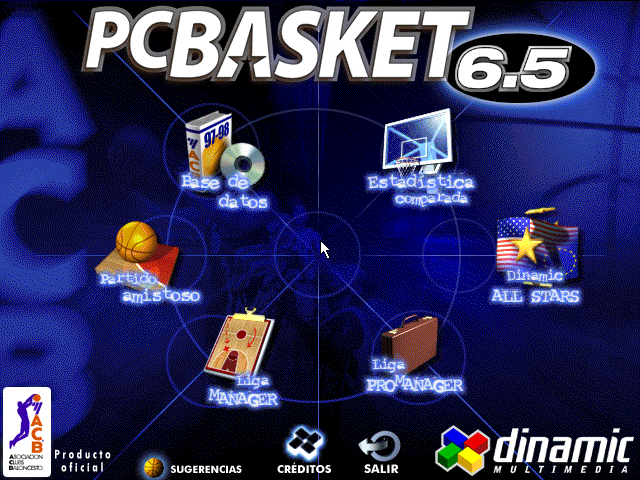

# PC Basket 6.5 — menú principal (arrancado de verdad)

`[jugado]` 2026-08-20. Arranca directo al menú, igual que 6.0 de fútbol.
Interesa menos por sí mismo que por lo que **no** comparte con PC Fútbol —
es la comparación que dice qué parte de la gramática es del "manager Dinamic"
en general y qué parte es específica de la línea de fútbol.



## Lo que se ve

```
              PCBASKET 6.5  (blanco/negro, óvalo)

        ◇  Base de       ◇  Estadística
           datos            comparada

  ◇ Partido                        ◇ Dinamic
    amistoso        (cursor)         ALL STARS

        ◇  Liga            ◇  Liga
           MANAGER            PROMANAGER

[ACB oficial]  Producto oficial   ⭐Sugerencias  ◇Créditos  ↩Salir  [dinamic]
```

- **Sin rejilla.** Seis losetas dispuestas en hexágono alrededor de un punto
  central, unidas por líneas finas que irradian desde ese centro — más
  parecido a un mapa de constelación que a un tablero de casillas. El fondo
  es una foto de cancha de baloncesto oscurecida, no una textura geométrica.
- **Seis categorías, no nueve.** No hay equivalente visible de "Historia" ni
  de "Proquinielas": el catálogo de modos es más corto que el de fútbol.
  "Estadística comparada" ocupa el lugar conceptual de "Seguimiento", y
  "Dinamic All Stars" el de "Desafío América-Europa" — incluso el nombrado
  reemplaza "desafío regional" por "una selección de estrellas", coherente
  con cómo se organiza el baloncesto de la época frente al fútbol de liga.
- **Riel inferior, no lateral.** El sello de licencia oficial (ACB en vez de
  LFP) y el logo de Dinamic Multimedia están abajo, no a la izquierda — el
  espacio lateral que en PC Fútbol lleva los títulos hermanos aquí no existe.

## Qué exige — y qué corrige

La hipótesis registrada en
[`../../pcfutbol/01-historia-y-versiones.md`](../../pcfutbol/01-historia-y-versiones.md)
("el catálogo preservado... demuestra que el armazón es separable del
contenido") queda **matizada, no refutada**, por esta captura: el armazón
compartido es el conjunto de *categorías* (base de datos, seguimiento/
estadísticas, amistoso, desafío/evento especial, liga manager, liga
promanager) y el lenguaje de loseta-con-icono-y-rótulo — **no** la disposición
exacta en pantalla. Fútbol usa rejilla; baloncesto usa una constelación
radial. Si `DestinationBoard` alguna vez sirviera a un modo no futbolístico,
el layout en rejilla no debería asumirse como universal — sólo el patrón de
loseta y el vocabulario de categorías lo son.

Para PC Dynasty, cuyo objetivo declarado es específicamente PC Fútbol 6.0/7.0,
esto no cambia nada de lo ya construido: confirma que la rejilla es la forma
correcta *para el fútbol*, y dice que copiar Basket 6.5 tal cual sería copiar
la piel equivocada.
