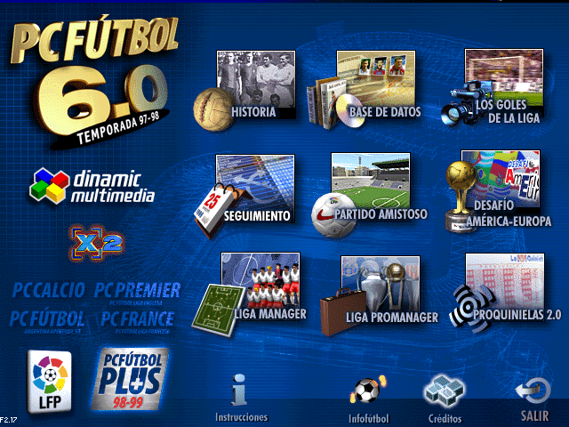

# PC Fútbol 6.0 — menú principal (arrancado de verdad)

`[jugado]` 2026-08-20. Arrancado bajo QEMU (`qemu-system-i386 -m 256 -hda
win98_pcf6.bin -hdb win98_pcf6_data.bin -cdrom PCF6.bin`) desde las imágenes
de disco de `dinamicmultimedia.es`. El sistema arranca directo a este menú sin
intervención — es la pantalla de bienvenida del disco preservado.

Confirma, pixel a pixel, el wireframe ya escrito de segunda mano en
[`../../pcfutbol/16-lectura-de-capturas.md`](../../pcfutbol/16-lectura-de-capturas.md) §1 —
no hay correcciones que hacer a ese capítulo, esta es la validación en vivo.



## Lo que se ve

```
┌──────────────────────────────────────────────────────────────────┐
│ PCFÚTBOL              ┌────────┐  ┌────────┐  ┌────────┐         │
│   6.0                 │HISTORIA│  │  BASE  │  │ GOLES  │         │
│ TEMPORADA 97-98       │        │  │ DATOS  │  │  LIGA  │         │
│ (oro 3D, sobre azul)  └────────┘  └────────┘  └────────┘         │
│                        ┌────────┐  ┌────────┐  ┌────────┐         │
│ dinamic multimedia     │SEGUIMI-│  │PARTIDO │  │DESAFÍO │         │
│                        │ ENTO   │  │AMISTOSO│  │AMÉRICA-│         │
│ eX2 (gris, apagado)    └────────┘  └────────┘  └EUROPA──┘         │
│                        ┌────────┐  ┌────────┐  ┌────────┐         │
│ PCCALCIO   PCPREMIER   │ LIGA   │  │ LIGA   │  │PROQUINI│         │
│ PCFÚTBOL   PCFRANCE    │MANAGER │  │PROMANAG│  │ELAS 2.0│         │
│ (links, gris-azul)     └────────┘  └────────┘  └────────┘         │
│ [LFP] [PLUS 98-99]                                                │
│                    ⓘ Instrucciones  ⚽Infofutbol ▣Créditos ↩SALIR │
│ F2.17                                                             │
└──────────────────────────────────────────────────────────────────┘
```

- **Fondo**: azul oscuro con una retícula fina de líneas diagonales — textura,
  no navegación.
- **Rejilla 3×3** de losetas cuadradas, cada una con miniatura + rótulo en
  mayúsculas debajo. Sin bordes duros: la miniatura es la loseta.
- **Riel izquierdo**: logo de Dinamic Multimedia, dos "extensiones" (`eX2`) en
  gris — se leen como entradas desactivadas/veladas, no ausentes — y una lista
  de títulos hermanos (PC Calcio, PC Fútbol Argentina, PC France, PC Premier)
  en azul apagado: son enlaces de venta cruzada, no navegación del propio
  juego. Abajo, el sello de la LFP y el badge "PCFÚTBOL PLUS 98-99".
- **Barra inferior**: cuatro acciones con icono + texto (Instrucciones,
  Infofútbol, Créditos, Salir) — más pequeñas que las losetas de la rejilla,
  marcando que son meta-acciones, no modos de juego.
- **Esquina inferior izquierda**: `F2.17`, un marcador de versión de build,
  discretísimo — un dato de ingeniería que se dejó visible sin querer
  destacarlo.

## Qué exige

Esto es exactamente [`DestinationBoard`](../../../../game/godot/Scripts/Shell/DestinationBoard.cs) +
[`DestinationTile`](../../../../game/godot/Theme/DestinationTile.cs) tal y como
se implementaron en f00051 S3 — rejilla 3×3, loseta con miniatura+rótulo,
riel lateral, barra de meta-acciones. No hay delta que aplicar aquí; esta
captura es la prueba de que el rumbo ya tomado es el correcto.

Ver también [`01-submenu-y-ayuda.md`](01-submenu-y-ayuda.md) para lo que hay
**detrás** de una de estas losetas.
