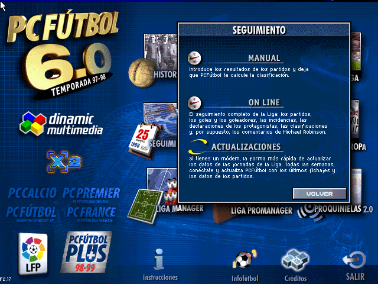

# PC Fútbol 6.0 — un submenú modal y el visor de ayuda

`[jugado]` 2026-08-20, misma sesión que [`00-menu-principal.md`](00-menu-principal.md).
La loseta **SEGUIMIENTO** del menú principal, al activarse, no cambia de
pantalla: abre un panel modal por encima, con el resto del menú visible (no
oscurecido) detrás. Es el mismo patrón que un `ConfirmDialog`, pero con
contenido informativo/de elección en vez de una pregunta sí/no.

> El ratón no respondió con fiabilidad en esta sesión (ver
> [`../README.md`](../README.md)), así que no se puede afirmar con certeza que
> esto se abriera por un clic **dirigido** a esa loseta en concreto — sí es
> certero que el panel es real, que su contenido es el que se documenta abajo,
> y que apareció tras interacción (no en 20s de inactividad, comprobado aparte).



## El panel modal

```
┌────────────────────────────────────────────┐
│              SEGUIMIENTO                   │
├────────────────────────────────────────────┤
│ ⚽  MANUAL                                  │
│    Introduce los resultados de los         │
│    partidos y deja que PCFútbol calcule    │
│    la clasificación.                        │
│                                              │
│ ⚽  ON LINE                                 │
│    El seguimiento completo de la Liga:      │
│    los partidos, los goles y goleadores,   │
│    las incidencias, las declaraciones...    │
│                                              │
│ ⚽  ACTUALIZACIONES            ↖(cursor)    │
│    Si tienes un módem, la forma más        │
│    rápida de actualizar los datos...        │
│                                              │
│                                   [ VOLVER ] │
└────────────────────────────────────────────┘
```

- **Título centrado** en una barra propia, más ancha que el panel — se sale
  un poco por los lados, como una etiqueta pegada encima del marco.
- **Tres opciones apiladas**, cada una: icono redondo + rótulo en mayúsculas +
  un párrafo explicativo en minúsculas debajo. No son botones pequeños: cada
  fila entera es la zona de clic (el cursor, en la captura, está sobre el
  párrafo de ACTUALIZACIONES, no sobre su icono).
- **VOLVER** abajo a la derecha, único control con aspecto de botón real
  (rectángulo con relieve) — todo lo demás es zona de texto clicable.
- El menú principal sigue **visible y con su color intacto** detrás del
  panel — no hay atenuado ni desenfoque. Distinto de cómo se comporta hoy
  `ConfirmDialog` (que sí atenúa el fondo); a valorar si conviene diferenciar
  "elección informativa" de "confirmación de una acción" con ese mismo matiz.

## Qué exige

Un componente nuevo, no cubierto por `ConfirmDialog`: un panel de **elección
con descripción larga por opción** (icono + título + párrafo), pensado para
decisiones de 2-4 opciones donde cada una necesita explicarse, no solo
nombrarse. Candidato de nombre en
[`../../pc-dynasty/mapa-de-equivalencias.md`](../../pc-dynasty/mapa-de-equivalencias.md):
`ChoicePanel` u `OptionSheet`.

## El visor de ayuda (ACTUALIZACIONES)

> Sin captura propia en esta ronda — se vio y se describió en una sesión
> anterior, pero el fichero se perdió en un reinicio del entorno antes de
> guardarlo aquí. La descripción de abajo es fiel a lo observado; falta
> repetir la captura si se necesita la imagen.

Al entrar en ACTUALIZACIONES aparece una aplicación de ayuda completamente
distinta — no una pantalla del juego, sino un visor de documentos con chrome
propio, del estilo de los visores "InfoSurf"/ayuda de Windows de la época:

```
┌──────────────────────────────────────────────────────────────────┐
│[SALIR][◀ANTERIOR][▶SIGUIENTE]│[▲MENU][📖HISTORIA]│[■REANUD][⏹STOP]│
│                               │[🖥GRAFICOS]│[💻CONFIGURAR][🔌CONECTAR]│[?AYUDA] [🎨]│
├──────────────────────────────────────────────────────────────────┤
│                     Actualizaciones                               │
│                      PCFUTBOL  (logo dorado 3D)                   │
│                                                                    │
│        Ayuda de las actualizaciones de PCFUTBOL                  │
│                                                                    │
│  1  Menú principal de actualizaciones:                            │
│     Desde esta pantalla podrás seleccionar los datos de           │
│     PCFUTBOL 6.0 que quieres actualizar...                        │
│                                                                    │
│  2  Actualización de jornadas:                                    │
│     Seleccionamos la jornada a transferir de la lista...          │
│                                                                    │
├──────────────────────────────────────────────────────────────────┤
│ Documento O.k.                                            [——————]│
└──────────────────────────────────────────────────────────────────┘
```

- **Barra de herramientas de iconos** arriba, en grupos separados por
  divisores verticales finos: navegación (Salir/Anterior/Siguiente),
  contenido (Menú/Historia), reproducción (Reanudar/Stop), sistema
  (Gráficos/Configurar/Conectar), ayuda, y un icono de marca (el logo
  arcoíris de Dinamic) al extremo derecho — el mismo patrón de "grupos con
  separador" que ya usamos en `ShellArea`.
- **Cuerpo**: título de sección, logo del juego, subtítulo, y una lista
  **numerada** (círculo con número) de entradas con encabezado en negrita y
  párrafo explicativo — el mismo lenguaje visual del panel modal anterior,
  reutilizado aquí para un documento en vez de un menú.
- **Barra de estado** abajo: texto de estado a la izquierda ("Documento
  O.k.") y una barra de progreso/scroll a la derecha.

## Qué exige

Confirma que el juego reutiliza **la misma gramática de lista numerada con
icono** (círculo+número, título, párrafo) tanto en menús como en documentos
de ayuda — es un componente transversal, no específico de un flujo. Si se
construye un sistema de ayuda/manual en PC Dynasty (ver `f00050`, el panel de
errores, como precedente de "chrome de utilidad" separado del juego), esta es
la referencia de chrome: barra de iconos agrupados arriba, cuerpo de
documento, barra de estado abajo.
