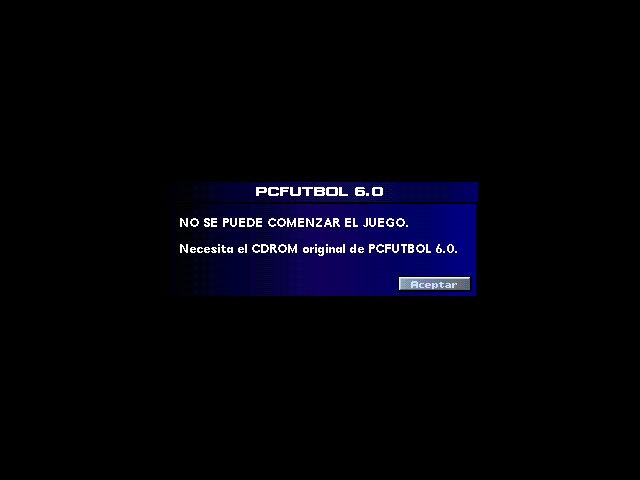

# PC Fútbol 6.0 — el ejecutable de Liga Manager, corriendo de verdad

`[jugado]` 2026-08-20. QEMU no dejaba controlar el ratón dentro del juego (ver
[`../README.md`](../README.md)). En vez de insistir por ahí, se extrajeron los
ejecutables reales del disco de datos (`win98_pcf6_data.bin`, carpeta
`FUTBOL6\`) y se corrieron directamente con Wine en este host — que sí acepta
entrada real, porque ya no hay una VM completa de por medio.

## Lo que hay en el disco

La carpeta `FUTBOL6\` no es un único juego monolítico: son **aplicaciones
Windows independientes**, una por sección del menú principal:

| Ejecutable | Sección del menú |
|---|---|
| `PCF6.EXE` | El menú principal (el lanzador) |
| `MANAGER.EXE` / `MANAGER2.EXE` | Liga Manager / Liga Promanager |
| `DBASEWIN.EXE` | Base de Datos |
| `ACTWIN.EXE` | Actualizaciones (el visor de ayuda ya documentado en `01-submenu-y-ayuda.md`) |
| `INFOSURF.EXE` | El motor de ayuda que usan varias de las anteriores |
| `PLAYVID.EXE` | Reproducción de vídeo (`.MPG`) |
| `PROQUINI\PROQUINI.EXE` | Proquinielas 2.0 |

Esto confirma algo que la wiki no tenía documentado: el "menú principal" no es
una sola aplicación con pantallas — **lanza un proceso distinto por sección**.
Cada loseta de `DestinationBoard` corresponde, en el original, a un `.exe`
separado, no a un cambio de escena dentro del mismo binario.

## Lo que se consiguió arrancar

`MANAGER.EXE` corre y llega a pintar una ventana real (`"PCFUTBOL 6.0"`,
640×480, DirectDraw activo por software). Pero el ejecutable trae su propia
comprobación de disco:



```
┌────────────────────────────────────┐
│           PCFUTBOL 6.0             │
├────────────────────────────────────┤
│ NO SE PUEDE COMENZAR EL JUEGO.      │
│                                      │
│ Necesita el CDROM original de       │
│ PCFUTBOL 6.0.                       │
│                                      │
│                          [Aceptar]  │
└────────────────────────────────────┘
```

Un diálogo de sistema Windows 98 estándar (título azul, cuerpo gris claro,
botón con relieve) — el mismo lenguaje de caja de diálogo que usaría
cualquier aviso de error, y una referencia directa para el panel de errores
de `f00050`.

**Actualización — el chequeo sí se resuelve.** Un `DISK.ID` copiado a mano
(contenido real: `PCF6 00`) y una etiqueta de volumen `PCFUTBOL6` vía
`.windows-label` de Wine no bastaron. Pero extrayendo el **CD-ROM entero**
(`PCF6.bin`, vía `pycdlib`, leyendo Joliet directamente del `.iso` sin
montar nada) a esa misma carpeta `D:`, y lanzando **`PCF6.EXE`** — el
lanzador real, no `MANAGER.EXE` suelto, como bien señaló el usuario — el
diálogo desapareció. No era una protección de sectores crudos: el chequeo
debía comparar contenido o tamaño de varios ficheros reales del disco
(candidato: `LONGITUD.DAT`, "longitud" = tamaño esperado), y un `DISK.ID`
aislado no los tenía.

**Pero eso destapa un problema distinto y más profundo.** Tanto `PCF6.EXE`
como `MANAGER.EXE` pintan sobre una superficie DirectDraw de pantalla
completa (`"DM Loader"`, 2048×2048) que **no compone bajo WSLg** — exactamente
el mismo negro que ya daba QEMU. Y clics reales por `python-xlib` contra las
coordenadas conocidas del menú (idéntico mecanismo que sí funcionó en
`DBASEWIN.EXE`, ver `03-base-de-datos.md`) no lanzaron `MANAGER.EXE` ni una
sola vez. La lectura que mejor encaja con **todo** lo probado en esta
carpeta (QEMU absoluto, QEMU relativo, VNC real, Wine+XTest): el menú
animado y el despacho leen el ratón en modo exclusivo de DirectInput
(sondeo directo del dispositivo), mientras que `DBASEWIN.EXE` usa mensajes
de ventana normales — por eso uno responde a cualquier inyección sintética
y el otro a ninguna. Es una frontera del motor, no un fallo de herramienta.

**Actualización — 2026-08-21, sí se consiguió entrar.** Lo anterior describía
un límite de **Wine bajo WSLg** (DirectDraw a pantalla completa no compone
ahí). Cambiando de entorno — VirtualBox en vez de Wine/QEMU, con inyección de
ratón por su API COM en vez de `python-xlib` — el menú sí resultó pulsable.
Ver [`../como-esta-montado.md`](../como-esta-montado.md) para el mecanismo y
el bug de calibración que lo bloqueó al principio, y
[`06-liga-manager-personalizacion.md`](06-liga-manager-personalizacion.md)
para la primera pantalla real dentro de Liga Manager.

## Qué exige — y qué es nuevo

1. **Arquitectura por procesos, no por escenas.** Documentar en
   `mapa-de-equivalencias.md` que la separación en PC Dynasty (una sola app,
   varias escenas Godot) es una simplificación deliberada, no un descuido: el
   original tampoco compartía estado en memoria entre secciones, cada una
   arranca en frío.
2. **El diálogo de aviso es la referencia visual para `f00050`** (el panel de
   error propuesto): título con barra de color, cuerpo con el mensaje en dos
   frases (qué pasó, qué hace falta), un único botón de confirmación.
