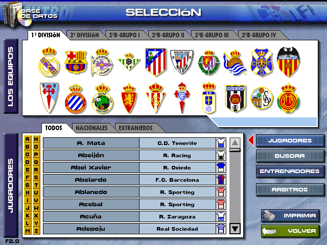
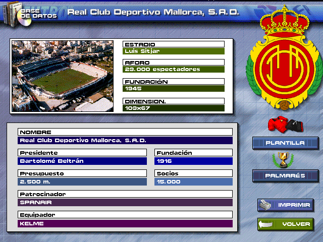
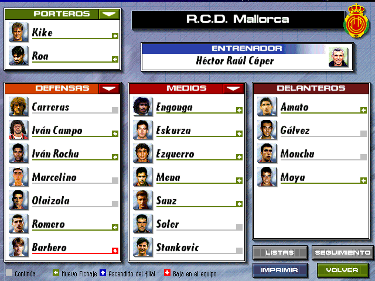

# PC Fútbol 6.0 — Base de Datos, de verdad e interactiva

`[jugado]` 2026-08-20. A diferencia de `MANAGER.EXE` (bloqueado por su
comprobación de CD-ROM, ver [`02-liga-manager-ejecutable.md`](02-liga-manager-ejecutable.md)),
**`DBASEWIN.EXE` arranca sin pedir el disco** y es completamente navegable:
aquí sí hubo clics reales, con `python-xlib` enviando eventos `XTestFakeInput`
a la ventana de Wine — el mismo mecanismo que usaría un usuario, sin
necesidad de QEMU. Tres pantallas encadenadas, cada clic documentado.

## 1. Selección — el punto de entrada



```
┌──────────────────────────────────────────────────────────────────┐
│ [disco] BASE DE DATOS          SELECCIÓN                          │
├──────────────────────────────────────────────────────────────────┤
│ [1ªDIV*] [2ªDIV] [2ªB-I] [2ªB-II] [2ªB-III] [2ªB-IV]              │
│ ┌────────────────────────────────────────────────┐                │
│ │ (escudo)(escudo)(escudo)(escudo)... 20 equipos  │  LOS│         │
│ │  en dos filas de 10, cada uno un icono clicable │  EQ │         │
│ └────────────────────────────────────────────────┘  UI │         │
│                                                       POS│        │
│ [TODOS*] [NACIONALES] [EXTRANJEROS]                              │
│ ┌──┬─────────────────────────────────────┐  JUG│ [JUGADORES]     │
│ │A │ A. Mata          C.D. Tenerife  🎽  │  ADO│ [BUSCAR]        │
│ │B │ Abeijón          R. Racing      🎽  │  RES│ [ENTRENADORES]  │
│ │· │ ... (lista alfabética, con scroll)   │     │ [ARBITROS]      │
│ │Z │                                      │     │ [IMPRIMIR]      │
│ └──┴─────────────────────────────────────┘     │ [VOLVER]        │
│ F2.0                                                              │
└──────────────────────────────────────────────────────────────────┘
```

- **Doble nivel de pestañas independientes**: arriba, categoría/división de
  equipo (1ª, 2ª, 2ªB por grupos); abajo, filtro de jugador (Todos/
  Nacionales/Extranjeros). Son dos controles de pestaña simultáneos y
  desacoplados, no un único breadcrumb.
- **Los escudos son la navegación primaria**, no una decoración — 20 iconos
  de equipo en rejilla libre (no una tabla estricta), cada uno lleva a la
  ficha de ese club (ver §2).
- **Índice alfabético lateral** (A-Z) junto a la lista de jugadores — salto
  directo a la letra, no scroll progresivo.
- **Riel de acciones a la derecha**, igual que en el menú principal:
  JUGADORES/BUSCAR/ENTRENADORES/ÁRBITROS arriba (sub-secciones de esta
  misma base de datos), IMPRIMIR/VOLVER abajo (meta-acciones). Mismo
  vocabulario visual que `DestinationBoard`, aplicado dentro de una
  sub-pantalla en vez de en el menú raíz — la rejilla de losetas con riel
  lateral es un patrón que se repite a distintas escalas, no solo en el
  menú de inicio.

## 2. Ficha de club — al pulsar un escudo

Pulsar el escudo del Mallorca (fila inferior) navega directo a su ficha,
sin paso intermedio:



```
┌──────────────────────────────────────────────────────────────────┐
│ [disco]  Real Club Deportivo Mallorca, S.A.D.                     │
├──────────────────────────────────────────────────────────────────┤
│ ┌─────────────────┐┌──────────────┐         (escudo grande)       │
│ │ (foto estadio)  ││ESTADIO       │                                │
│ │                 ││ Luis Sitjar  │                                │
│ │                 │├──────────────┤                                │
│ │                 ││AFORO         │                                │
│ │                 ││ 23.000 esp.  │                                │
│ └─────────────────┘├──────────────┤                                │
│                     │FUNDACIÓN 1945│                                │
│                     ├──────────────┤                                │
│                     │DIMENSIÓN103x67│                               │
│                     └──────────────┘                                │
│ ┌──────────────────────────────────┐                [PLANTILLA]    │
│ │NOMBRE: Real Club Deportivo M.SAD │                [PALMARÉS]     │
│ │PRESIDENTE          │FUNDACIÓN    │                                │
│ │ Bartolomé Beltrán  │ 1916        │                [IMPRIMIR]     │
│ │PRESUPUESTO         │SOCIOS       │                [VOLVER]       │
│ │ 2.500 m.           │ 15.000      │                                │
│ │PATROCINADOR: SPANAIR              │                               │
│ │EQUIPADOR: KELME                   │                               │
│ └──────────────────────────────────┘                                │
└──────────────────────────────────────────────────────────────────┘
```

- **Dos fechas de fundación distintas y ambas reales**: 1945 junto al estadio
  (la ficha del **estadio** Luis Sitjar) y 1916 junto al presidente (la ficha
  del **club**). No es un error de captura — son dos entidades con su propia
  fecha de fundación, mostradas una al lado de la otra sin aclaración
  textual de cuál es cuál más que la agrupación espacial. Vale la pena
  decidir si PC Dynasty aclara esto con una etiqueta o lo deja igual de
  implícito.
- **Cada campo es una etiqueta-cabecera + una franja de color con el valor**
  (blanco arriba, color debajo) — el mismo patrón repetido para Estadio,
  Aforo, Fundación, Dimensión, y para Nombre/Presidente/Presupuesto/Socios/
  Patrocinador/Equipador. Es una gramática de "campo etiquetado" reutilizable,
  no un layout distinto por dato.
- **Presupuesto en unidades ambiguas** ("2.500 m." — ¿millones de pesetas?
  no se aclara la moneda ni la unidad en pantalla) — coherente con lo que
  [`07-economia-y-club.md`](../../pcfutbol/07-economia-y-club.md) ya
  advertía sobre economía de la época.
- **Patrocinador y equipador como datos de ficha**, no solo cosméticos —
  confirma que son campos de datos reales (Spanair, Kelme), no solo texturas
  de camiseta.

## 3. Plantilla — al pulsar PLANTILLA



```
┌───────────────┐ ┌────────────────────────┐ (escudo)
│PORTEROS    [v]│ │      R.C.D. Mallorca   │
│ (foto) Kike   >│ ├────────────────────────┤
│ (foto) Roa    >│ │ENTRENADOR              │
└───────────────┘ │ (foto) Héctor R. Cúper │
┌───────────────┐ └────────────────────────┘
│DEFENSAS    [v]│┌───────────────┐┌───────────────┐
│(foto)Carreras >││MEDIOS     [v]││DELANTEROS  [v]│
│(foto)I.Campo  ▸││(foto)Engonga >││(foto)Amato   >│
│(foto)I.Rocha  >││(foto)Eskurza >││(foto)Gálvez  >│
│(foto)Marcelino>││(foto)Ezquerro>││(foto)Monchu  >│
│(foto)Olaizola >││(foto)Mena    >││(foto)Moya    >│
│(foto)Romero   >││(foto)Sanz    >│└───────────────┘
│(foto)Barbero  ▾││(foto)Soler   >│   [LISTAS] [SEGUIMIENTO]
└───────────────┘│(foto)Stankovic>│   [IMPRIMIR]  [VOLVER]
                  └───────────────┘
· Continúa  ▸Nuevo fichaje  (azul)Ascendido del filial  ▾Baja en el equipo
```

- **Cuatro columnas por demarcación**, cada una con cabecera de color propio
  (portero=verde, defensa=naranja, medio=rojo, delantero=granate) y su
  flecha de colapsar (▾) — son paneles plegables, no solo agrupaciones
  visuales.
- **Cada jugador lleva una miniatura de cara** junto al nombre — no solo
  texto. Algunos nombres en **negrita** (Iván Campo) frente a otros en
  regular (Carreras, Iván Rocha...) — probablemente titular vs. suplente,
  sin confirmar interactuando más (el filtro no se pudo comprobar a fondo
  en esta sesión).
- **Icono de estado a la derecha de cada fila**, con leyenda explícita al
  pie: gris "Continúa", verde "Nuevo fichaje", azul "Ascendido del filial",
  rojo "Baja en el equipo" — un vocabulario de estado de plantilla completo
  y ya resuelto, útil directamente para el mercado/plantilla de PC Dynasty.
- **Entrenador como su propia ficha** con foto, separado de la plantilla de
  jugadores — refuerza que "cuerpo técnico" es una entidad de datos aparte,
  no un campo más del club.
- Botones inferiores: **LISTAS** y **SEGUIMIENTO** (a la derecha del todo,
  bajo Delanteros) junto a IMPRIMIR/VOLVER — más meta-acciones específicas
  de esta pantalla.

## Qué exige

Esta cadena de tres pantallas (selección → ficha de club → plantilla) es
la referencia más completa que tenemos de cómo el original organiza datos
de club y plantilla — muy por encima de lo que se podía inferir de
capturas sueltas. Aporta directamente a
[`10-datos-seguimiento-y-base-de-datos.md`](../../pcfutbol/10-datos-seguimiento-y-base-de-datos.md)
y a [`07-economia-y-club.md`](../../pcfutbol/07-economia-y-club.md): el
vocabulario de "campo etiquetado" (título blanco + franja de color con el
valor) y el vocabulario de "icono de estado + leyenda" en plantillas son
candidatos directos a componentes (`LabeledField`, `RosterStatusIcon` en
`mapa-de-equivalencias.md`).
