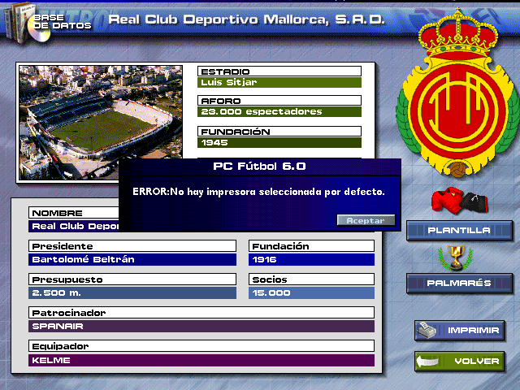

# PC Fútbol 6.0 — un diálogo de error real

`[jugado]` 2026-08-20, dentro de la sesión de [`03-base-de-datos.md`](03-base-de-datos.md).
Pulsar **IMPRIMIR** en la ficha de club, sin impresora configurada en el
sistema, dispara este error — capturado por accidente al buscar el botón
VOLVER, pero es exactamente la referencia que le faltaba a la propuesta
`f00050` (el panel de errores de PC Dynasty).



```
┌──────────────────────────────────────────┐
│           PC Fútbol 6.0                   │
├──────────────────────────────────────────┤
│ ERROR: No hay impresora seleccionada      │
│ por defecto.                              │
│                                            │
│                                [Aceptar]  │
└──────────────────────────────────────────┘
```

- **Aparece centrado sobre la pantalla que lo disparó** (la ficha de club
  sigue visible detrás, sin atenuar) — mismo comportamiento que el panel de
  Seguimiento del menú principal: nunca oscurece el fondo.
- **Un solo botón, "Aceptar"** — no hay opción de "cancelar" ni de
  configurar la impresora desde aquí; el error es puramente informativo,
  no una decisión.
- **El título de la barra es el nombre del juego** ("PC Fútbol 6.0"), no la
  palabra "Error" ni el nombre de la pantalla — la marca antes que la
  clasificación del mensaje.
- **El texto del error empieza con la palabra "ERROR:"** dentro del cuerpo,
  no solo en el título — es redundante con la barra de título de otros
  diálogos (que sólo llevaban el nombre de la sección, como "SEGUIMIENTO"),
  reforzando que esta es una categoría de mensaje distinta a un submenú.

## Qué exige — directo para `f00050`

Esta es la referencia mínima y suficiente para un panel de error de PC
Dynasty:

1. Título = nombre del producto, no "Error".
2. Cuerpo: una frase que empieza explícitamente por "ERROR:" seguida de la
   causa en lenguaje llano (no un código, no una traza).
3. Un único botón de reconocimiento — un error no es una decisión.
4. No atenuar el fondo — el usuario no pierde el contexto de dónde estaba.

Vale la pena decidir si PC Dynasty quiere diferenciar visualmente error de
aviso informativo (aquí ambos usan la misma barra azul), o si mantener esa
misma ambigüedad es fiel al original.
