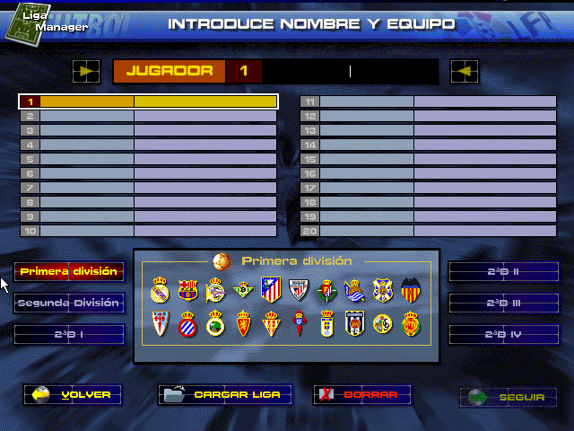

# PC Fútbol 6.0 — Liga Manager: crear partida nueva

`[jugado]` 2026-08-20. Tras resolver el chequeo de CD-ROM (ver
[`02-liga-manager-ejecutable.md`](02-liga-manager-ejecutable.md)) y conectar
por RDP a la VM (VRDE + `xfreerdp` desde WSL — ver
[`../como-esta-montado.md`](../como-esta-montado.md)), esta es la primera
pantalla real de Liga Manager: elegir jugador y equipo antes de empezar.



```
┌──────────────────────────────────────────────────────────────────┐
│[Liga    │        INTRODUCE NOMBRE Y EQUIPO                       │
│ Manager]│                                                        │
├──────────────────────────────────────────────────────────────────┤
│ ▶ [ JUGADOR 1                    |cursor]              ◄         │
│ ┌──────────────────────┐  ┌──────────────────────┐              │
│ │1 ██████████████████  │  │11                     │              │
│ │2                     │  │12                     │              │
│ │3  ... hasta 10        │  │13  ... hasta 20        │              │
│ └──────────────────────┘  └──────────────────────┘              │
│ [PRIMERA DIVISIÓN*]      ┌────────────────────────┐   [2ªB II]   │
│ [Segunda División]       │ ⚽ Primera división      │   [2ªB III]  │
│ [2ªB I]                  │ (20 escudos en rejilla) │   [2ªB IV]   │
│                          └────────────────────────┘              │
│ [VOLVER] [CARGAR LIGA] [BORRAR]              [SEGUIR]            │
└──────────────────────────────────────────────────────────────────┘
```

- **Slot de guardado = jugador, no partida.** La rejilla de 20 casillas
  (1-20, dos columnas de 10) no es "elige tu equipo": es "elige en qué
  ranura guardas". El nombre del **entrenador/mánager** se escribe en el
  campo `JUGADOR 1` de arriba, con flechas `◄▶` para pasar de una ranura a
  otra — un modelo de **múltiples carreras en paralelo**, cada una en su
  propio slot numerado, no una única partida con equipos distintos.
- **La selección de equipo ocurre en la misma pantalla**, no en un paso
  aparte: pestañas de categoría (Primera, Segunda, 2ªB I-IV) a la izquierda
  y a la derecha, con la rejilla de escudos de la categoría activa en el
  centro — el mismo componente de "selección por escudo" que ya vimos en
  Base de Datos (`03-base-de-datos.md` §1), reutilizado aquí para **elegir**
  en vez de solo para **consultar**.
- **Cuatro acciones al pie**: VOLVER, CARGAR LIGA (retomar una liga ya
  guardada en otro fichero, distinto de los 20 slots), BORRAR (vaciar un
  slot), SEGUIR (confirmar y continuar) — cada botón con su propio icono,
  mismo lenguaje visual que el resto del juego.

## Qué exige

**El modelo de "slots de mánager"** (20 ranuras numeradas + nombre del
entrenador) es una referencia directa para cómo PC Dynasty organiza
partidas de carrera guardadas — confirma que el original separaba
"quién soy" (nombre + slot) de "qué liga juego" (fichero de liga vía
CARGAR LIGA), dos conceptos que conviene no fusionar.

> La barra superior que se ve pasando el ratón por arriba **no es de esta
> pantalla** — aparece en todo el juego. Documentada una sola vez en
> [`general.md`](general.md).

Sigue: entrar con SEGUIR para ver el despacho real, y repetir esta misma
exploración en Liga Promanager para comparar.
