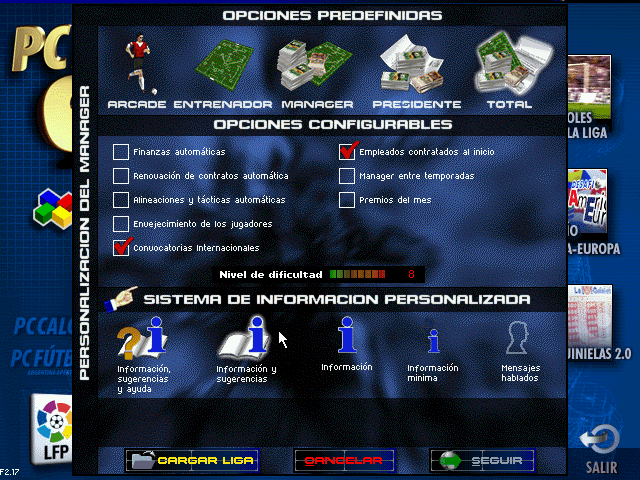

# PC Fútbol 6.0 — Liga Manager: personalización antes de jugar

`[jugado]` 2026-08-21. Primera pantalla real dentro de Liga Manager, tras
resolver de verdad la inyección de clics (ver
[`../como-esta-montado.md`](../como-esta-montado.md)) — pulsando la loseta
"LIGA MANAGER" del menú principal se entra aquí directamente, **antes** de
la pantalla "Introduce nombre y equipo" ya documentada en
[`05-liga-manager-nueva-partida.md`](05-liga-manager-nueva-partida.md). El
orden real del flujo es: menú principal → **esta pantalla** → nombre y
equipo → despacho.



```
┌──────────────────────────────────────────────────────────────────┐
│[Personali│           OPCIONES PREDEFINIDAS                        │
│zación del│ [Arcade] [Entrenador] [Manager] [Presidente] [Total]   │
│ Manager] ├──────────────────────────────────────────────────────┤
│          │           OPCIONES CONFIGURABLES                       │
│          │ [ ] Finanzas automáticas    [x] Empleados contratados  │
│          │ [ ] Renovación contratos       al inicio                │
│          │     automática              [ ] Manager entre          │
│          │ [ ] Alineaciones y             temporadas               │
│          │     tácticas automáticas    [ ] Premios del mes         │
│          │ [ ] Envejecimiento de       [x] Convocatorias           │
│          │     los jugadores               internacionales         │
│          │                                                        │
│          │  Nivel de dificultad  [████████░░]  8                  │
│          ├──────────────────────────────────────────────────────┤
│          │        SISTEMA DE INFORMACIÓN PERSONALIZADA            │
│          │  [?]      [📖]      [i]      [i]      [👤]              │
│          │ Ayuda   Info y    Info-   Info-    Mensajes            │
│          │         sugeren.  ación   mínima   hablados             │
│          ├──────────────────────────────────────────────────────┤
│          │ [CARGAR LIGA]      [CANCELAR]        [SEGUIR]          │
└──────────────────────────────────────────────────────────────────┘
```

- **Perfiles predefinidos como atajos, no como bloqueo.** Cinco iconos
  (Arcade, Entrenador, Manager, Presidente, Total) rellenan de golpe las
  casillas de abajo con un perfil de automatización — de "todo automático"
  (Arcade, para solo jugar los partidos) a "nada automático" (Total, control
  manual de cada aspecto). Elegir un perfil no bloquea las casillas
  individuales: siguen siendo checkboxes sueltos debajo, editables tras
  aplicar el perfil.
- **Ocho interruptores independientes**, cada uno delega o no una faceta de
  gestión al motor del juego: finanzas, renovación de contratos,
  alineaciones/tácticas, envejecimiento de jugadores, empleados ya
  contratados al empezar, cambio de manager entre temporadas, premios
  mensuales, convocatorias de selecciones internacionales. Esto es
  **granularidad real de simulación vs. control manual**, pieza por pieza,
  no un simple slider de "dificultad".
- **Un slider de dificultad aparte** (0-10, capturado en 8) — numérico y
  separado de los interruptores de automatización: dificultad de la IA
  rival y automatización del propio equipo son dos ejes distintos, no uno.
- **Selector de verbosidad de información**, cinco niveles con icono propio:
  ayuda contextual (el mismo icono `?` de la barra superior, ver
  [`general.md`](general.md)), información+sugerencias, información,
  información mínima, mensajes hablados (voz). Controla cuánto te explica
  el juego sus propias decisiones automáticas, no si las toma.
- **Tres acciones al pie**: CARGAR LIGA (salta directo a una liga guardada,
  sin pasar por personalización — coherente con el mismo botón ya visto en
  `05-liga-manager-nueva-partida.md`), CANCELAR, SEGUIR.

## Qué exige

**Separar "perfil de automatización" de "nivel de dificultad"** como dos
conceptos independientes en el mapa de equivalencias de PC Dynasty — no
colapsar en un único selector "fácil/normal/difícil". Los ocho interruptores
granulares son candidatos directos a flags de configuración de partida
(`AutoFinances`, `AutoContractRenewal`, `AutoLineups`, `AutoAging`,
`StartWithStaff`, `ManagerChangeBetweenSeasons`, `MonthlyAwards`,
`InternationalCallups`), cada uno activable u ocultable de forma
independiente del perfil elegido.

## Pendiente

El botón SEGUIR no respondió al primer cálculo de coordenadas — pendiente de
recalibrar (ver "Qué queda abierto" en
[`../como-esta-montado.md`](../como-esta-montado.md)) antes de documentar
qué hay después de esta pantalla.
