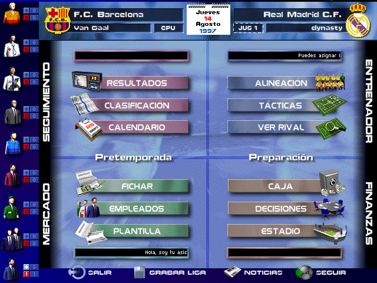

# PC Fútbol 6.0 — el despacho: hub central de Liga Manager

`[jugado]` 2026-08-21. Tras nombre y equipo
([`05-liga-manager-nueva-partida.md`](05-liga-manager-nueva-partida.md)),
personalización
([`06-liga-manager-personalizacion.md`](06-liga-manager-personalizacion.md))
y una pantalla de pretemporada (amistosos, no documentada aparte — ver más
abajo), se llega aquí: el **despacho**, la pantalla desde la que se juega
toda la temporada. No es una pantalla más del flujo inicial — es el hub al
que se vuelve constantemente durante toda la carrera.

## Instrucciones permanentes para cualquier agente que continúe esta exploración

Esto forma parte de la propuesta
[`d00001`](../../../delendai/proposals/in-progress/d00001-play-through-liga-manager-and-liga-promanager-screen-by-screen-documenting-every-button.md).
Léelas antes de tocar la VM:

1. **Modo RESULTADO, nunca visionado.** Cualquier pantalla de configuración
   de partido/simulación debe dejarse siempre en modo "simulación por
   resultado" (checkbox `RESULTADO` marcado, `VISIONADO` desmarcado — son
   mutuamente excluyentes). Nunca elegir "ver partido". Esto es una
   instrucción explícita del usuario, no una preferencia de estilo — ver
   la sección "El ciclo SEGUIR" más abajo para el flujo exacto ya
   verificado.
2. **Una carpeta de capturas por pantalla temática, nunca todo bajo
   `liga-manager/`.** Cada pantalla propia (Resultados, Calendario,
   Alineación, Táctica, Ver Rival, Caja, Decisiones, Estadio, Plantilla/
   Fichar, Partido, etc.) tiene su propia subcarpeta en
   `docs/wiki/in-game/pcf6/screenshots/<tema>/`. Solo lo que es
   genuinamente del despacho/flujo de creación de partida va en
   `liga-manager/`. Esta convención se corrigió a mitad de esta propuesta
   tras feedback explícito del usuario — no revertirla.
3. **Explorar cada pantalla en profundidad, no solo entrar y volver.**
   Cada botón visible dentro de una pantalla (pestañas, sub-botones,
   diálogos que abre) debe pulsarse y documentarse, no solo el botón del
   despacho que lleva hasta ella. Si un sub-botón concreto no se ha
   probado, decirlo explícitamente en la sección "Pendiente" de su fichero
   — nunca omitirlo en silencio como si estuviera cubierto.
4. **Registrar el progreso en el fichero de la pantalla correspondiente,
   no solo aquí.** Este fichero (`07-despacho.md`) trackea el estado del
   despacho y sus 12+4 botones de primer nivel; cada pantalla propia
   (`13-resultados.md` … `21-plantilla-fichar.md`, etc.) trackea su propio
   detalle interno en su propia sección "Pendiente". Antes de dar una
   pantalla por completa, releer su "Pendiente" y tachar/actualizar lo que
   ya se haya resuelto en la sesión actual.
5. **Antes de intentar un botón "atascado" repetidamente, recalibrar
   primero.** La inmensa mayoría de "no responde" en esta exploración
   resultaron ser error de coordenada (crop+zoom de una captura ya tomada
   para afinar el centro exacto del botón), no una anomalía real del
   juego. Solo tras 2-3 recalibraciones distintas fallidas, más doble clic
   y Enter/Espacio por scancode, se considera candidato a la anomalía real
   de "diálogo que no responde" (ver "Pendiente" más abajo — ya van 4
   instancias confirmadas).
6. **Prioridad de la propuesta**: S1 (despacho + sub-pantallas, este
   fichero y los que enlaza) primero; S2 (Liga Promanager) segundo; S3
   (Historia, Goles de la Liga, Desafío América-Europa, Amistoso) último.
   No saltar a S2/S3 mientras S1 tenga sub-botones sin probar con un
   enfoque nuevo disponible.



```
┌──────────────────────────────────────────────────────────────────┐
│[F.C.B][F.C. Barcelona / Van Gaal / CPU] [Jueves 14 Agosto 1997]   │
│                                    [Real Madrid C.F./dynasty/JUG 1][RMA]│
├────────┬─────────────────────────────┬─────────────────────────┬─┤
│S       │ (mensaje del asistente 1)  │ (mensaje del asistente 2)│E│
│E       │  RESULTADOS                │  ALINEACIÓN              │N│
│G       │  CLASIFICACIÓN              │  TÁCTICAS                │T│
│U       │  CALENDARIO                 │  VER RIVAL                │R│
│I       │      Pretemporada            │      Preparación          │E│
│M       │  FICHAR                     │  CAJA                     │N│
│I       │  EMPLEADOS                  │  DECISIONES                │A│
│E       │  PLANTILLA                  │  ESTADIO                  │D│
│N       │ (hint del asistente, línea) │                           │O│
│T       │                             │                           │ │
│O       ├─────────────────────────────┴─────────────────────────┴─┤
│(plant.)│ [SALIR] [GRABAR LIGA]      [NOTICIAS]        [SEGUIR]    │
└────────┴─────────────────────────────────────────────────────────┘
```

- **Cabecera de partido, no de menú.** No dice "Liga Manager" — dice quién
  juega contra quién en la próxima fecha (`F.C. Barcelona / Van Gaal / CPU`
  vs. `Real Madrid C.F. / dynasty / JUG 1`) y la fecha exacta (`Jueves 14
  Agosto 1997` — la misma que se fijó en la pantalla de amistosos). El
  despacho está siempre anclado al **próximo partido**, no a un estado
  neutro.
- **Columna izquierda de retratos**: una fila vertical de miniaturas con
  camiseta + un contador numérico con icono (visto: números junto a un
  icono de "+"y de alerta roja "!") junto a cada una — muy probablemente la
  plantilla o el cuerpo técnico en miniatura, con avisos (lesión, sanción,
  etc.) codificados por icono. Pendiente de confirmar clicando cada
  miniatura.
- **Ocho acciones organizadas en una rejilla 2×4 con eje temático**, no una
  lista plana: las etiquetas verticales de los bordes (`SEGUIMIENTO`,
  `MERCADO` a la izquierda; `ENTRENADOR`, `FINANZAS` a la derecha) agrupan
  las columnas, y dos subtítulos internos (`Pretemporada`, `Preparación`)
  agrupan las filas de abajo. Es una **matriz categoría×momento**, no solo
  una lista de botones:

  | | Columna izquierda | Columna derecha |
  |---|---|---|
  | Fila superior | RESULTADOS, CLASIFICACIÓN, CALENDARIO | ALINEACIÓN, TÁCTICAS, VER RIVAL |
  | Fila inferior | FICHAR, EMPLEADOS, PLANTILLA | CAJA, DECISIONES, ESTADIO |

- **Dos cajas de texto del asistente**, una encima de cada columna de
  botones — cambian de contenido según el último botón tocado/pasado por
  encima (mensajes vistos: *"Hola, soy tu asistente..."*, *"Puedes asignar
  los dorsales"*, *"...no tendrás más remedio que realizarlo antes de..."*)
  — un sistema de ayuda contextual **por hover**, coherente con el selector
  de verbosidad de la pantalla de personalización
  (`06-liga-manager-personalizacion.md`).
- **Barra inferior con cuatro acciones globales**: SALIR (volver al menú
  principal, se asume), GRABAR LIGA (guardar), NOTICIAS, SEGUIR (avanzar el
  día/la simulación — el mismo verbo que ya se usó para avanzar entre
  pantallas del asistente de creación, reutilizado aquí como "pasar tiempo").

## Confirmado navegable

Los doce botones de la rejilla 2×4, más los cuatro de la barra inferior,
están **todos confirmados navegables** tras la sesión de 2026-08-21 (segunda
pasada, con un Real Madrid C.F./`dynasty` recién creado):

- **RESULTADOS** → resultados por competición, ver
  [`13-resultados.md`](13-resultados.md).
- **CLASIFICACIÓN** → tabla de Liga completa, ver
  [`09-clasificacion.md`](09-clasificacion.md).
- **CALENDARIO** → mes navegable + próximos partidos, ver
  [`14-calendario.md`](14-calendario.md).
- **ALINEACIÓN** → hub de plantilla con cinco sub-pantallas propias
  (Entrenamiento, Lesionados, Estadísticas...), ver
  [`15-alineacion.md`](15-alineacion.md).
- **TÁCTICAS** → editor de formación + tácticas guardables, ver
  [`16-tacticas.md`](16-tacticas.md).
- **VER RIVAL** → scouting del próximo contrincante, ver
  [`17-ver-rival.md`](17-ver-rival.md).
- **FICHAR** → mercado de fichajes + cartera de seguimiento, ver
  [`21-plantilla-fichar.md`](21-plantilla-fichar.md).
- **EMPLEADOS** → plantilla de personal técnico y de club, ver
  [`08-personal-del-club.md`](08-personal-del-club.md).
- **PLANTILLA** → gestión contractual de la plantilla propia, ver
  [`21-plantilla-fichar.md`](21-plantilla-fichar.md).
- **CAJA** → finanzas del club por semana y temporada, ver
  [`18-caja.md`](18-caja.md).
- **DECISIONES** → Junta Directiva, historial de manager, TV/merchandising,
  ver [`19-decisiones.md`](19-decisiones.md).
- **ESTADIO** → render 3D + estado de las obras, ver
  [`20-estadio.md`](20-estadio.md).
- **NOTICIAS** → panel superpuesto con pestañas FICHAJES/LESIONES/
  SANCIONES por semana (ACTUAL/ANTERIOR), vacío al inicio de temporada.
  Se cierra con el icono `X` de su esquina — **este `X` sí respondió al
  primer clic**, sin la anomalía de los diálogos "OK" descritos abajo.
- **SALIR** → abre un diálogo de confirmación *"¿Estás seguro de que deseas
  abandonar la competición actual? Sí/No"*
  (`screenshots/liga-manager/17-salir-confirmacion.png`). **Ambos botones
  del diálogo responden con normalidad** (probado `No`, sin anomalía) — a
  diferencia de otros diálogos modales de una sola respuesta documentados
  más abajo.
- **SEGUIR** → dispara el flujo completo de avance de jornada/partido, ver
  "El ciclo SEGUIR: de despacho a despacho" más abajo.

## PLANTILLA y FICHAR: la anomalía anterior era de calibración, no de flujo

La entrada previa de este fichero (sesiones anteriores) registraba que
ambos botones "no navegaban pese a hover confirmado", con la hipótesis de
un prerrequisito de juego bloqueante. **Esta sesión lo descarta**: con las
coordenadas de la fila inferior recalibradas (más abajo de lo que sugería
el cálculo geométrico ingenuo a partir del wireframe de este fichero — unos
30-40 px más abajo de cada fila), ambos navegan con normalidad a la primera.
Ver el detalle de ambas pantallas en
[`21-plantilla-fichar.md`](21-plantilla-fichar.md).

## El ciclo SEGUIR: de despacho a despacho, siempre en modo RESULTADO

Confirmado el ciclo completo de avance de un partido, **siempre forzando
`RESULTADO` en vez de `VISIONADO`** en la pantalla de configuración (per
instrucción explícita de esta exploración — nunca "ver partido"):

1. **SEGUIR** desde el despacho → pantalla `OPCIONES DE CONFIGURACIÓN`
   (`screenshots/partido/01-opciones-configuracion.png`): checkboxes
   `RESULTADO`/`RESUMEN`/`HIGHLIGHTS`/`VISIONADO`/`INTERACTIVO` (mutuamente
   excluyentes — marcar uno desmarca los demás), resolución, calidad
   gráfica, cámara, sonido y duración simulada (4/8/12/20 minutos). Marcar
   `RESULTADO` y pulsar `SEGUIR` (abajo a la derecha del panel).
2. **Pantalla estática de estadio + rótulo de porteros**
   (`screenshots/partido/02-previa-estadio.png`) — **no avanza sola ni con
   más espera**; requiere una pulsación de **barra espaciadora** (scancode
   `39`/`b9`) para continuar. Tras el espacio muestra un segundo cuadro con
   las dos alineaciones completas antes de seguir.
3. **`FINAL PRIMERA PARTE`**
   (`screenshots/partido/03-final-primera-parte.png`): marcador,
   posesión %, tarjetas y goles por equipo, datos de asistencia/
   recaudación del estadio, botón `SEGUIR`.
4. **`FINAL DE PARTIDO`**
   (`screenshots/partido/04-final-de-partido.png`): mismo panel más
   `JUGADOR DEL PARTIDO`, botón `SEGUIR`.
5. `SEGUIR` de nuevo devuelve directamente **al despacho**, con la fecha
   avanzada al día del siguiente partido y la cabecera con los equipos
   intercambiados si tocó jugar como visitante/local según corresponda.

### Detalle a fondo de `FINAL PRIMERA PARTE`/`FINAL DE PARTIDO` (sesión 4, 2026-08-21)

Se jugó un partido completo (R. Zaragoza 4 - 0 R.C. Celta, jornada 1, en
modo `RESULTADO`) explorando cada elemento de ambas pantallas en vez de
pulsar `SEGUIR` directamente:

- **Dos tablas `TARJETAS`/`min` y `GOLES`/`min` por equipo**, no solo un
  contador: cada tarjeta lleva el nombre del jugador y el minuto exacto
  (`Sundgren 4'`, `Aguado 37'`, `Juanmi 43'`... — incluso el portero puede
  ver tarjeta), cada gol lleva autoría y minuto (`Gustavo López 23'`,
  `Kily González 59'` y `85'` — el mismo jugador puede repetir). Un
  contador `TOTAL FALTAS` por equipo aparte de las tarjetas.
- **Botones `ESTADÍSTICAS` (uno por equipo, no uno global)**: cada uno abre
  la misma tabla ya documentada en
  [`15-alineacion.md`](15-alineacion.md) ("ESTADÍSTICAS"), pero aquí
  accesible **a mitad de partido** (no solo desde el despacho) y también
  para el **equipo rival** — confirmado abriendo la de R.C. Celta con la
  plantilla completa de titulares y su fila `TOTAL EQUIPO`. `VOLVER` navega
  con normalidad de vuelta a `FINAL PRIMERA PARTE`.
- **`TÁCTICAS`/`ALINEACIÓN` también son accesibles desde `FINAL PRIMERA
  PARTE`** (mismos botones que en el despacho, mismas pantallas) — permite
  ajustar el once o el esquema **en el descanso**, antes de que arranque la
  segunda parte.
- **Datos económicos del estadio en vivo, no solo aforo**: `AFORO` (31.990),
  `ENTRADA` (asistentes reales + %), `RECAUDACIÓN` (taquilla), `VALLAS
  CONTRATADAS` (% de publicidad estática vendida) y una **segunda
  `RECAUDACIÓN` distinta** (ingreso de esas vallas, separado del de
  taquilla) — dos fuentes de ingreso de matchday ya modeladas por partido,
  no una única cifra agregada.
- **`JUGADOR DEL PARTIDO` en `FINAL DE PARTIDO`** incluye foto de carné del
  jugador, no solo el nombre (confirmado con Gustavo López, autor del
  primer gol).

## Confirmado: cambio de demarcación/ROL por jugador (sesión 4, 2026-08-21)

Ver el detalle completo en [`16-tacticas.md`](16-tacticas.md) ("Cambio de
demarcación/ROL"): la flechita junto a la columna `DEM` de cada jugador en
`TÁCTICAS` abre un desplegable con ~18 roles específicos (no solo
POR/DEF/MED/DEL) y **reasignarlo cambia de verdad el `ROL` mostrado y la
`ME` (media efectiva) del jugador** — jugar fuera de posición penaliza la
media. El `DEM` (especialización fija del jugador) no cambia con esto, solo
el `ROL` (su asignación táctica actual) — son dos conceptos distintos en la
misma fila. El editor de campo (arrastrar la ficha del jugador sobre el
minicampo) **no respondió al arrastre** (confirmado con la nueva
`vm:drag`, ver `docs/wiki/in-game/como-esta-montado.md`) — el minicampo es
un diagrama de solo lectura que refleja la formación elegida en `TÁCTICAS
PREDEF.`, no un editor de posiciones libre por arrastre.

En ningún punto de este ciclo se mostró el pop-up de recap de Supercopa que
sí bloqueó sesiones anteriores (ver más abajo) — no está claro si depende
de si el equipo elegido tenía o no plaza real en la competición
(ver "Orden real completo" más abajo), de si ya se completó una ronda, o si
simplemente no siempre aparece.

## Pendiente

- **La pantalla de pretemporada** (calendario de amistosos, mapa
  Europa/Sudamérica, selección de rival por escudo con autocompletado de
  estadio) sigue sin ficha propia — ver captura de referencia con Real
  Madrid en `screenshots/liga-manager/16-pretemporada-real-madrid.png`. El
  patrón de interacción "elegir de una rejilla → se autocompleta y avanza
  al siguiente slot" ya se documentó en `05-liga-manager-nueva-partida.md`
  (incorporarlo también aquí en una próxima pasada). El botón `NO JUGAR`
  (esquina superior derecha del bloque España) permite saltar las cinco
  fechas de amistosos sin asignar rival, confirmado en esta sesión.
- **`VISIONAR` de CALENDARIO no probado** deliberadamente, por riesgo de
  disparar un modo de visionado de partido — ver
  [`14-calendario.md`](14-calendario.md).
- **Orden real completo confirmado en una segunda pasada (2026-08-21,
  segundo reinicio de VM)**: nombre y equipo → personalización → pretemporada
  → **"Equipos en Competiciones"** (una pantalla de solo lectura, no un
  formulario: seis competiciones europeas — Copa de Europa, Copa de la UEFA,
  Recopa, Supercopa de España, Supercopa de Europa, Copa Intercontinental —
  cada una con sus participantes reales de la temporada 97-98 y su
  entrenador. **Confirmado en dos pasadas con equipos distintos**: si el
  equipo elegido por el jugador ya tenía plaza real en alguna de estas
  competiciones, su entrenador real se sustituye por el nombre del
  mánager/slot del jugador (p. ej. eligiendo R. Betis B. se vio
  "R. Betis B. / dynasty" en la Recopa); si el equipo elegido **no** tenía
  plaza (p. ej. R. Racing), la pantalla se muestra sin ningún cambio, con
  todos los entrenadores reales intactos — el juego no inventa una plaza
  nueva, solo sustituye el nombre del técnico donde ya había una real) →
  **un pop-up de resultado de temporada anterior** ("Campeón Supercopa de España": escudo+nombre+entrenador del
  campeón y del subcampeón, con un único botón OK) → despacho.
- **Anomalía reproducible, confirmada dos veces por separado (incluso tras
  un ciclo completo de guardado/restauración de estado de la VM): el botón
  OK de ese pop-up de Supercopa no responde a ningún método de entrada
  probado.** Se probaron, con el cursor confirmado visualmente sobre el
  botón en cada intento: ~8 variantes de coordenada (paso de 1-2 px),
  doble clic, clic tras enfocar antes la barra de título del propio
  diálogo, clic tras esperar 3s desde la aparición del diálogo (por si el
  motor ignora clics durante los primeros frames de un modal), Enter
  (`1c`/`9c`) y Espacio (`39`/`b9`) por scancode. Ninguno cerró el diálogo.
  Mismo síntoma exacto que la anomalía de VOLVER en Clasificación (ver
  [`09-clasificacion.md`](09-clasificacion.md) "Pendiente") — dos diálogos
  distintos, en dos pantallas distintas, ambos con el mismo estilo visual
  "caja azul/blanca con un solo botón rectangular", a diferencia de los
  botones normales del juego que sí responden con el mismo mecanismo de
  clic. **Hipótesis más plausible**: estos dos concretamente podrían ser
  diálogos nativos de Windows (controles Win32 reales, no dibujados por el
  motor DirectDraw del juego como el resto de la UI) que requieren mensajes
  `WM_LBUTTONDOWN`/`WM_LBUTTONUP` dirigidos a su propio HWND — y aunque
  `IMouse.PutMouseEvent` inyecta a nivel de dispositivo (como haría un
  ratón físico), es posible que ese diálogo concreto no sea la ventana con
  foco real de teclado/ratón dentro del proceso, o que necesite un
  `WM_ACTIVATE` previo que un evento de dispositivo puro no dispara. No
  descartado del todo — solo la hipótesis con más apoyo tras agotar lo
  demás. Se salió de este punto reiniciando la VM (`poweroff` + `vm:start`)
  para poder seguir explorando, sin resolver la causa real.
- **Contraejemplo parcial a la hipótesis Win32, confirmado en esta sesión
  (2026-08-21)**: el `VOLVER` de Clasificación, listado como stuck en
  `09-clasificacion.md`, **respondió con normalidad al primer clic** en
  esta pasada — mismo estilo visual, mismo flujo de llegada, sin ningún
  cambio de método de entrada. La anomalía no es determinista por pantalla:
  puede depender de un estado previo concreto (qué se pulsó justo antes,
  cuánto tiempo lleva la VM arrancada) más que de qué diálogo es. No se
  descarta la hipótesis Win32 pero se rebaja su fuerza explicativa.
- **Cuarta instancia del mismo síntoma, nueva en esta sesión: el diálogo de
  `GRABAR LIGA`.** Al pulsar `GRABAR LIGA` se abre un selector de slots
  (columnas LIGA/JUGADOR con partidas guardadas de sesiones anteriores,
  campo de texto, botones `GRABAR`/`CANCELAR`). **`CANCELAR` no respondió a
  ningún clic** (varias coordenadas recalibradas con crop de zoom, todas
  con el cursor confirmado sobre el texto del botón). `GRABAR` sí mostró
  un cambio visual (borde rojo de "foco/hover" al pasar el cursor) pero
  **tampoco ejecutó la acción de guardado tras un segundo clic** — se
  quedó con el mismo borde, sin cerrar el diálogo ni crear una entrada
  nueva en la lista de partidas. Tampoco respondió Escape (`01`/`81`).
  Se salió reiniciando la VM (`poweroff` + `vm:start`), como en los casos
  anteriores — ver `screenshots/liga-manager/15-grabar-liga-stuck.png`.
  Refuerza que el patrón de "modal con botón(es) rectangular(es) que no
  ejecuta la acción" no está limitado a un único diálogo fijo del juego:
  ya son cuatro instancias en tres pantallas distintas (recap de Supercopa,
  VOLVER de Clasificación —a veces—, ayuda de Historia, y ahora
  GRABAR LIGA), lo que apunta más a una condición de estado/tiempo
  compartida que a un diálogo concreto mal soportado.
- **Sesión 2 (2026-08-21, misma partida continuada tras la primera pasada,
  ahora en Sábado 23 Agosto 1997, Supercopa vuelta)**: se completó una
  pasada de profundidad sobre TÁCTICAS, ESTADIO y FICHAR/PLANTILLA — ver
  el detalle en [`16-tacticas.md`](16-tacticas.md),
  [`20-estadio.md`](20-estadio.md) y
  [`21-plantilla-fichar.md`](21-plantilla-fichar.md). Hallazgo relevante:
  el `OK` de `TÁCTICA DE EQUIPO` pareció al principio una quinta instancia
  de esta misma anomalía (3 intentos fallidos, incluido Enter) pero se
  resolvió recalibrando el hitbox — **no cuenta como quinta instancia**,
  el contador de anomalías reales de diálogo-atascado sigue en 4.
- **Segundo contraejemplo a la anomalía del recap de Supercopa (sesión 3,
  2026-08-21, flujo de Liga Promanager)**: el mismo pop-up "Campeón
  Supercopa de España" con botón `OK` (idéntico estilo visual, mismo punto
  del flujo tras "Equipos en Competiciones") **respondió con normalidad al
  primer clic** al recorrer el flujo equivalente de Liga Promanager (ver
  [`10-liga-promanager-ofertas.md`](10-liga-promanager-ofertas.md)). Junto
  con el contraejemplo ya registrado del `VOLVER` de Clasificación, esto
  refuerza que la anomalía **no es determinista ni ligada a un diálogo
  fijo** — de los 4 diálogos que alguna vez se quedaron atascados
  (Supercopa, Clasificación VOLVER, ayuda de Historia, GRABAR LIGA), dos ya
  tienen al menos una repetición donde respondieron con normalidad. La
  hipótesis Win32 pierde fuerza todavía más; parece más probable que sea
  una condición de estado/tiempo intermitente (p. ej. cuántos frames lleva
  el modal abierto antes del primer clic) que un problema fijo de
  implementación de ese control concreto.
- **Tercer contraejemplo (sesión 3, mismo día, flujo de Desafío
  América-Europa)**: el pop-up de cierre "Campeón Desafío América-Europa"
  (mismo estilo visual exacto) también **respondió con normalidad al
  primer clic** — ver
  [`11-desafio-america-europa.md`](11-desafio-america-europa.md). Van ya
  tres repeticiones de este estilo de diálogo funcionando sin problema en
  esta misma sesión, frente a las cuatro instancias históricas donde se
  quedó atascado. La anomalía sigue sin descartarse del todo pero cada vez
  parece más una condición de estado/tiempo puntual que un defecto fijo de
  un tipo de control.
- **Nuevo hallazgo distinto de la anomalía de diálogo**: en `CAJA`, las
  pestañas `INGRESOS`/`GASTOS`/`POR SEMANA`/`TEMPORADA` disparan de forma
  consistente (tras varios reintentos recalibrados) una superposición
  ambiental `PCFUTBOL 6.0` en vez de cambiar de vista — ver el detalle en
  [`18-caja.md`](18-caja.md). No se ha resuelto si es un bug reproducible
  del juego o solo un artefacto de esta build/resolución de captura.

## Qué exige

**El despacho es la escena central de PC Dynasty's career mode** — el
equivalente directo de lo que allí se llame "hub" o "oficina del mánager".
La matriz categoría×momento (Seguimiento/Mercado × Entrenador/Finanzas,
Pretemporada/Preparación) es un candidato fuerte para la organización real
del menú de navegación de esa escena, no una lista plana de botones. El
sistema de asistente-por-hover es una pieza de UX transferible tal cual:
texto contextual que cambia según qué se está mirando, no un tutorial fijo.
