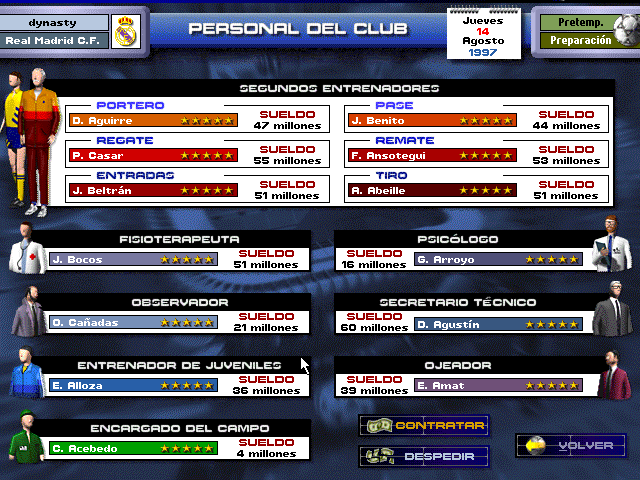
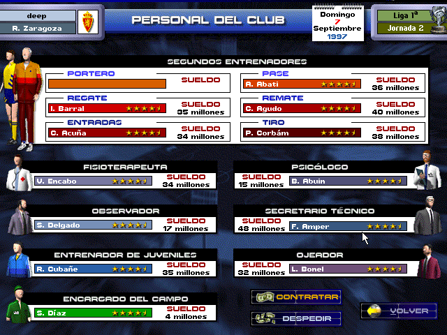
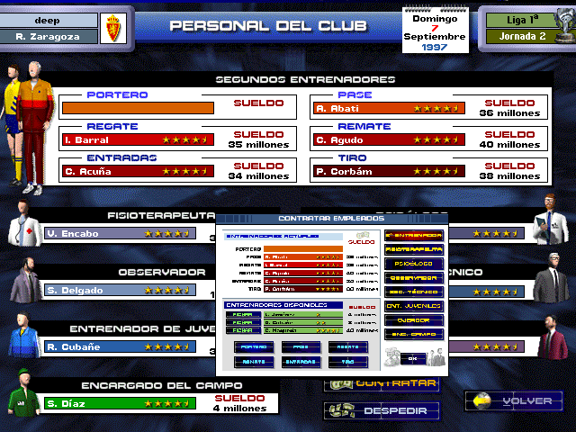
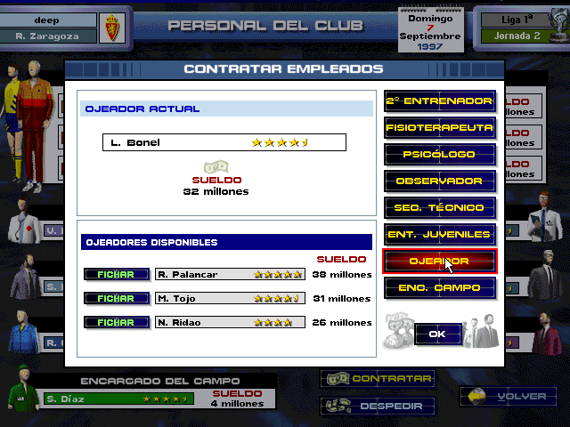
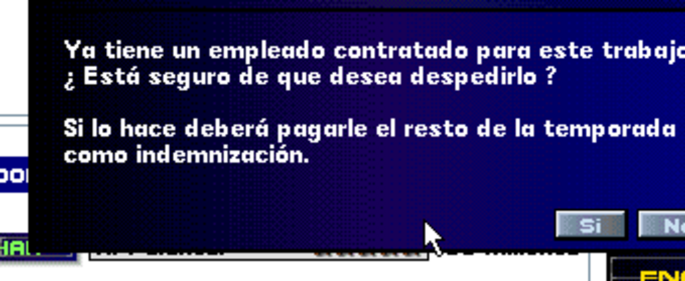
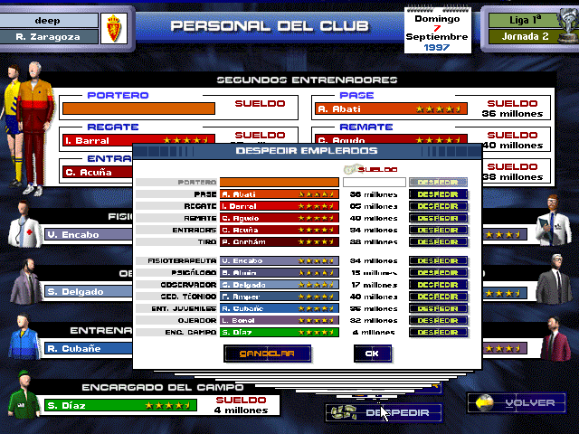

# PC Fútbol 6.0 — Personal del Club (EMPLEADOS)

`[jugado]` 2026-08-21. Se llega aquí desde el despacho
([`07-despacho.md`](07-despacho.md)) pulsando **EMPLEADOS**, en la columna
"Mercado" del hub.



```
┌──────────────────────────────────────────────────────────────────┐
│[dynasty/RMA]      PERSONAL DEL CLUB          [Jueves 14 Ago 1997]│
│                                              [Pretemp./Preparación]│
├──────────────────────────────────────────────────────────────────┤
│              SEGUNDOS ENTRENADORES                                │
│ PORTERO   D. Aguirre   ★★★★★  SUELDO 47M │ PASE   J. Benito  ★★★★  SUELDO 44M│
│ REGATE    P. Casar     ★★★★   SUELDO 55M │ REMATE F.Ansotegui★★★★  SUELDO 53M│
│ ENTRADAS  J. Beltrán   ★★★★★  SUELDO 51M │ TIRO   A. Abeille ★★★★★ SUELDO 51M│
├──────────────────────────────────────────────────────────────────┤
│ FISIOTERAPEUTA  J. Bocos  SUELDO 51M   │ PSICÓLOGO  G. Arroyo  SUELDO 16M    │
│ OBSERVADOR      O. Cañadas SUELDO 21M  │ SECRETARIO TÉCNICO D.Agustín SUELDO 60M│
│ ENTR. JUVENILES E. Alloza SUELDO 36M   │ OJEADOR    E. Amat    SUELDO 39M    │
│ ENCARGADO CAMPO C. Acebedo SUELDO 4M   │                                     │
│                                          [CONTRATAR]                        │
│                                          [DESPEDIR]      [VOLVER]           │
└──────────────────────────────────────────────────────────────────┘
```

- **"Segundos entrenadores" está desglosado por especialidad, no es un
  cuerpo técnico genérico.** Seis asistentes, cada uno dueño de una faceta
  de entrenamiento muy concreta: PORTERO (portería), REGATE (regate/control),
  ENTRADAS (entradas/defensa), PASE (pase), REMATE (remate/finalización),
  TIRO (tiro/lanzamientos, probablemente faltas y penaltis). Cada uno tiene
  nombre propio, una valoración en estrellas (1-5) y un sueldo en millones —
  el mismo lenguaje visual que se ve en fichajes de jugadores en otros
  títulos de la saga.
- **Debajo, un segundo grupo de personal no futbolístico**: fisioterapeuta,
  psicólogo, observador (scout de rivales, se asume), secretario técnico,
  entrenador de juveniles (cantera), ojeador (scout de fichajes — distinto
  del "observador"), encargado del campo (mantenimiento del estadio). Estos
  no llevan estrellas visibles, solo nombre y sueldo.
- **Dos roles de scouting distintos y no fusionados**: OBSERVADOR y OJEADOR
  aparecen como puestos separados — señal de que el juego modela "vigilar
  al rival" y "buscar fichajes" como dos trabajos distintos, no una sola
  función de "ojeador" genérica.
- **CONTRATAR / DESPEDIR como acciones globales de la pantalla**, no por
  fila — sugiere que se selecciona primero una fila (click en el nombre o
  en el puesto) y luego se actúa sobre la selección, en vez de un botón por
  persona. No confirmado en esta sesión (no se probó clicar una fila
  todavía).

## Qué exige

**Plantilla de personal técnico granular por especialidad**, no un genérico
"cuerpo técnico": un mapa de equivalencias para PC Dynasty debería
considerar como mínimo estos roles como entidades independientes con
sueldo y nivel propios: entrenador de porteros, de regate, de
entradas/defensa, de pase, de remate, de tiro; más fisioterapeuta,
psicólogo, secretario técnico, entrenador de juveniles, encargado de
campo, y **dos** roles de scouting separados (observador de rivales,
ojeador de fichajes).

## CONTRATAR y DESPEDIR: dos diálogos autocontenidos, no selección de fila (sesión 5, 2026-08-22)

`[jugado]` 2026-08-22. Resuelve la duda pendiente de la sesión anterior.
**Clicar directamente sobre una fila de la pantalla principal (probado
sobre la fila de OJEADOR) no produce ningún resaltado ni selección** —
la hipótesis de "selecciona fila, luego pulsa CONTRATAR/DESPEDIR" queda
descartada.



En su lugar, **`CONTRATAR` y `DESPEDIR` abren cada uno su propio diálogo
modal, autocontenido, con su propia lista y sus propios botones por
fila** — la pantalla principal de PERSONAL DEL CLUB es solo una vista de
lectura.

### `CONTRATAR` → "CONTRATAR EMPLEADOS"



- El diálogo tiene tres zonas: **`ENTRENADORES ACTUALES`** (arriba,
  quienes ya ocupan cada especialidad de segundo entrenador), una columna
  de **puestos** a la derecha (`2° ENTRENADOR`, `FISIOTERAPEUTA`,
  `PSICÓLOGO`, `OBSERVADOR`, `SEC. TÉCNICO`, `ENT. JUVENILES`, `OJEADOR`,
  `ENC. CAMPO`) que actúa como selector de categoría, y **`ENTRENADORES
  DISPONIBLES`** (abajo) con un botón `FICHAR` propio por candidato.
- Clicar la categoría `OJEADOR` en la columna derecha cambia el contenido
  de ambos paneles al ojeador actual (**L. Bonel**, ★★★★, sueldo 32
  millones) y **tres candidatos disponibles con `FICHAR` cada uno**
  (R. Palancar 38M, M. Tojo 31M, N. Ridao 26M):

  

- **Pulsar `FICHAR` sobre un candidato cuando ya hay alguien en el puesto
  dispara un diálogo de confirmación**: *"Ya tiene un empleado contratado
  para este trabajo. ¿Está seguro de que desea despedirlo? Si lo hace
  deberá pagarle el resto de la temporada como indemnización."* con
  `Sí`/`No` — fichar un segundo especialista para el mismo puesto implica
  despedir automáticamente al anterior, con coste de indemnización.

  

- Confirmado que **`No` cancela sin cambios** (L. Bonel sigue de
  ojeador). Se probó también cerrar el diálogo con `OK` sin haber pulsado
  ningún `FICHAR` — el modal se cierra y **`PERSONAL DEL CLUB` vuelve
  exactamente igual que antes** (sin contratación real completada en esta
  sesión, deliberadamente, para no alterar la economía de la partida).

### `DESPEDIR` → "DESPEDIR EMPLEADOS"



- Diálogo distinto y más simple: **una sola lista con las 13 plazas de
  personal actuales** (los 6 segundos entrenadores por especialidad +
  fisioterapeuta, psicólogo, observador, secretario técnico, entrenador
  de juveniles, ojeador, encargado de campo), cada una con su propio
  botón `DESPEDIR`, más `CANCELAR`/`OK` al pie — no hay que elegir puesto
  primero como en `CONTRATAR`.
- Pulsar `DESPEDIR` sobre una fila (probado con el `ENCARGADO DEL CAMPO`,
  S. Díaz) dispara **el mismo diálogo de confirmación `Sí`/`No`** con el
  mismo texto de indemnización que en `CONTRATAR`.
- Confirmado que **`No` cancela** (S. Díaz sigue en la lista con su
  sueldo intacto) y que `CANCELAR` cierra el diálogo entero sin efecto.
  No se completó ningún despido real en esta sesión, por la misma razón
  económica.
- La fila `PORTERO` de segundos entrenadores aparece vacía (barra de
  sueldo sin nombre) en ambos diálogos — no se ha determinado si es un
  puesto genuinamente sin cubrir en esta partida o un artefacto de la
  captura.

## Qué exige

Confirmado con esta sesión: **CONTRATAR y DESPEDIR no son acciones sobre
una fila preseleccionada de la pantalla principal, son dos diálogos modal
independientes**, cada uno con su propia lista y sus propios botones por
fila. Y el sistema de contratación **fusiona fichar-y-despedir en una
sola operación** cuando el puesto ya está ocupado (con coste de
indemnización explícito), en vez de exigir despedir primero y contratar
después como dos pasos separados. Un mapa de equivalencias para PC
Dynasty debería modelar "sustituir a alguien en un puesto" como una
transacción atómica con su propio coste de indemnización, no como dos
acciones independientes encadenadas por el usuario.

## Pendiente

- No se ha completado ninguna contratación ni ningún despido real (ambos
  flujos se probaron hasta el diálogo de confirmación y se canceló con
  `No`, para no alterar la economía de la partida).
- No se ha determinado si la fila `PORTERO` de segundos entrenadores
  vacía es un puesto sin cubrir real o un artefacto de captura.
- No se ha probado si `CONTRATAR`/`DESPEDIR` sobre las categorías de
  segundo entrenador (`PORTERO`/`REGATE`/`ENTRADAS`/`PASE`/`REMATE`/
  `TIRO`) siguen el mismo patrón que `OJEADOR` — solo se probó esta
  última categoría a fondo.
