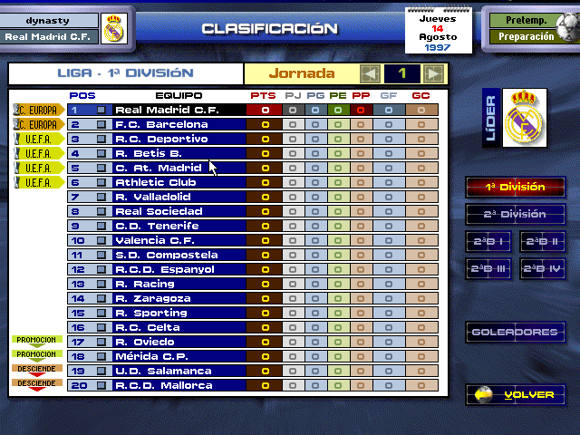
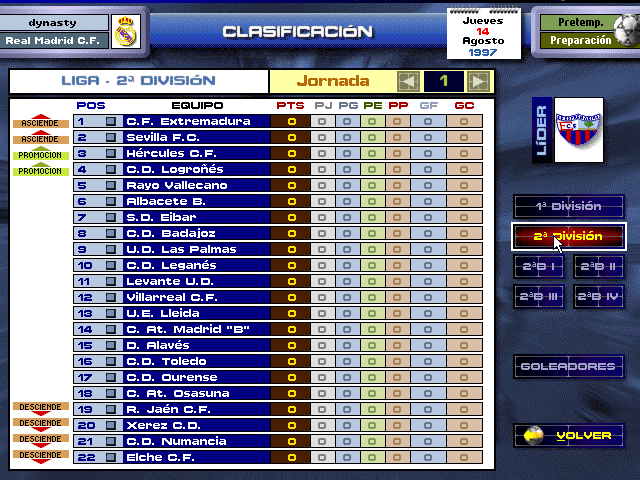
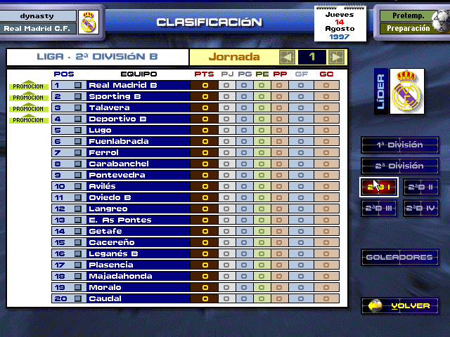
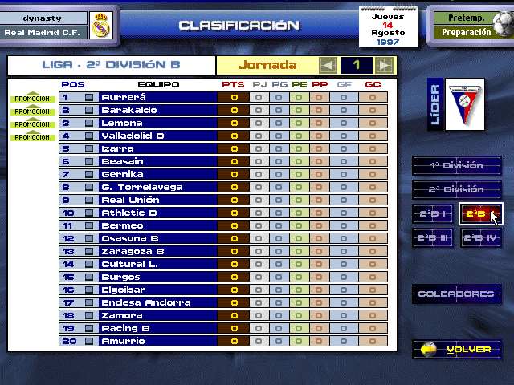
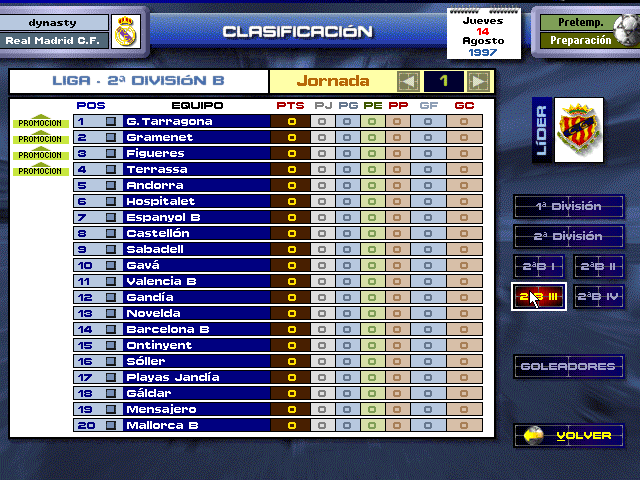
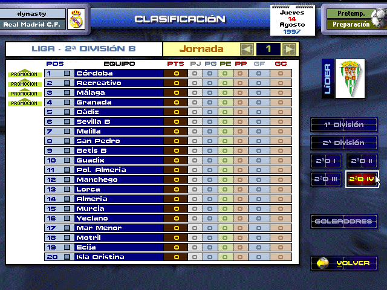
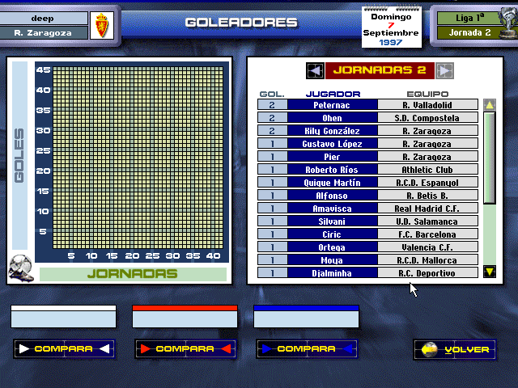
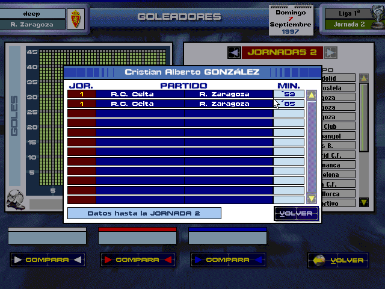

# PC Fútbol 6.0 — Clasificación

`[jugado]` 2026-08-21. Se llega aquí desde el despacho
([`07-despacho.md`](07-despacho.md)) pulsando **CLASIFICACIÓN**, en la
columna "Seguimiento" del hub. Es la primera pantalla explorada del
despacho que respondió al primer intento de clic tras la calibración —
buena referencia de posición estable para la fila superior de botones.



```
┌──────────────────────────────────────────────────────────────────┐
│[dynasty/RMA]        CLASIFICACIÓN         [Jueves 14 Ago 1997]   │
│                                            [Pretemp./Preparación] │
├──────────────────────────────────────────────────────────────────┤
│ LIGA · 1ª DIVISIÓN          Jornada [◄] 1 [►]                     │
├────────────────────────────────────────────────────┬─────────────┤
│ EUROPA │ POS EQUIPO          PTS PJ PG PE PP GF GC  │   LIDER     │
│ EUROPA │  1  Real Madrid CF   0  0  0  0  0  0  0   │  [escudo]   │
│ UEFA   │  2  F.C. Barcelona   0  0  0  0  0  0  0   │             │
│ UEFA   │  3  R.C. Deportivo   0  0  0  0  0  0  0   │ [1ª División]│
│ UEFA   │  4  R. Betis B.      0  0  0  0  0  0  0   │ [2ª División]│
│ UEFA   │  5  C. At. Madrid    0  0  0  0  0  0  0   │ [2ªB I][2ªB II]│
│ UEFA   │  6  Athletic Club    0  0  0  0  0  0  0   │ [2ªBIII][2ªBIV]│
│        │  7  R. Valladolid    ...                    │             │
│        │  8-16 (equipos, todo a 0)                    │[GOLEADORES] │
│PROMOCIÓN│ 17 R. Oviedo         0  0  0  0  0  0  0   │             │
│PROMOCIÓN│ 18 Mérida C.P.       0  0  0  0  0  0  0   │             │
│DESCIENDE│ 19 U.D. Salamanca    0  0  0  0  0  0  0   │  [VOLVER]   │
│DESCIENDE│ 20 R.C.D. Mallorca   0  0  0  0  0  0  0   │             │
└────────────────────────────────────────────────────┴─────────────┘
```

- **20 equipos, Primera División real de la temporada 97-98** (Real Madrid,
  Barcelona, Deportivo, Betis, Atlético, Athletic, Valladolid, Sociedad,
  Tenerife, Valencia, Compostela, Espanyol, Racing, Zaragoza, Sporting,
  Celta, Oviedo, Mérida, Salamanca, Mallorca) — nombres y orden reales de
  la liga española de esa temporada, no genéricos.
  Real Madrid aparece primero con una barra roja destacada (nuestro
  equipo), aunque todos los valores están a 0 — es orden por defecto
  (probablemente alfabético o el mismo de la ficha de club), no una
  clasificación real todavía, porque la Jornada 1 aún no se ha jugado.
- **Columnas estándar de tabla de liga**: POS, EQUIPO, PTS, PJ (jugados),
  PG (ganados), PE (empatados), PP (perdidos), GF (goles a favor), GC
  (goles en contra) — el vocabulario exacto a usar en cualquier tabla de
  clasificación de PC Dynasty.
- **Franjas de color a la izquierda marcan las zonas de la tabla**, no solo
  el texto: "EUROPA" (posiciones 1-2, arriba del todo — Champions/copa de
  Europa), "UEFA" (posiciones 3-7), zona neutra sin marcar en medio,
  "PROMOCIÓN" (17-18, playoff de descenso) y "DESCIENDE" (19-20, descenso
  directo). Cuatro zonas, no solo "arriba bueno / abajo malo".
- **Selector de jornada** (`◄ 1 ►`) junto al título de la tabla — permite
  ver la clasificación tal y como estaba en cualquier jornada ya disputada,
  no solo la actual.
- **Panel lateral derecho**: escudo del líder actual bajo la etiqueta
  "LIDER" (aquí, Real Madrid, aunque sea un empate a 0 — el juego elige a
  alguien igualmente), pestañas de categoría (1ª/2ª División, 2ªB I-IV,
  las mismas cuatro subdivisiones de Segunda B ya vistas en
  `05-liga-manager-nueva-partida.md`), un botón GOLEADORES (máximos
  goleadores, pantalla propia no explorada aún) y VOLVER.

## Qué exige

**Cuatro zonas de tabla, no dos.** El mapa de equivalencias de PC Dynasty
debería modelar explícitamente Europa (posiciones 1-2), UEFA/competición
secundaria (3-7), neutro, promoción de descenso (17-18) y descenso directo
(19-20) como franjas de color independientes — no un simple "top 4 verde,
resto normal, últimos 3 rojo" que es la simplificación habitual en juegos
modernos.

## Segunda División y Segunda B (2026-08-21, misma sesión)







- **Segunda División: 22 equipos**, mismas columnas que Primera. Zonas de
  color distintas a las de Primera: **ASCIENDE** (posiciones altas,
  ascenso directo), **PROMOCIÓN** (ascenso por playoff) y **DESCIENDE**
  (descenso a 2ªB) — nombres de zona propios de esta categoría, no una
  copia literal de las de Primera (no hay "EUROPA"/"UEFA" aquí, lógicamente).
- **2ªB no es una cuarta categoría deportiva: son cuatro grupos regionales
  de la misma categoría**, confirmado leyendo la plantilla real de cada
  pestaña — **I** (norte/vasco), **II** (vasco/cantábrico), **III**
  (Cataluña/Valencia/Canarias), **IV** (Andalucía/Murcia). El mapa de
  equivalencias de PC Dynasty debe modelar 2ªB como "una división con N
  grupos paralelos", no como una división más en la jerarquía vertical.
- **Clicar una fila de equipo en la tabla es una acción pasiva**: solo
  dibuja un marco de selección fino alrededor de la fila (highlight), no
  navega a ninguna ficha de club ni abre ningún panel adicional — probado
  en varias filas de Primera y de Segunda.
- El selector de Jornada (`◄ 1 ►`) y el botón GOLEADORES no dieron señal de
  respuesta en la Jornada 1 (liga recién creada, sin partidos jugados aún)
  — pendiente de reprobar una vez haya al menos una jornada disputada,
  porque puede ser un bloqueo por falta de datos, no un botón roto.

## GOLEADORES: tabla de máximos goleadores con ficha por jugador y gráfico de progresión (sesión 4, 2026-08-21)



Con al menos una jornada disputada, el botón `GOLEADORES` navega con
normalidad (en la Jornada 1 sin jugar de sesiones previas no daba señal —
confirmado que era por falta de datos, no un botón roto, tal como se
sospechaba en el Pendiente original).

- **Lista ordenada por goles** (`GOL.`/`JUGADOR`/`EQUIPO`), con scrollbar,
  y un selector `JORNADAS 2` (`◄ ►`, no probado en profundidad) que
  delimita hasta qué jornada se cuentan los goles.
- **Clicar una fila de jugador abre una ficha modal por jugador**
  (nombre completo, distinto del apellido corto de la lista — p. ej.
  "Hilu González" en la lista es *Cristian Alberto GONZÁLEZ* en la ficha)
  con una **tabla de cada gol marcado**: `JOR.` (jornada), `PARTIDO`
  (ambos equipos) y `MIN.` (minuto exacto) — un log de goles por jugador,
  no solo el total. Pie con `Datos hasta la JORNADA N` y `VOLVER`.

  

- **El gráfico grande de la izquierda (ejes `GOLES` 5-45 / `JORNADAS`
  5-40) se rellena con un patrón de puntos mientras la ficha de un
  jugador está abierta**, y **vuelve a quedar vacío al cerrar la ficha**
  — es la progresión de goles de ese jugador concreto a lo largo de la
  temporada, no una comparación simultánea de varios (aunque existen tres
  franjas `COMPARA` con flechas ◄/► bajo la lista, sugiriendo que sí se
  pueden fijar hasta tres jugadores a la vez para comparar sus curvas —
  no se llegó a probar el flujo completo de "fijar" un jugador en un
  slot de `COMPARA` en vez de solo abrir su ficha).
- El botón `VOLVER` de la ficha modal (no el de la pantalla `GOLEADORES`)
  necesitó una recalibración fina de coordenadas (estaba más a la
  derecha/abajo de lo esperado por el cálculo geométrico ingenuo) — igual
  que otros casos ya documentados de "no es una anomalía, es calibración"
  en `16-tacticas.md`.

## `VOLVER` de esta pantalla: la anomalía histórica no se reprodujo (sesión 4, 2026-08-21)

Se repitió deliberadamente el mismo botón `VOLVER` de `CLASIFICACIÓN` que
en una sesión anterior requirió reiniciar la VM (ver el Pendiente
original más abajo, conservado como registro histórico). Esta vez, con
`--reset` explícito en el clic, **`VOLVER` respondió a la primera** y
devolvió limpiamente al despacho. Es coherente con el hallazgo más amplio
de sesión 4 sobre pérdida de foco espontánea + omisión de `--reset` (ver
[`como-esta-montado.md`](../como-esta-montado.md)): es plausible que la
anomalía original de esta pantalla fuera ese mismo fenómeno mal
diagnosticado como "botón atascado", en vez de un defecto real del juego.
No se puede confirmar retroactivamente con certeza total (no se guardó
una captura del escritorio de Windows en aquel momento), pero la
reproducción limpia esta sesión reduce la confianza en que sea un bug
del juego.

## Pendiente

- Selector de jornada (`◄ ►`) en `CLASIFICACIÓN` no probado con datos
  reales de varias jornadas ya jugadas (solo Jornada 1/2).
- El selector `◄ JORNADAS N ►` de `GOLEADORES` no se probó a fondo
  (cambiar de jornada, ver si recalcula la lista).
- El mecanismo de las tres franjas `COMPARA` en `GOLEADORES` (fijar hasta
  tres jugadores para comparar curvas en el mismo gráfico) no se
  completó — solo se abrió la ficha individual de un jugador a la vez.
