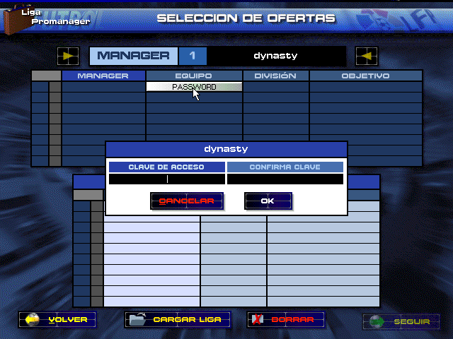
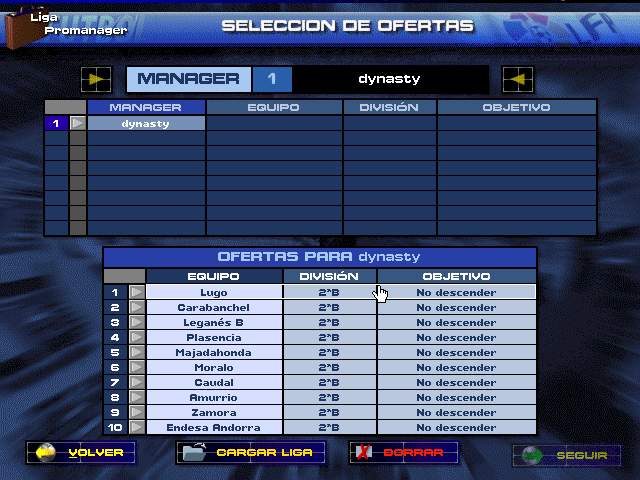
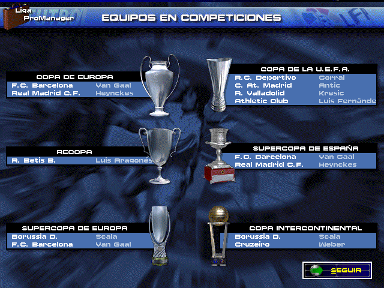
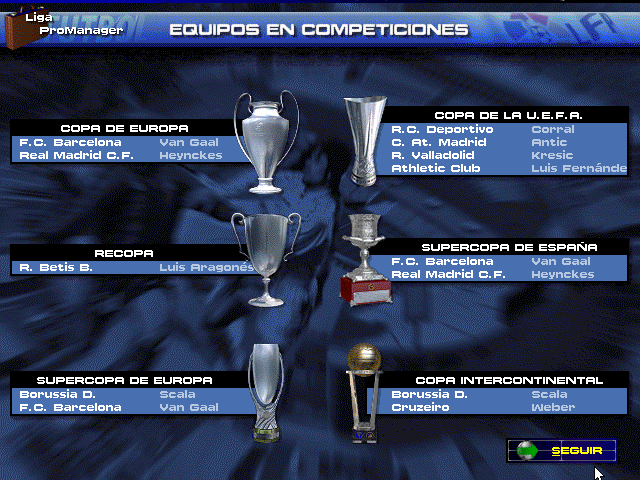
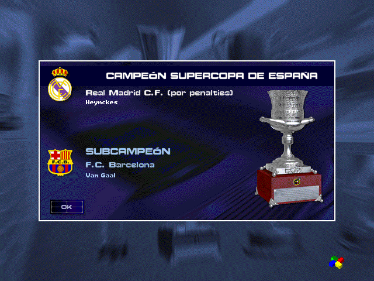

# PC Fútbol 6.0 — Liga Promanager: clave de acceso y selección de ofertas

`[jugado]` 2026-08-21. Se llega aquí pulsando la loseta **LIGA PROMANAGER**
del menú principal (distinta de LIGA MANAGER — ver
[`00-menu-principal.md`](00-menu-principal.md)). Comparte la pantalla de
personalización con Liga Manager casi al pixel
([`06-liga-manager-personalizacion.md`](06-liga-manager-personalizacion.md)),
pero a partir de ahí el flujo es **estructuralmente distinto**, no una copia
con otro nombre.

## Personalización del Promanager: un interruptor extra


Misma rejilla de perfiles predefinidos, mismos ocho... no, **nueve**
interruptores: todos los de Liga Manager más uno exclusivo de este modo,
**"Clave de acceso en Promanager"** — activado por defecto — que resulta ser
la pieza central de todo lo que sigue.

## Selección de ofertas: no eliges equipo, te lo ofrecen

Tras SEGUIR y pretemporada (no repetido aquí, mismo componente que en Liga
Manager), Liga Manager te lleva a "Introduce nombre y equipo" con una
rejilla libre de 20 equipos de Primera para elegir cualquiera. **Liga
Promanager no.** Lleva a una pantalla completamente distinta:
"SELECCIÓN DE OFERTAS".

```
┌──────────────────────────────────────────────────────────────────┐
│           SELECCION DE OFERTAS                                    │
│ ▶ [ MANAGER 1  |dynasty]                                  ◄       │
│ ┌────────────────────────────────────────────────────────────┐   │
│ │1│▷│dynasty │            │          │             │          │   │
│ │ (filas 2-10 vacías: slots de manager libres)                 │   │
│ └────────────────────────────────────────────────────────────┘   │
│         OFERTAS PARA dynasty                                      │
│ ┌────────────────────────────────────────────────────────────┐   │
│ │ EQUIPO         DIVISIÓN   OBJETIVO                          │   │
│ │ 1 Lugo          2ªB       No descender                       │   │
│ │ 2 Carabanchel   2ªB       No descender                       │   │
│ │ 3 Leganés B     2ªB       No descender                       │   │
│ │ 4 Plasencia     2ªB       No descender                       │   │
│ │ 5 Majadahonda   2ªB       No descender                       │   │
│ │ 6 Morolo        2ªB       No descender                       │   │
│ │ 7 Caudal        2ªB       No descender                       │   │
│ │ 8 Amurrio       2ªB       No descender                       │   │
│ │ 9 Zamora        2ªB       No descender                       │   │
│ │10 Endesa Andorra 2ªB      No descender                       │   │
│ └────────────────────────────────────────────────────────────┘   │
│ [VOLVER] [CARGAR LIGA] [BORRAR]                     [SEGUIR]     │
└──────────────────────────────────────────────────────────────────┘
```

- **El mánager es la entidad persistente, no la liga.** El nombre se escribe
  en el mismo componente de slots (1-20) que en Liga Manager
  ([`05-liga-manager-nueva-partida.md`](05-liga-manager-nueva-partida.md)),
  pero aquí ese slot no lleva a elegir equipo: lleva a una tabla de
  **ofertas de trabajo recibidas**, con columnas EQUIPO / DIVISIÓN /
  OBJETIVO. **No se elige libremente dónde entrenar — se acepta una oferta
  entre las que llegan.**
- **Las diez ofertas iniciales son todas de 2ªB**, con el mismo objetivo
  para las diez: "No descender". Un mánager novato empieza abajo del
  todo y con un objetivo puramente defensivo — coherente con una
  simulación de carrera realista (llegas sin currículum, te ofrecen lo
  que hay), frente al arranque libre de Liga Manager (cualquier equipo de
  Primera desde el primer día). Esta es la diferencia de diseño real entre
  los dos modos, no solo un nombre distinto.
- **Clave de acceso obligatoria antes de que SEGUIR haga nada.** Pulsar
  SEGUIR con el nombre puesto pero sin clave configurada **no avanza ni da
  ningún error visible** — parecía un botón roto hasta que se probó pulsar
  directamente la palabra `PASSWORD` en la columna EQUIPO de la fila del
  mánager (arriba, no en la tabla de ofertas):

  

  Un diálogo modal (`CLAVE DE ACCESO` / `CONFIRMA CLAVE`, enmascarado con
  `****`, botones CANCELAR/OK) pide fijar una contraseña para ese slot de
  mánager. **Tras confirmarla, la tabla de ofertas aparece poblada** — antes
  de fijar la clave, la sección "OFERTAS PARA `<nombre>`" ni siquiera tenía
  título con el nombre. Fijar la clave es lo que "activa" el perfil de
  mánager y desbloquea las ofertas, no un mero requisito de seguridad
  cosmético.

### Causa raíz confirmada (sesión 3, 2026-08-21): `PASSWORD` solo responde si ya hay un nombre de mánager escrito

En una sesión posterior se reprodujo un bloqueo completo del clic sobre
`PASSWORD` — más de 10 intentos con recalibración, doble clic, `--hold-ms`
más largo (400ms) e incluso clic derecho, todos sin abrir el diálogo. La
causa: **al entrar en esta pantalla, el foco de teclado ya está puesto por
defecto en el campo de nombre del mánager** (una barra de texto negra junto
a `MANAGER 1`, con un cursor parpadeante apenas visible) — no en la tabla.
Si ese campo sigue vacío, `PASSWORD` en la columna EQUIPO **no es
clicable todavía**: es un placeholder inerte hasta que existe un nombre de
mánager. Se confirmó tecleando directamente (sin clicar antes, el foco ya
estaba ahí) y el nombre apareció en el campo; **solo entonces** el clic
sobre `PASSWORD` abrió el diálogo `CLAVE DE ACCESO`/`CONFIRMA CLAVE` con
normalidad, en el primer intento. Nótese que `Tab` **no** mueve el foco
entre `CLAVE DE ACCESO` y `CONFIRMA CLAVE` dentro de ese diálogo — hay que
clicar cada campo por separado (se probó y confirmó: Tab reescribe en el
mismo campo en vez de saltar de campo).

Secuencia mínima reproducible: entrar en "SELECCIÓN DE OFERTAS" → teclear
un nombre directamente (sin clicar nada primero) → Enter → clicar
`PASSWORD` → clicar dentro de `CLAVE DE ACCESO`, teclear clave → clicar
dentro de `CONFIRMA CLAVE`, teclear la misma clave → clicar `OK`.
- **Este OK sí respondió al primer clic**, con el mismo estilo visual
  (caja blanca con título azul, botón rectangular) que los dos diálogos que
  no responden a ningún método de entrada en Liga Manager (VOLVER en
  Clasificación, OK en el recap de Supercopa — ver
  [`09-clasificacion.md`](09-clasificacion.md) y
  [`07-despacho.md`](07-despacho.md)). Esto **debilita, sin descartarla del
  todo**, la hipótesis de "diálogo Win32 nativo vs. canvas DirectDraw del
  motor" como explicación única — puede que sea un problema específico de
  esos dos diálogos concretos y no de una categoría entera de UI.



## Qué exige

**Modelar el Promanager como un mánager con historial de contrataciones,
no como "Liga Manager con menos pasos".** El mapa de equivalencias de PC
Dynasty debería representar: (1) una identidad de mánager persistente,
protegida por credencial, independiente de cualquier liga concreta; (2)
un sistema de ofertas de trabajo entrantes, filtradas por el prestigio
actual del mánager (aquí: cero prestigio → solo 2ªB); (3) un objetivo de
temporada explícito por oferta ("No descender"), no solo "juega con este
equipo" — el objetivo es parte del contrato, y probablemente condiciona
si el mánager es despedido o asciende de prestigio al final de temporada.

## Selección de oferta: confirmada (sesión 3, 2026-08-21)


Clicar directamente sobre el nombre del equipo en una fila de la tabla
`OFERTAS PARA <nombre>` (probado con "Playas Jandía", fila 1) sí funciona:
la fila 1 de la tabla superior de mánagers se actualiza al instante con
`EQUIPO=Playas Jandía`, `DIVISIÓN=2ªB`, `OBJETIVO=No descender`, y el
contador `MANAGER` pasa de `1` a `2` (crea automáticamente un segundo slot
de mánager vacío, listo para un segundo perfil si se quisiera). El botón
`SEGUIR` pasa de apagado a su color activo normal en cuanto hay una oferta
asignada.

**Cuidado con el atajo de teclado `S` para `SEGUIR` en este punto
concreto**: si el foco de teclado sigue en el campo de nombre del segundo
mánager (vacío, recién creado), pulsar `S` **teclea la letra dentro de ese
campo** en vez de activar `SEGUIR` — no navega. Hay que pulsar `SEGUIR` con
el ratón cuando hay un campo de texto con foco activo; el atajo de teclado
solo es fiable cuando no hay ningún campo editable enfocado.

## Qué pasa tras aceptar una oferta: confirmado, mismo flujo que Liga Manager

Tras `SEGUIR` desde "SELECCIÓN DE OFERTAS" con una oferta ya asignada, el
flujo es **idéntico en estructura** al de Liga Manager
([`07-despacho.md`](07-despacho.md) "Orden real completo"), solo que
saltándose la pantalla libre de "elige equipo" (aquí el equipo ya viene
fijado por la oferta aceptada):

1. **`Pretemporada para <equipo>`** (título con el nombre del equipo
   aceptado, aquí "Pretemporada para Playas Jandía") — mismo componente de
   calendario de amistosos + mapa Europa/Sudamérica + rejilla de escudos de
   España que en Liga Manager.

   

2. **`Equipos en Competiciones`** — misma pantalla de solo lectura con las
   seis competiciones europeas y sus participantes reales de la 97-98.

   

3. **Pop-up de recap de temporada anterior** ("Campeón Supercopa de
   España", escudo+nombre+entrenador de campeón/subcampeón, botón `OK`) —

   

   **en esta sesión el `OK` respondió con normalidad al primer clic**, sin
   ningún síntoma de la anomalía de diálogo-atascado documentada en
   `07-despacho.md`. Es el **segundo contraejemplo** (tras el `VOLVER` de
   Clasificación) de que este diálogo concreto no está atascado de forma
   determinista — ver la nota añadida en `07-despacho.md`.
4. **Despacho propio del Promanager** — ver
   [`22-promanager-despacho.md`](22-promanager-despacho.md) para la
   comparación completa contra el despacho de Liga Manager.

## Pendiente

- Solo se probó con una oferta de la lista (fila 1, "Playas Jandía"); no se
  ha comprobado si aceptar una oferta distinta (p. ej. fila 10) cambia algo
  del flujo posterior más allá del nombre del equipo.
- No se ha explorado qué ofrece el segundo slot de mánager que se crea
  automáticamente al aceptar la primera oferta (¿permite gestionar dos
  carreras de mánager en paralelo dentro de la misma partida?).
- No se ha probado `CARGAR LIGA` ni `BORRAR` en esta pantalla.
