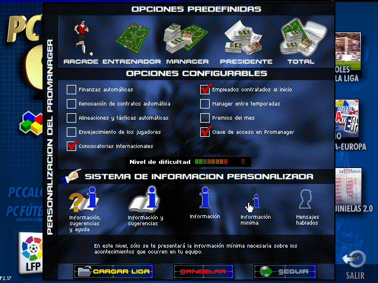

# PC Fútbol 6.0 — Liga Promanager: clave de acceso y selección de ofertas

`[jugado]` 2026-08-21. Se llega aquí pulsando la loseta **LIGA PROMANAGER**
del menú principal (distinta de LIGA MANAGER — ver
[`00-menu-principal.md`](00-menu-principal.md)). Comparte la pantalla de
personalización con Liga Manager casi al pixel
([`06-liga-manager-personalizacion.md`](06-liga-manager-personalizacion.md)),
pero a partir de ahí el flujo es **estructuralmente distinto**, no una copia
con otro nombre.

## Personalización del Promanager: un interruptor extra



Misma rejilla de perfiles predefinidos, mismos ocho... no, **nueve**
interruptores: todos los de Liga Manager más uno exclusivo de este modo,
**"Clave de acceso en Promanager"** — activado por defecto — que resulta ser
la pieza central de todo lo que sigue.

## Selección de ofertas: no eliges equipo, te lo ofrecen

Tras SEGUIR y pretemporada (no repetido aquí, mismo componente que en Liga
Manager), Liga Manager te lleva a "Introduce nombre y equipo" con una
rejilla libre de 20 equipos de Primera para elegir cualquiera. **Liga
Promanager no.** Lleva a una pantalla completamente distinta:
"SELECCIÓN DE OFERTAS".

```
┌──────────────────────────────────────────────────────────────────┐
│           SELECCION DE OFERTAS                                    │
│ ▶ [ MANAGER 1  |dynasty]                                  ◄       │
│ ┌────────────────────────────────────────────────────────────┐   │
│ │1│▷│dynasty │            │          │             │          │   │
│ │ (filas 2-10 vacías: slots de manager libres)                 │   │
│ └────────────────────────────────────────────────────────────┘   │
│         OFERTAS PARA dynasty                                      │
│ ┌────────────────────────────────────────────────────────────┐   │
│ │ EQUIPO         DIVISIÓN   OBJETIVO                          │   │
│ │ 1 Lugo          2ªB       No descender                       │   │
│ │ 2 Carabanchel   2ªB       No descender                       │   │
│ │ 3 Leganés B     2ªB       No descender                       │   │
│ │ 4 Plasencia     2ªB       No descender                       │   │
│ │ 5 Majadahonda   2ªB       No descender                       │   │
│ │ 6 Morolo        2ªB       No descender                       │   │
│ │ 7 Caudal        2ªB       No descender                       │   │
│ │ 8 Amurrio       2ªB       No descender                       │   │
│ │ 9 Zamora        2ªB       No descender                       │   │
│ │10 Endesa Andorra 2ªB      No descender                       │   │
│ └────────────────────────────────────────────────────────────┘   │
│ [VOLVER] [CARGAR LIGA] [BORRAR]                     [SEGUIR]     │
└──────────────────────────────────────────────────────────────────┘
```

- **El mánager es la entidad persistente, no la liga.** El nombre se escribe
  en el mismo componente de slots (1-20) que en Liga Manager
  ([`05-liga-manager-nueva-partida.md`](05-liga-manager-nueva-partida.md)),
  pero aquí ese slot no lleva a elegir equipo: lleva a una tabla de
  **ofertas de trabajo recibidas**, con columnas EQUIPO / DIVISIÓN /
  OBJETIVO. **No se elige libremente dónde entrenar — se acepta una oferta
  entre las que llegan.**
- **Las diez ofertas iniciales son todas de 2ªB**, con el mismo objetivo
  para las diez: "No descender". Un mánager novato empieza abajo del
  todo y con un objetivo puramente defensivo — coherente con una
  simulación de carrera realista (llegas sin currículum, te ofrecen lo
  que hay), frente al arranque libre de Liga Manager (cualquier equipo de
  Primera desde el primer día). Esta es la diferencia de diseño real entre
  los dos modos, no solo un nombre distinto.
- **Clave de acceso obligatoria antes de que SEGUIR haga nada.** Pulsar
  SEGUIR con el nombre puesto pero sin clave configurada **no avanza ni da
  ningún error visible** — parecía un botón roto hasta que se probó pulsar
  directamente la palabra `PASSWORD` en la columna EQUIPO de la fila del
  mánager (arriba, no en la tabla de ofertas):

  

  Un diálogo modal (`CLAVE DE ACCESO` / `CONFIRMA CLAVE`, enmascarado con
  `****`, botones CANCELAR/OK) pide fijar una contraseña para ese slot de
  mánager. **Tras confirmarla, la tabla de ofertas aparece poblada** — antes
  de fijar la clave, la sección "OFERTAS PARA `<nombre>`" ni siquiera tenía
  título con el nombre. Fijar la clave es lo que "activa" el perfil de
  mánager y desbloquea las ofertas, no un mero requisito de seguridad
  cosmético.
- **Este OK sí respondió al primer clic**, con el mismo estilo visual
  (caja blanca con título azul, botón rectangular) que los dos diálogos que
  no responden a ningún método de entrada en Liga Manager (VOLVER en
  Clasificación, OK en el recap de Supercopa — ver
  [`09-clasificacion.md`](09-clasificacion.md) y
  [`07-despacho.md`](07-despacho.md)). Esto **debilita, sin descartarla del
  todo**, la hipótesis de "diálogo Win32 nativo vs. canvas DirectDraw del
  motor" como explicación única — puede que sea un problema específico de
  esos dos diálogos concretos y no de una categoría entera de UI.


## Qué exige

**Modelar el Promanager como un mánager con historial de contrataciones,
no como "Liga Manager con menos pasos".** El mapa de equivalencias de PC
Dynasty debería representar: (1) una identidad de mánager persistente,
protegida por credencial, independiente de cualquier liga concreta; (2)
un sistema de ofertas de trabajo entrantes, filtradas por el prestigio
actual del mánager (aquí: cero prestigio → solo 2ªB); (3) un objetivo de
temporada explícito por oferta ("No descender"), no solo "juega con este
equipo" — el objetivo es parte del contrato, y probablemente condiciona
si el mánager es despedido o asciende de prestigio al final de temporada.

## Pendiente

- **No se logró seleccionar una fila de oferta concreta** — SEGUIR
  permanece sin efecto con las diez ofertas visibles pero ninguna
  visiblemente resaltada. Se probó clicar el nombre del equipo, la columna
  numérica y el icono `▷` de cada fila sin éxito visible. Puede que la
  selección real esté en una zona de la fila aún no probada (p. ej. la
  celda OBJETIVO, o requiera doble clic exacto sobre el triángulo) —
  recalibrar con el método de arrastre en la próxima pasada.
  Nótese que ninguna disparó el mismo síntoma de "no responde a nada" — no
  se ha llegado a agotar los métodos de entrada aquí como sí se hizo con
  los otros dos diálogos, así que no se puede aún clasificar esto como la
  misma anomalía.
- Qué pasa tras aceptar una oferta (¿otra pantalla de pretemporada? ¿directo
  al despacho?) no explorado todavía.
- Comparar el despacho de Promanager con el de Liga Manager una vez se
  llegue — ¿mismo hub, o hay diferencias por jugar "contratado" en vez de
  "dueño"?
