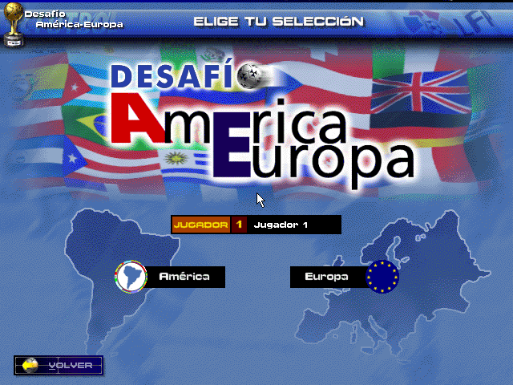
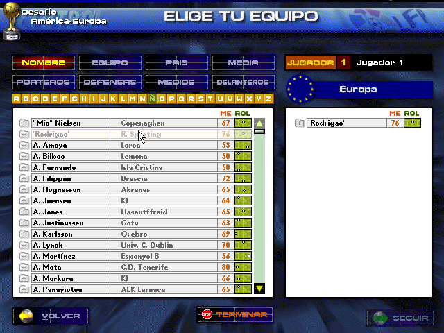

# PC Fútbol 6.0 — Desafío América-Europa: selección de estrellas por draft

`[jugado]` 2026-08-21. Se llega aquí pulsando la loseta **DESAFÍO
AMÉRICA-EUROPA** del menú principal — un modo de exhibición completamente
distinto de Liga Manager/Promanager: no gestionas un club de la liga real,
sino que **te construyes un combinado de estrellas** eligiendo jugador a
jugador de toda la base de datos real del juego.

## Elige tu selección: dos confederaciones, no clubes

Pantalla de entrada minimalista: un logo "DESAFÍO AMÉRICA-EUROPA" y dos
continentes clicables — **América** y **Europa** — cada uno como un mapa
en miniatura con su icono de confederación (CONMEBOL-style para América,
círculo de estrellas estilo UEFA para Europa). El campo `JUGADOR 1` reutiliza
el mismo componente de nombre que el resto del juego. Un único botón
VOLVER — no hay SEGUIR en esta pantalla, la elección de continente navega
directo a la siguiente.

## Elige tu equipo: un draft real sobre toda la base de datos

Tras elegir Europa, la pantalla siguiente es un **draft de jugadores
individuales**, no una selección de plantilla predefinida:

- **Cuatro criterios de orden** (NOMBRE, EQUIPO, PAÍS, MEDIA) como pestañas
  de cabecera — clicar una reordena la lista completa por ese campo.
- **Cuatro filtros de posición** (PORTEROS, DEFENSAS, MEDIOS, DELANTEROS)
  como una segunda fila de pestañas — confirmado funcionando: clicar
  "MEDIOS" cambia la lista a solo centrocampistas, **ordenados por MEDIA
  descendente** automáticamente, mostrando nombres reales de la temporada
  97-98 con su valoración real (Basler 92, Overmars 91, Zidane 87, Giggs 87,
  Beckham 87, Redondo 87...) — ver
  [`screenshots/desafio-america-europa/03-filtro-medios.png`](screenshots/desafio-america-europa/03-filtro-medios.png).
- **Índice alfabético A-Z** encima de la lista, para saltar directo a un
  apellido.
- **Columnas ME (media) y ROL** (estrellas de rol/versatilidad) en cada
  fila — mismo vocabulario de valoración que el resto del juego.
- **Clicar una fila de jugador lo "ficha" para tu combinado**: confirmado
  clicando `'Rodrigao'` — aparece inmediatamente en el **panel derecho**
  (tu plantilla en construcción, vacío al empezar) y la fila original
  **se atenúa/deshabilita** en la lista izquierda (ya no se puede volver a
  elegir el mismo jugador). Mecánica de un solo clic, sin diálogo de
  confirmación — muy distinto del resto de listas de selección del juego
  (que normalmente rellenan un campo de texto en vez de mover la fila a
  otro panel).
- **Tres acciones al pie**: VOLVER, **TERMINAR** (probablemente da por
  cerrado el draft con los jugadores ya elegidos, no probado), SEGUIR
  (continuar — presumiblemente exige un mínimo de jugadores por posición
  antes de habilitarse, no confirmado).

## Qué exige

**Un modo de "equipo de estrellas por draft" es una mecánica de juego
completa y distinta de la carrera de club**, con su propio flujo de
selección (filtrar/ordenar/fichar de un pool compartido, con exclusión
mutua entre jugadores ya elegidos) reutilizando la base de datos de
jugadores real ya vista en Base de Datos. Si PC Dynasty considera un modo
de exhibición equivalente, este draft de un solo clic con panel
izquierda=disponibles / derecha=elegidos, más filtros de posición y orden,
es la referencia directa a replicar — no hace falta una pantalla nueva por
selección, es una única lista con estado de "ya fichado".

## Pendiente

- Qué pasa al pulsar SEGUIR sin completar un once (¿bloquea? ¿avisa?) — no
  probado.
- TERMINAR vs SEGUIR — diferencia de comportamiento no confirmada.
- El propio partido de exhibición (¿simulado o jugable?) — no alcanzado
  todavía.
- Repetir el mismo flujo eligiendo América, para comparar el pool de
  jugadores disponible (sudamericanos reales de la época, se asume).
