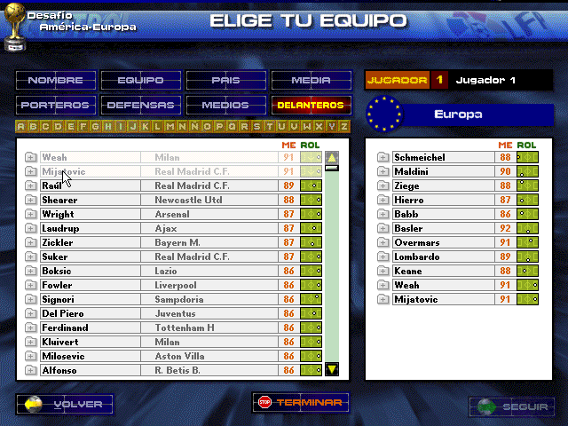
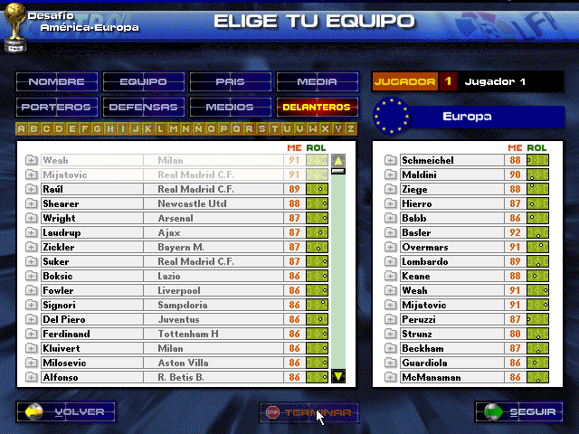
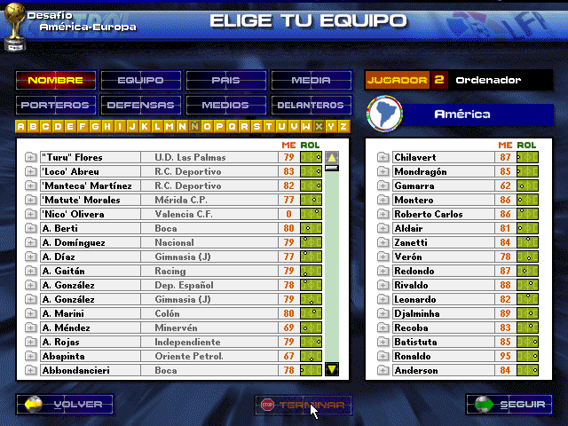
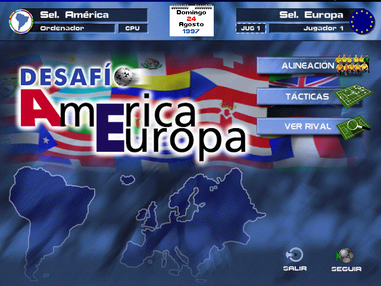
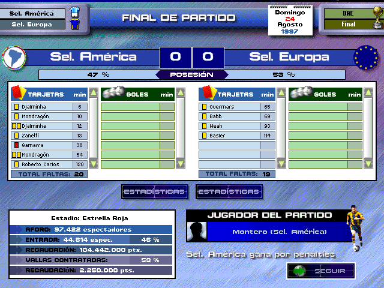
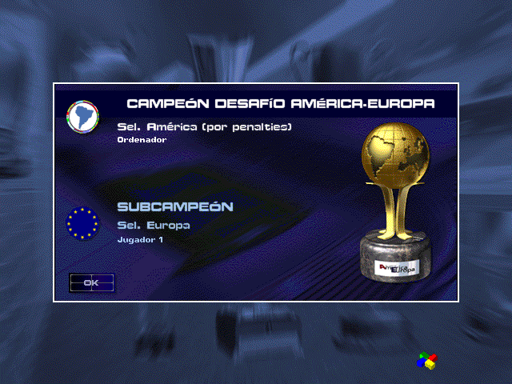

# PC Fútbol 6.0 — Desafío América-Europa: selección de estrellas por draft

`[jugado]` 2026-08-21. Se llega aquí pulsando la loseta **DESAFÍO
AMÉRICA-EUROPA** del menú principal — un modo de exhibición completamente
distinto de Liga Manager/Promanager: no gestionas un club de la liga real,
sino que **te construyes un combinado de estrellas** eligiendo jugador a
jugador de toda la base de datos real del juego.

## Elige tu selección: dos confederaciones, no clubes

Pantalla de entrada minimalista: un logo "DESAFÍO AMÉRICA-EUROPA" y dos
continentes clicables — **América** y **Europa** — cada uno como un mapa
en miniatura con su icono de confederación (CONMEBOL-style para América,
círculo de estrellas estilo UEFA para Europa). El campo `JUGADOR 1` reutiliza
el mismo componente de nombre que el resto del juego. Un único botón
VOLVER — no hay SEGUIR en esta pantalla, la elección de continente navega
directo a la siguiente.

## Elige tu equipo: un draft real sobre toda la base de datos

Tras elegir Europa, la pantalla siguiente es un **draft de jugadores
individuales**, no una selección de plantilla predefinida:

- **Cuatro criterios de orden** (NOMBRE, EQUIPO, PAÍS, MEDIA) como pestañas
  de cabecera — clicar una reordena la lista completa por ese campo.
- **Cuatro filtros de posición** (PORTEROS, DEFENSAS, MEDIOS, DELANTEROS)
  como una segunda fila de pestañas — confirmado funcionando: clicar
  "MEDIOS" cambia la lista a solo centrocampistas, **ordenados por MEDIA
  descendente** automáticamente, mostrando nombres reales de la temporada
  97-98 con su valoración real (Basler 92, Overmars 91, Zidane 87, Giggs 87,
  Beckham 87, Redondo 87...) — ver
  [`screenshots/desafio-america-europa/03-filtro-medios.png`](screenshots/desafio-america-europa/03-filtro-medios.png).
- **Índice alfabético A-Z** encima de la lista, para saltar directo a un
  apellido.
- **Columnas ME (media) y ROL** (estrellas de rol/versatilidad) en cada
  fila — mismo vocabulario de valoración que el resto del juego.
- **Clicar una fila de jugador lo "ficha" para tu combinado**: confirmado
  clicando `'Rodrigao'` — aparece inmediatamente en el **panel derecho**
  (tu plantilla en construcción, vacío al empezar) y la fila original
  **se atenúa/deshabilita** en la lista izquierda (ya no se puede volver a
  elegir el mismo jugador). Mecánica de un solo clic, sin diálogo de
  confirmación — muy distinto del resto de listas de selección del juego
  (que normalmente rellenan un campo de texto en vez de mover la fila a
  otro panel).
- **Tres acciones al pie**: VOLVER, **TERMINAR** (probablemente da por
  cerrado el draft con los jugadores ya elegidos, no probado), SEGUIR
  (continuar — presumiblemente exige un mínimo de jugadores por posición
  antes de habilitarse, no confirmado).

## Qué exige

**Un modo de "equipo de estrellas por draft" es una mecánica de juego
completa y distinta de la carrera de club**, con su propio flujo de
selección (filtrar/ordenar/fichar de un pool compartido, con exclusión
mutua entre jugadores ya elegidos) reutilizando la base de datos de
jugadores real ya vista en Base de Datos. Si PC Dynasty considera un modo
de exhibición equivalente, este draft de un solo clic con panel
izquierda=disponibles / derecha=elegidos, más filtros de posición y orden,
es la referencia directa a replicar — no hace falta una pantalla nueva por
selección, es una única lista con estado de "ya fichado".

## TERMINAR vs SEGUIR: confirmado (sesión 3, 2026-08-21)

Se fichó manualmente un once completo para Europa (1 portero, 4 defensas,
4 medios, 2 delanteros — 11 jugadores) y `SEGUIR` **no hizo nada**: la
pantalla no avanzó. La hipótesis "SEGUIR exige un mínimo de jugadores por
posición" no explica esto por sí sola — probablemente exige más de 11
(una plantilla completa con reservas, no solo un once).

**`TERMINAR` no es "dar por cerrado el draft y salir" — es "autocompletar
la plantilla con los mejores disponibles".** Al pulsarlo con 11 jugadores
ya fichados, el panel derecho **ganó 5 jugadores más al instante** (Peruzzi,
Strunz, Beckham, Guardiola, McManaman), sin cerrar la pantalla:

Tras esto, `SEGUIR` **sí avanzó** — a la pantalla de draft del **`JUGADOR
2` (`Ordenador`/CPU)**, con el continente automáticamente asignado al que
**no** eligió el jugador humano (`América`, ya que Europa se había
elegido antes) y el pool de jugadores cambiado a futbolistas
sudamericanos reales de la época. El panel derecho del `JUGADOR 2`
empieza vacío — la CPU no draftea sola con solo `SEGUIR`.

Pulsando `TERMINAR` en la pantalla del `JUGADOR 2` (CPU), el motor
**autocompletó instantáneamente una plantilla completa para la CPU** con
estrellas reales sudamericanas de máxima valoración (Chilavert 87, Roberto
Carlos 86, Verón 84, Rivaldo 88, Ronaldo 95, Batistuta 85...):

`SEGUIR` desde ahí llevó a un **mini-hub de partido**, con la misma
estructura reducida ya vista en
[`24-partido-amistoso.md`](24-partido-amistoso.md) (`ALINEACIÓN`/
`TÁCTICAS`/`VER RIVAL` + `SALIR`/`SEGUIR`), cabecera `Sel. América
(Ordenador/CPU)` vs. `Sel. Europa (Jugador 1)`, fecha `Domingo 24 Agosto
1997`:

**Conclusión**: `TERMINAR` es el atajo de "que el juego complete el
resto del equipo automáticamente con los mejores jugadores disponibles del
pool restante" — útil tanto para el jugador humano (rellenar suplentes sin
draftear uno a uno) como, aparentemente, obligatorio para que la CPU tenga
plantilla en absoluto. `SEGUIR` solo avanza de pantalla cuando la
plantilla actual ya se considera "completa" (umbral exacto no confirmado,
pero 11 titulares sin resto no basta).

## El partido en sí: un "Final" a un solo choque, con prórroga y penaltis

Completando el ciclo desde el mini-hub (mismo patrón `OPCIONES DE
CONFIGURACIÓN` con `RESULTADO` ya marcado por defecto, respetado sin
tocar nada — instrucción permanente de esta exploración): la cabecera
identifica el partido como **`DAE` / `Final`** (no una liga con jornadas).
El marcador terminó `0-0` tras un partido con una tarjeta en el minuto
`120` (indicio de prórroga jugada, no solo 90 minutos), resuelto por
**"Sel. América gana por penalties"** — confirma que `Desafío
América-Europa` es un formato de **eliminatoria única a partido final**,
con prórroga y tanda de penaltis si hace falta, distinto de la liga
regular de Liga Manager/Promanager.

`SEGUIR` desde `FINAL DE PARTIDO` abre un pop-up de cierre **"CAMPEÓN
DESAFÍO AMÉRICA-EUROPA"** (mismo estilo visual "caja azul/blanca con
escudo+nombre+entrenador de campeón/subcampeón, botón OK" que el recap de
Supercopa documentado en [`07-despacho.md`](07-despacho.md)). **Este `OK`
respondió con normalidad al primer clic** y devolvió directamente al
**menú principal** (no hay ciclo de temporada que continuar, es un modo de
un solo torneo). Es el **tercer contraejemplo** documentado de la anomalía
de "diálogo que no responde" — junto con el `VOLVER` de Clasificación y el
recap de Supercopa en el flujo de Promanager (ver `07-despacho.md`), sigue
sin encontrarse un diálogo de este estilo que falle de forma determinista
en más de una sesión.

## Pendiente

- El umbral exacto de jugadores que activa `SEGUIR` sin pasar por
  `TERMINAR` no se ha determinado (se sabe que 11 no basta; no se probó
  fichar manualmente 16+ para ver si `SEGUIR` se activa solo sin usar
  `TERMINAR`).
- `ALINEACIÓN`/`TÁCTICAS`/`VER RIVAL` del mini-hub no se probaron en
  profundidad (se asume que son los mismos componentes ya documentados en
  el despacho, pero no confirmado explícitamente en este modo).
- Repetir el mismo flujo eligiendo América como `JUGADOR 1` (en vez de
  CPU), para comparar el pool de jugadores disponible desde ese lado.
