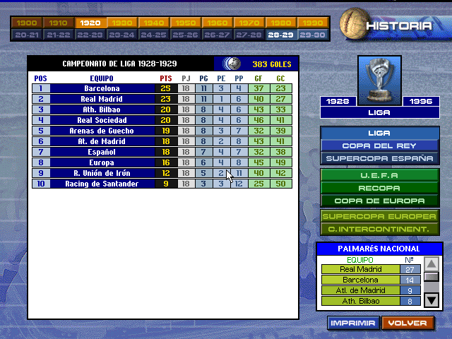
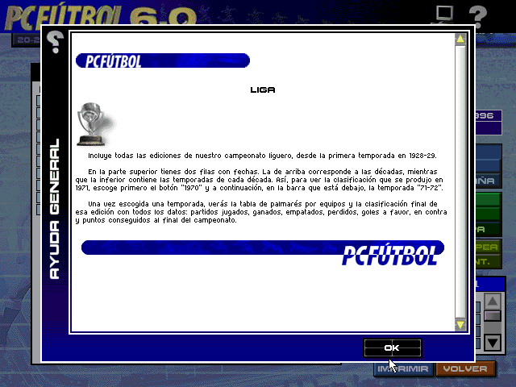

# PC Fútbol 6.0 — Historia: el palmarés completo desde 1928-29

`[jugado]` 2026-08-21. Se llega aquí pulsando la loseta **HISTORIA** del
menú principal — un visor de datos históricos reales, de solo lectura, no
un modo de juego.



## Doble fila de fechas: década, luego temporada

```
┌──────────────────────────────────────────────────────────────────┐
│ [1900][1910][1920][1930][1940][1950][1960][1970][1980][1990] 🏈  │
│ [20-21][21-22][22-23][23-24][24-25][25-26][26-27][27-28*][28-29][29-30]│
├──────────────────────────────────────────────────────────────────┤
│ CAMPEONATO DE LIGA 1928-1929              🌐 383 GOLES            │
│ POS EQUIPO           PTS PJ PG PE PP GF GC │  [trofeo]             │
│  1  Barcelona         25 18 11 3 4  37 23 │  1928  1996            │
│  2  Real Madrid       23 18 11 1 6  40 27 │    LIGA                │
│  3  Ath. Bilbao       20 18 10 0 8  43 33 │                        │
│  4  Real Sociedad     20 18 10 0 8  46 41 │  LIGA                  │
│  5  Arenas de Guecho  19 18  8 3 7  32 39 │  COPA DEL REY          │
│  6  At. de Madrid     18 18  8 2 8  43 41 │  SUPERCOPA ESPAÑA      │
│  7  Español           18 18  7 4 7  32 38 │  U.E.F.A               │
│  8  Europa            16 18  6 4 8  45 49 │  RECOPA                │
│  9  R. Unión de Irún  12 18  5 2 11 40 42 │  COPA DE EUROPA        │
│ 10  Racing de Santander 9 18 3 3 12 25 50 │  SUPERCOPA EUROPEA     │
│                                            │  C.INTERCONTINENT.    │
│                                 PALMARÉS NACIONAL                  │
│                                 EQUIPO           Nº                │
│                                 Real Madrid       27                │
│                                 Barcelona         14                │
│                                 Atl. de Madrid     9                │
│                                 Ath. Bilbao        8                │
│                        [IMPRIMIR]              [VOLVER]           │
└──────────────────────────────────────────────────────────────────┘
```

- **Dos filas de pestañas de fecha, jerárquicas**: la de arriba son
  **décadas** (1900...1990); la de abajo son las **temporadas de esa
  década** (p. ej., dentro de "1920": 20-21, 21-22... 29-30). Elegir una
  década recarga la fila de abajo con sus diez temporadas; elegir una
  temporada recarga toda la tabla. **1928-29 es la primera edición real
  del campeonato de Liga español** — el juego modela el campeonato desde
  su origen histórico real, no desde una fecha arbitraria.
- **Misma tabla de clasificación que en Liga Manager**
  ([`09-clasificacion.md`](09-clasificacion.md)), pero aquí es un **dato
  histórico cerrado** (la liga 1928-29 ya jugada por completo, no una en
  curso) — mismas columnas POS/EQUIPO/PTS/PJ/PG/PE/PP/GF/GC, y un total de
  goles de la edición completa ("383 GOLES") que Clasificación no muestra.
- **Selector de competición a la derecha** (LIGA, COPA DEL REY, SUPERCOPA
  ESPAÑA en azul; UEFA, RECOPA, COPA DE EUROPA en verde; SUPERCOPA EUROPEA,
  C.INTERCONTINENTAL en un tono atenuado) — las competiciones sin datos
  para esa temporada concreta aparecen atenuadas/deshabilitadas (en
  1928-29 España no competía aún en UEFA ni en Europa) en vez de
  ocultarse: **la ausencia de datos se comunica como "deshabilitado", no
  como "no existe el botón"**.
- **Trofeo con rango de años ("1928 — 1996")**: el icono de trofeo muestra
  el primer y el último año para el que hay datos de esa competición — un
  indicador de cobertura temporal de los propios datos, útil como
  metadato honesto ("hasta aquí llega nuestra base de datos").
- **PALMARÉS NACIONAL**: tabla lateral de "campeón histórico" (número total
  de títulos por equipo, con datos reales: Real Madrid 27, Barcelona 14,
  Atlético de Madrid 9, Athletic Bilbao 8 — cifras reales de la Liga hasta
  esa fecha de corte del disco) — un resumen agregado, no solo la
  clasificación de la temporada elegida.
- **IMPRIMIR** como acción real junto a VOLVER — la única pantalla del
  juego vista hasta ahora con una acción de impresión explícita.

## El icono "?" flotante: ayuda contextual con su propio visor

Encima de la rejilla de décadas hay una barra de chrome que solo aparece al
pasar el ratón cerca del borde superior (mismo patrón ya documentado en
[`general.md`](general.md)), con un icono de monitor y un icono "**?**".
Pulsarlo abre el mismo **visor de ayuda de chrome propio** ya descrito en
[`01-submenu-y-ayuda.md`](01-submenu-y-ayuda.md) §"El visor de ayuda"
— aquí confirmado con una imagen real:



Explica textualmente, con sus propias palabras, la mecánica de
década→temporada descrita arriba — confirma que la doble fila de fechas es
la mecánica pretendida, no una lectura errónea de la captura.

## Anomalía: un tercer diálogo OK que no responde a ningún clic

**El botón OK de este panel de ayuda no cerró el panel** con el cursor
confirmado exactamente encima (clic simple, reintento, tampoco Escape por
scancode `01`/`81`) — mismo síntoma exacto que el VOLVER de Clasificación
y el OK del recap de Supercopa en Liga Manager (ver
[`09-clasificacion.md`](09-clasificacion.md) y
[`07-despacho.md`](07-despacho.md)). **Esta es la tercera instancia
confirmada**, y la primera en una pantalla fuera de Liga Manager —
descarta que la causa sea específica de ese modo. Notablemente, este panel
de ayuda es el **mismo componente de "visor con chrome propio"** descrito
en `01-submenu-y-ayuda.md` (barra de iconos arriba, cuerpo de documento,
scroll a la derecha) — mientras que el diálogo de clave de acceso de
Promanager que **sí funcionó** (`10-liga-promanager-ofertas.md`) es una
caja modal simple sin ese chrome. Hipótesis reforzada: el visor de
ayuda/documentos podría ser un control o ventana separada (un lector de
documentos embebido, quizás con su propio bucle de mensajes) cuyo botón OK
no recibe el evento de clic inyectado por `IMouse.PutMouseEvent`, mientras
que las cajas de diálogo simples del propio motor del juego sí lo reciben.
Se escapó de este punto con `vm:poweroff` + `vm:start`, como en los casos
anteriores.

## Qué exige

**Un visor de datos históricos navegable por década→temporada es una
pieza de contenido totalmente aparte de la simulación de carrera** —
candidato a una pantalla "Hemeroteca"/"Historia" en PC Dynasty, de solo
lectura, con la misma tabla de clasificación reutilizada y un selector de
competición que se atenúa (no se oculta) cuando no hay datos para el
periodo elegido. El patrón "trofeo con rango de años de cobertura" es una
buena referencia de cómo comunicar honestamente los límites de una base de
datos histórica simulada.

## Pendiente

- Probar las demás competiciones (COPA DEL REY, UEFA...) y décadas más
  recientes (1990) para ver si el patríón de columnas cambia.
- IMPRIMIR no probado (riesgo de acoplarse a una impresora real de Windows
  configurada en la VM — no se ha intentado).
- Determinar si el visor de ayuda puede cerrarse por algún método aún no
  probado (clic fuera del panel, doble clic en el icono "?" que lo abrió)
  antes de aceptar la anomalía como un límite duro del entorno.
