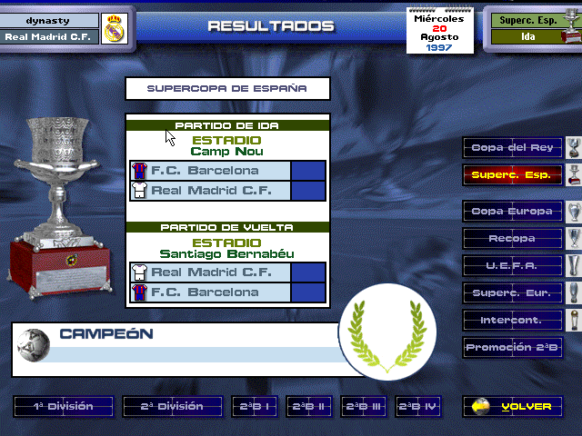
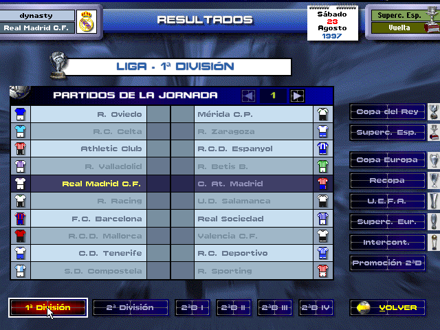

# PC Fútbol 6.0 — RESULTADOS: resultados por competición

`[jugado]` 2026-08-21. Se llega desde el despacho pulsando **RESULTADOS**
(fila superior izquierda, ver [`07-despacho.md`](07-despacho.md)). Confirmado
navegable en esta sesión (no listado como "pendiente" en pasadas previas: es
la primera vez que se documenta con contenido real de partida).

## Qué se ve

- **Dos filas de pestañas de competición**: `COPA DEL REY`, `SUPERC. ESP.`,
  `COPA EUROPA`, `RECOPA`, `U.E.F.A.`, `SUPERC. EUR.`, `INTERCONT.`,
  `PROMOCIÓN 2ªB` — todas las competiciones en las que el club puede
  participar en la temporada, no solo la Liga.
- **Debajo, las divisiones de liga regular**: `1ª DIVISIÓN`, `2ª DIVISIÓN`,
  `2ªB I`-`2ªB IV` — mismo componente de pestañas que en
  [`09-clasificacion.md`](09-clasificacion.md), reutilizado aquí para
  resultados en vez de clasificación.
- **Cuerpo**: resultado de la eliminatoria/jornada actual para la
  competición seleccionada (en la captura: Supercopa de España, ida
  F.C. Barcelona 0 - 0 Real Madrid C.F., recién disputada en modo
  RESULTADO — ver [`general.md`](general.md) sobre el flujo SEGUIR).
- **VOLVER** (abajo a la derecha) — confirmado navegable, sin anomalía:
  vuelve limpiamente al despacho.

## Qué exige

RESULTADOS es la vista de "qué ha pasado", complementaria a CALENDARIO
("qué va a pasar") y CLASIFICACIÓN ("cómo va la tabla") — las tres
comparten el mismo par de filas de pestañas (competición arriba, división
de liga abajo) como navegación consistente entre ellas. PC Dynasty debería
tratar estas tres vistas como una sola familia de pantallas con el mismo
selector de competición, no tres pantallas independientes.

## Competiciones sin empezar: aviso explícito, no pantalla vacía

Sesión 2 (2026-08-21): se probó la pestaña `COPA DEL REY`. En vez de una
tabla vacía o un error, el juego muestra un diálogo explícito: **"Copa del
Rey — Esta competición no ha comenzado"**, con botón `Aceptar` (confirmado
sin anomalía). Es de esperar el mismo comportamiento en las demás
competiciones que todavía no arrancan esta temporada (`COPA EUROPA`,
`RECOPA`, `U.E.F.A.`, `SUPERC. EUR.`, `INTERCONT.`, `PROMOCIÓN 2ªB`), pero
solo se confirmó con Copa del Rey.

## 1ª División: jornada completa con navegación y fila propia resaltada

- Título **"LIGA · 1ª DIVISIÓN"**, cabecera **"PARTIDOS DE LA JORNADA"**
  con selector de jornada `◄ 1 ►` (navegación jornada a jornada, no solo la
  actual).
- Lista completa de los 10 partidos de la jornada (escudo + nombre de cada
  equipo, local/visitante), **sin marcador visible** porque la jornada 1
  aún no se ha disputado — a diferencia de la Supercopa (eliminatoria ya
  jugada, con marcador 0-0).
- **La fila del propio equipo (`Real Madrid C.F. vs. C. At. Madrid`) se
  resalta con un color de fondo distinto** al resto de filas — confirma
  que esta vista distingue visualmente "tu próximo partido" del resto de
  la jornada, sin necesidad de buscarlo.

## Pendiente

- No se ha confirmado que las demás competiciones sin empezar (`COPA
  EUROPA`, `RECOPA`, `U.E.F.A.`, `SUPERC. EUR.`, `INTERCONT.`, `PROMOCIÓN
  2ªB`) muestren el mismo aviso — solo se probó con `COPA DEL REY`.
- No se ha visto el formato de una jornada de Liga **ya jugada** con
  marcadores reales (solo se vio la jornada 1 sin empezar) — repetir tras
  avanzar varias semanas con SEGUIR.
- `2ª DIVISIÓN` y `2ªB I`-`2ªB IV` no se han pulsado.
