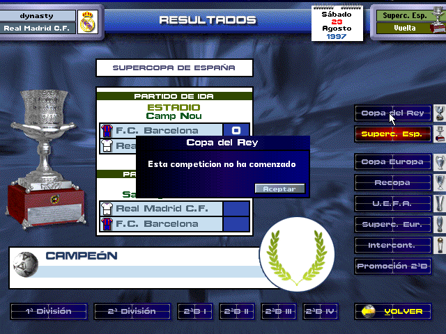
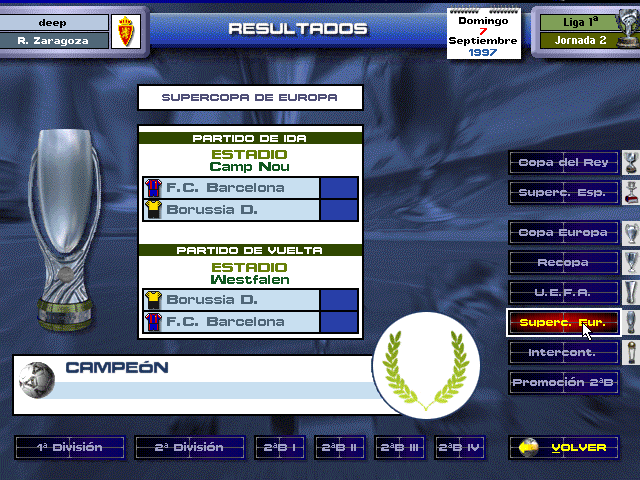

# PC Fútbol 6.0 — RESULTADOS: resultados por competición

`[jugado]` 2026-08-21. Se llega desde el despacho pulsando **RESULTADOS**
(fila superior izquierda, ver [`07-despacho.md`](07-despacho.md)). Confirmado
navegable en esta sesión (no listado como "pendiente" en pasadas previas: es
la primera vez que se documenta con contenido real de partida).

## Qué se ve

- **Dos filas de pestañas de competición**: `COPA DEL REY`, `SUPERC. ESP.`,
  `COPA EUROPA`, `RECOPA`, `U.E.F.A.`, `SUPERC. EUR.`, `INTERCONT.`,
  `PROMOCIÓN 2ªB` — todas las competiciones en las que el club puede
  participar en la temporada, no solo la Liga.
- **Debajo, las divisiones de liga regular**: `1ª DIVISIÓN`, `2ª DIVISIÓN`,
  `2ªB I`-`2ªB IV` — mismo componente de pestañas que en
  [`09-clasificacion.md`](09-clasificacion.md), reutilizado aquí para
  resultados en vez de clasificación.
- **Cuerpo**: resultado de la eliminatoria/jornada actual para la
  competición seleccionada (en la captura: Supercopa de España, ida
  F.C. Barcelona 0 - 0 Real Madrid C.F., recién disputada en modo
  RESULTADO — ver [`general.md`](general.md) sobre el flujo SEGUIR).
- **VOLVER** (abajo a la derecha) — confirmado navegable, sin anomalía:
  vuelve limpiamente al despacho.

## Qué exige

RESULTADOS es la vista de "qué ha pasado", complementaria a CALENDARIO
("qué va a pasar") y CLASIFICACIÓN ("cómo va la tabla") — las tres
comparten el mismo par de filas de pestañas (competición arriba, división
de liga abajo) como navegación consistente entre ellas. PC Dynasty debería
tratar estas tres vistas como una sola familia de pantallas con el mismo
selector de competición, no tres pantallas independientes.

## Competiciones sin empezar: aviso explícito, no pantalla vacía

Sesión 2 (2026-08-21): se probó la pestaña `COPA DEL REY`. En vez de una
tabla vacía o un error, el juego muestra un diálogo explícito: **"Copa del
Rey — Esta competición no ha comenzado"**, con botón `Aceptar` (confirmado
sin anomalía). Es de esperar el mismo comportamiento en las demás
competiciones que todavía no arrancan esta temporada (`COPA EUROPA`,
`RECOPA`, `U.E.F.A.`, `SUPERC. EUR.`, `INTERCONT.`, `PROMOCIÓN 2ªB`), pero
solo se confirmó con Copa del Rey.

## 1ª División: jornada completa con navegación y fila propia resaltada

- Título **"LIGA · 1ª DIVISIÓN"**, cabecera **"PARTIDOS DE LA JORNADA"**
  con selector de jornada `◄ 1 ►` (navegación jornada a jornada, no solo la
  actual).
- Lista completa de los 10 partidos de la jornada (escudo + nombre de cada
  equipo, local/visitante), **sin marcador visible** porque la jornada 1
  aún no se ha disputado — a diferencia de la Supercopa (eliminatoria ya
  jugada, con marcador 0-0).
- **La fila del propio equipo (`Real Madrid C.F. vs. C. At. Madrid`) se
  resalta con un color de fondo distinto** al resto de filas — confirma
  que esta vista distingue visualmente "tu próximo partido" del resto de
  la jornada, sin necesidad de buscarlo.

## Jornada ya jugada: marcadores reales y filas atenuadas (sesión 4, 2026-08-21)

Con varias jornadas ya disputadas (mediados de temporada, Jornada 2 en
curso), `1ª DIVISIÓN` muestra la Jornada 1 con marcador real por partido
(p. ej. `R.C. Celta 0 - 4 R. Zaragoza`) en vez de los pares de equipos sin
resultado vistos en la sesión 2. **Las filas se atenúan (gris/tenue)
salvo la del propio club**, que se mantiene con color pleno — mismo patrón
de "destacar mi partido" que ya se documentó para la jornada sin jugar,
aplicado ahora también a resultados ya conocidos.

## Supercopa de España: formato de eliminatoria ida/vuelta con tabla IDA/VUELTA/GLOBAL (sesión 4)

La pestaña `SUPERC. ESP.` (una vez disputada la eliminatoria completa)
muestra un formato distinto al de una jornada de liga: dos partidos
(`PARTIDO DE IDA` en el Camp Nou, F.C. Barcelona 1 - 0 Real Madrid C.F.;
`PARTIDO DE VUELTA` en el Santiago Bernabéu, Real Madrid C.F. 2 - 1
F.C. Barcelona), agregado 2-2, y un anuncio explícito **`CAMPEÓN: F.C.
Barcelona`** (el criterio de desempate — goles en campo contrario,
presumiblemente — no se muestra en pantalla). Confirma que las
competiciones de eliminatoria a doble partido tienen su propia plantilla
de resultado, distinta de la tabla de jornada de liga.

## Copa del Rey: formato de tabla por ronda con columnas IDA/VUELTA/GLOBAL (sesión 4)

La pestaña `COPA DEL REY`, una vez la competición arranca, no repite el
diálogo de "no comenzada": muestra una tabla `RONDA 1` con selector de
ronda (`◄ RONDA 1 ►`) y **tres columnas de marcador por partido** (`IDA`,
`VUELTA`, `GLOBAL`) para toda la eliminatoria de esa ronda a la vez (no
solo el propio club) — a mitad de ronda solo la columna `IDA` tenía datos,
`VUELTA`/`GLOBAL` vacías. Es una tercera plantilla distinta de resultado
(ni tabla de jornada de liga, ni pantalla de trofeo de partido único),
para competiciones de eliminatoria con múltiples eliminatorias
simultáneas por ronda.

## Supercopa de Europa y Copa Intercontinental: plantilla de "partido único con trofeo" (sesión 4)

Estas dos competiciones (cuando ya tienen clubes asignados pero el
partido/eliminatoria todavía no se ha disputado) usan una **tercera
plantilla visual distinta**, con un trofeo 3D grande a la izquierda y
recuadros de marcador en blanco:

- **`SUPERC. EUR.`** (Supercopa de Europa): formato ida/vuelta como la
  Supercopa de España (`PARTIDO DE IDA` en el Camp Nou, `PARTIDO DE
  VUELTA` en el Westfalen), enfrentando F.C. Barcelona (campeón de C. de
  Europa, pendiente de acabar Ronda 1 — ver arriba) vs. Borussia D.
  (presumible campeón de Recopa/otra competición europea de la temporada
  anterior). Marcadores en blanco, fila `CAMPEÓN` vacía — el partido aún
  no se ha jugado.
- **`INTERCONT.`** (Copa Intercontinental): partido único (no ida/vuelta),
  con **escudo de club + bandera de país** para cada finalista (Borussia
  D. con bandera de Alemania, Cruzeiro con bandera de Brasil) y estadio
  real con nombre propio (**"Nacional de Tokio"** — el escenario histórico
  real de la Copa Intercontinental/Toyota Cup). Mismo patrón de marcador
  en blanco + `CAMPEÓN` vacío hasta que se dispute.

Confirma que el motor ya tiene resueltos los finalistas de competiciones
europeas/intercontinentales antes de que se jueguen sus partidos (deben
derivarse de resultados de competiciones de la temporada anterior o en
curso en otras ligas simuladas), y que el juego diferencia visualmente
"partido de gala único" (con trofeo, banderas, estadio neutral) de una
eliminatoria de liga/copa doméstica.

## Recopa, U.E.F.A. y Promoción 2ªB: aviso "no ha comenzado" confirmado también aquí (sesión 4)

Se confirma que el diálogo **"Esta competición no ha comenzado"** (visto
antes solo con Copa del Rey en sesión 2) también aparece en `RECOPA`
("Recopa de Europa — Esta competición no ha comenzado"), `U.E.F.A.`
("Copa de la U.E.F.A. — Esta competición no ha comenzado") y `PROMOCIÓN
2ªB` ("2ª División B - Liguilla de Promoción — La liguilla de promoción a
2ª no ha comenzado", texto ligeramente distinto/más específico que las
demás). `Aceptar` respondió al clic en los tres casos; también se confirmó
que **Enter cierra el mismo diálogo** (scancode `1c`/`9c`), no solo el
clic — método más rápido para descartar estos avisos en cadena.

## 2ª División y 2ªB I: mismo formato de jornada que 1ª División (sesión 4)

`2ª DIVISIÓN` (título `LIGA · 2ª DIVISIÓN`) y `2ªB I` (título `LIGA · 2ª
DIVISIÓN B`) muestran exactamente el mismo componente de "PARTIDOS DE LA
JORNADA" con selector `◄ 1 ►` y marcadores reales de la Jornada 1 ya
jugada — confirma que es una única plantilla de jornada reutilizada para
las cinco ligas del juego (1ª, 2ª, 2ªB I-IV), no una por división. En
`2ªB I` los **filiales de Primera aparecen como equipos propios** (`Real
Madrid B`, `Sporting B`, `Deportivo B`) — la reserva de un club de
Primera compite en su propia liga independiente, no es solo un dato de
plantilla.

## Pendiente

- `2ªB II`, `2ªB III` y `2ªB IV` no se han pulsado individualmente — por
  el patrón confirmado en `2ª DIVISIÓN`/`2ªB I` es razonable esperar el
  mismo formato de jornada, pero no está confirmado letra por letra.
- No se ha visto qué CAMPEÓN concreto queda anunciado en `SUPERC. EUR.`/
  `INTERCONT.` una vez jugado el partido (solo se vio el estado
  "pendiente, marcador en blanco").
- No se ha determinado el criterio de desempate exacto de la Supercopa de
  España (agregado 2-2 resuelto a favor de F.C. Barcelona — probablemente
  gol en campo contrario, no confirmado en pantalla).
