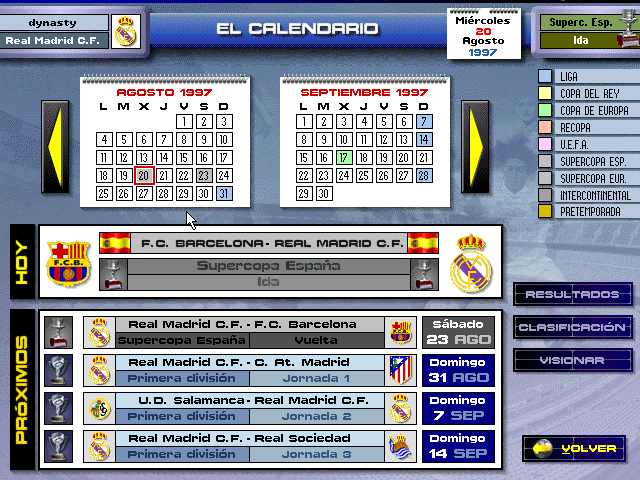

# PC Fútbol 6.0 — CALENDARIO: mes navegable + próximos partidos

`[jugado]` 2026-08-21. Se llega desde el despacho pulsando **CALENDARIO**
(fila superior izquierda, bajo RESULTADOS/CLASIFICACIÓN — ver
[`07-despacho.md`](07-despacho.md)). Confirmado navegable, sin anomalía.

## Qué se ve

- **Calendario mensual** (izquierda): cuadrícula de mes con marcadores de
  color por día — un código de color por competición, coherente con la
  leyenda que aparece en la franja superior del hub (mismo lenguaje visual
  que el resto del juego).
- **Columna central "HOY" + "PRÓXIMOS"**: tarjetas apiladas, una por
  partido, con fecha y rival — el partido de hoy resaltado, seguido de los
  próximos en orden cronológico. No es solo un calendario visual: es
  también una lista de agenda.
- **Botonera inferior**: `RESULTADOS`, `CLASIFICACIÓN`, `VISIONAR`,
  `VOLVER` — RESULTADOS y CLASIFICACIÓN saltan directamente a esas otras
  vistas (atajo cruzado entre las tres pantallas hermanas, ver
  [`13-resultados.md`](13-resultados.md)); VOLVER confirmado navegable sin
  anomalía.

## Qué exige

El patrón "agenda de próximos eventos + accesos directos a vistas
relacionadas" es más rico que un simple calendario de casillas — PC
Dynasty debería modelar el calendario como una cola de eventos navegable,
no solo una cuadrícula de fechas, con saltos directos a resultados y
clasificación desde el mismo sitio donde se consulta cuándo es el próximo
partido.

## Navegación de mes: las flechas amarillas no respondieron a ningún método probado (sesión 7, 2026-08-22)

`[jugado]` 2026-08-22. `EL CALENDARIO` muestra dos meses simultáneos
(el mes actual y el siguiente, p. ej. `SEPTIEMBRE 1997`/`OCTUBRE 1997`
en Jornada 4), cada uno flanqueado por una flecha amarilla grande
(izquierda del mes visible a la izquierda, derecha del mes visible a la
derecha) con apariencia clara de control de paginación.

Se probaron **tres métodos distintos** sobre la flecha derecha, todos
sin efecto — el calendario se quedó mostrando los mismos dos meses en
las tres capturas:

1. Clic simple con `--reset` sobre el centro calculado de la flecha.
2. Clic sostenido (`--hold-ms 300`) sobre el mismo punto, por si el
   control necesitara una pulsación mantenida en vez de un clic seco.
3. Tecla de flecha derecha del teclado (`4d`/`cd`), por si la
   navegación de mes tuviera un atajo de teclado en vez de (o adicional
   a) el clic de ratón.

**No se puede confirmar con certeza si las flechas son decorativas**
(el calendario solo mostraría siempre "mes actual + mes siguiente",
ligado a la fecha de partida, sin paginación real) **o si es otro caso
de calibración de coordenadas** (la flecha es un triángulo grande y
visualmente inequívoco, lo que hace menos probable un simple desajuste
de píxeles, pero no lo descarta del todo). Se deja documentado como
intento agotado con los métodos disponibles, no como conclusión
definitiva.

## Pendiente

- **VISIONAR no probado deliberadamente** — por el nombre, es candidato a
  disparar una previsualización/visionado del próximo partido, lo cual
  entra en conflicto con la instrucción explícita de esta sesión de nunca
  usar el modo "ver partido" (solo simulación por resultado). Queda
  pendiente de una sesión futura que confirme qué hace sin comprometer esa
  regla — puede que solo muestre una alineación probable sin simular nada,
  en cuyo caso sería seguro probarlo.
- Las flechas de navegación de mes (izquierda/derecha de cada
  calendario mensual) no respondieron a clic simple, clic sostenido, ni
  a la tecla de flecha derecha del teclado — no confirmado si son
  decorativas o si sigue siendo un problema de calibración fino sin
  resolver.
