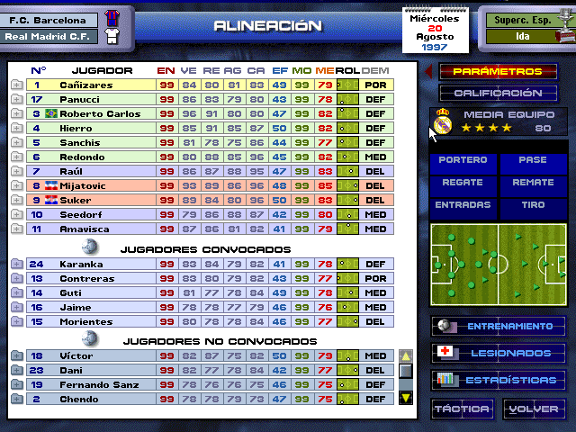
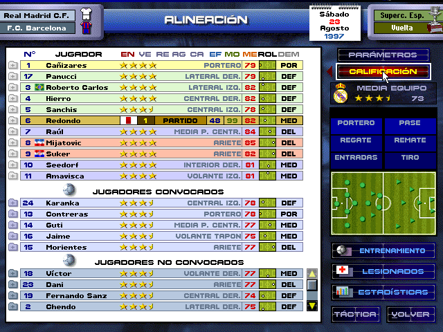
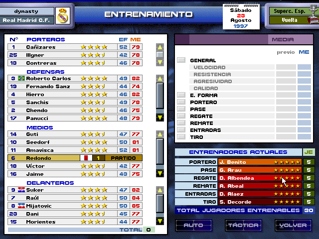
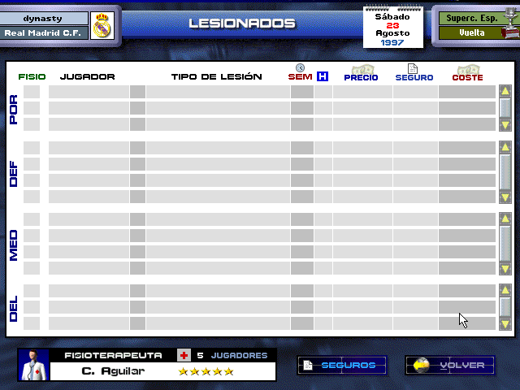
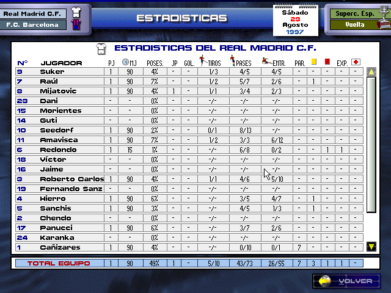
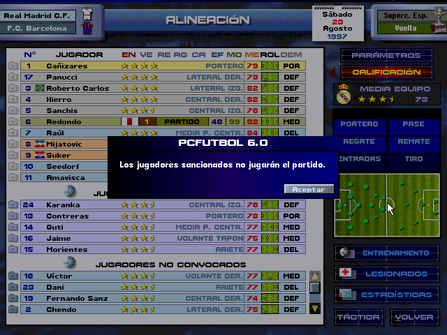

# PC Fútbol 6.0 — ALINEACIÓN: hub de plantilla, con seis sub-pantallas propias

`[jugado]` 2026-08-21. Se llega desde el despacho pulsando **ALINEACIÓN**
(fila superior derecha — ver [`07-despacho.md`](07-despacho.md)). No es una
pantalla simple: es un segundo hub, con su propia fila de sub-botones que
llevan a seis pantallas distintas.

## La lista de jugadores y sus dos modos de columna

- **Titulares** (arriba) / **Convocados** / **No convocados** (grupos con
  separador), cada jugador con dorsal, nombre y posición.
- **Alternar `PARÁMETROS` ↔ `CALIFICACIÓN`** (botones arriba a la derecha)
  cambia qué muestran las columnas de la misma tabla, sin cambiar de
  pantalla:
  - **PARÁMETROS**: valores numéricos crudos por atributo — `EN VE RE AG CA
    EF MO ME` (energía, velocidad, resistencia, agresividad, calidad,
    efectividad, moral, media) + `ROL` (icono) + `DEM` (demarcación/rol
    detallado).
  - **CALIFICACIÓN**: los mismos atributos como estrellas (1-5), y la
    columna de posición pasa de una demarcación genérica a un **rol táctico
    con nombre concreto por jugador** (`LATERAL DER.`, `CENTRAL IZQ.`,
    `MEDIA P. CENTR.`, `ARIETE`, `VOLANTE TAPÓN`...) — confirma que el motor
    asigna un rol específico por jugador dentro de su demarcación general,
    no solo POR/DEF/MED/DEL.

  

- **Jugadores sancionados se marcan en la propia fila**: Redondo aparece
  con una tarjeta roja + "1" (partidos de sanción) y la palabra `PARTIDO`
  en la columna donde otros tienen la posición — visualmente distinto de
  una lesión (ver `LESIONADOS` más abajo, tabla separada).

## Los seis tiles PORTERO/PASE/REGATE/REMATE/ENTRADAS/TIRO no son botones aquí

Aparecen como una rejilla 2×3 bajo `MEDIA EQUIPO` (estrellas + número). En
esta pantalla **no respondieron a clic** (sin cambio visible tras varios
intentos) — son un resumen visual de las seis categorías de habilidad del
equipo. La misma rejilla de seis nombres **sí es interactiva** dentro de
`ENTRENAMIENTO` (ver abajo), como checkboxes de foco de entrenamiento — son
la misma taxonomía reutilizada en dos contextos distintos (aquí resumen,
allí control).

## Las cinco sub-pantallas propias

Fila derecha, bajo la rejilla de tiles y el minicampo con posiciones:
`ENTRENAMIENTO`, `LESIONADOS`, `ESTADÍSTICAS`; fila inferior: `TÁCTICA`
(no confundir con `TÁCTICAS` del despacho, ver
[`16-tacticas.md`](16-tacticas.md) — aquí es un botón de acceso rápido a la
misma pantalla), `VOLVER`.

### ENTRENAMIENTO

- **Tabla de plantilla agrupada por demarcación** (PORTEROS/DEFENSAS/
  MEDIOS/DELANTEROS) con columna `EF` (efectividad actual) y `ME` (media).
- **Panel de foco de entrenamiento** (derecha): checkboxes por categoría
  — `GENERAL`, `VELOCIDAD`, `RESISTENCIA`, `AGRESIVIDAD`, `CALIDAD`,
  `E. FORMA`, y las seis de habilidad (`PORTERO`/`PASE`/`REGATE`/`REMATE`/
  `ENTRADAS`/`TIRO`) — cada una con barra `previo`/`ME`, sin marcar todavía
  en esta sesión.
- **Tabla "ENTRENADORES ACTUALES"**: un entrenador especializado por
  categoría de habilidad (`PORTERO`: J. Benito, `PASE`: G. Arau, `REGATE`:
  D. Albendea...) con estrellas — el cuerpo técnico está desglosado por
  especialidad, no es un único "entrenador" genérico.
- **`TOTAL JUGADORES ENTRENABLES: 90`** — un cupo global de entrenamiento
  compartido por toda la plantilla (incluye filiales/no convocados).
- Botones `AUTO`, `TÁCTICA` (acceso cruzado, igual que arriba), `VOLVER`
  (navegable sin anomalía).

### LESIONADOS

- Tabla de lesiones agrupada por demarcación (POR/DEF/MED/DEL), columnas
  `FISIO` (icono), `JUGADOR`, `TIPO DE LESIÓN`, `SEM` (semanas), `PRECIO`,
  `SEGURO`, `COSTE` — vacía en esta sesión (plantilla sin lesionados al
  inicio de temporada).
- **Fisioterapeuta con nombre y rating** (C. Aguilar, 5 estrellas,
  "5 JUGADORES" de capacidad) — mismo patrón de "personal especializado
  con nombre propio" que ENTRENAMIENTO.
- Botones `SEGUROS` (no probado) y `VOLVER` (navegable).

### ESTADÍSTICAS

- Tabla por jugador con estadísticas reales del partido ya disputado:
  `PJ`/`MJ` (partidos/minutos jugados), `POSES.` (% posesión individual),
  `JP` (jugadas peligrosas o similar), `GOL`, `TIROS`, `PASES`, `ENTR.`
  (entradas), `PAR.` (paradas — solo portero), tarjetas amarilla/roja,
  `EXP.` (expulsiones).
- **Fila `TOTAL EQUIPO`** con las sumas/porcentaje agregado.
- Confirma que el motor lleva estadística individual real por partido
  desde el primer encuentro, no solo un resultado global.

### El aviso de sancionados: aparece al pulsar VOLVER, no al entrar

Con Redondo (sancionado) todavía en el once titular, pulsar `VOLVER` desde
`ALINEACIÓN` (no `ESTADÍSTICAS` — comprobado que el disparador es VOLVER)
abre un diálogo modal `PCFUTBOL 6.0` con el aviso *"Los jugadores
sancionados no jugarán el partido"* y un único botón `Aceptar`. **Este
`Aceptar` sí respondió al clic** (sin anomalía) — tras aceptarlo, la
navegación de VOLVER se completa con normalidad. Es un aviso, no un bloqueo:
el juego deja salir de la pantalla igualmente, solo advierte de que el
sancionado no será alineado aunque siga en la lista de titulares.

## Qué exige

`ALINEACIÓN` es el segundo hub más grande del juego tras el despacho, con
cinco sub-pantallas propias — PC Dynasty debería tratarlo como una escena
con su propia navegación interna (plantilla, entrenamiento, enfermería,
estadísticas, táctica), no como una sola vista de "elige el once". El
patrón PARÁMETROS/CALIFICACIÓN como dos lentes sobre la misma tabla (número
crudo vs. estrellas + rol con nombre) es directamente reutilizable: mostrar
ambos registros (para el jugador nuevo y para el veterano) sin duplicar la
tabla.

## El aviso de sancionados también dispara al pulsar TÁCTICA (sesión 2)

Sesión 2 (2026-08-21): además de VOLVER, se confirmó que **navegar desde
aquí a `TÁCTICA` con Redondo (sancionado) en el once también dispara el
mismo aviso** "Los jugadores sancionados no jugarán el partido" — no es
exclusivo de VOLVER como se pensaba en la primera pasada, sino que aparece
en cualquier salida de ALINEACIÓN mientras haya un sancionado alineado.
`Aceptar` respondió con normalidad. Ver también
[`16-tacticas.md`](16-tacticas.md).

## Pendiente

- Colocar/quitar jugadores del once titular arrastrando o clicando el
  minicampo — no probado en esta sesión (se exploró solo lectura).
- `SEGUROS` en LESIONADOS no probado.
- `AUTO` en ENTRENAMIENTO no probado (¿autoconfigura el foco de
  entrenamiento?).
- Confirmar si `TÁCTICA` desde aquí lleva exactamente a la misma pantalla
  que `TÁCTICAS` desde el despacho o si hay diferencias de contexto (lo
  probado hasta ahora sugiere que sí es la misma pantalla).
