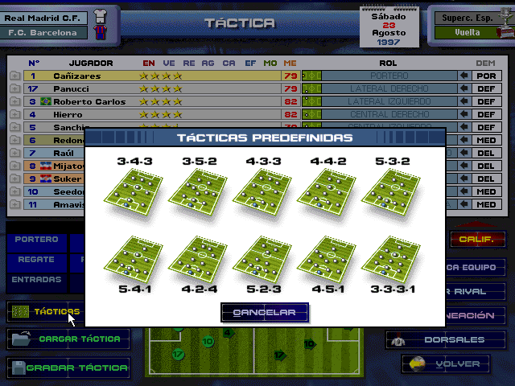
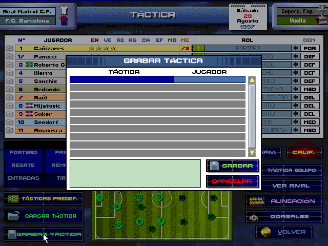
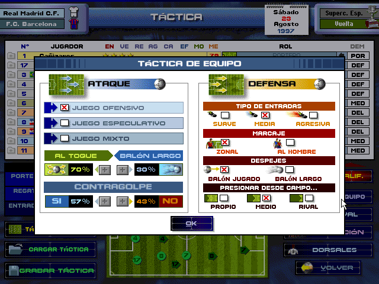
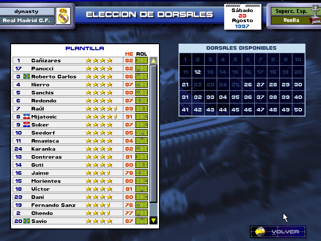

# PC Fútbol 6.0 — TÁCTICAS: editor de formación y roles

`[jugado]` 2026-08-21. Se llega desde el despacho pulsando **TÁCTICAS**
(fila superior derecha, bajo ALINEACIÓN — ver
[`07-despacho.md`](07-despacho.md)), o desde el botón `TÁCTICA` dentro de
`ALINEACIÓN`/`ENTRENAMIENTO` (ver [`15-alineacion.md`](15-alineacion.md)).
Confirmado navegable, sin anomalía.

## Qué se ve

- **Editor de formación sobre campo**: jugadores representados como fichas
  posicionables, con la disposición táctica actual dibujada sobre un campo
  esquemático — mismo componente visual de minicampo que aparece en
  `ALINEACIÓN` y `VER RIVAL`.
- **Botonera**: `PARÁM`, `CALIF` (mismo alternador numérico/estrellas que
  en Alineación), `TÁCTICA EQUIPO`, `VER RIVAL` (acceso cruzado a
  [`17-ver-rival.md`](17-ver-rival.md)), `ALINEACIÓN` (acceso cruzado a
  [`15-alineacion.md`](15-alineacion.md)), `DORSALES`, **`TÁCTICAS
  PREDEF.`**, **`CARGAR TÁCTICA`**, **`GRABAR TÁCTICA`**, `VOLVER`
  (navegable, sin anomalía).
- Los tres botones en negrita indican que las tácticas son **entidades con
  nombre, guardables y reutilizables** entre partidas/jornadas — no un
  ajuste que se pierde cada vez, sino una biblioteca de esquemas propios
  además de plantillas predefinidas.

## Qué exige

El sistema de tácticas como objetos con nombre, guardables/cargables e
independientes de una plantilla concreta de predefinidas es el patrón a
replicar: la pantalla táctica de PC Dynasty debería permitir grabar un
esquema propio y aplicarlo más tarde, no solo elegir entre unas pocas
formaciones fijas del propio partido.

## Los cinco botones en negrita: todos explorados (2026-08-21, sesión 2)

### `TÁCTICAS PREDEF.` → selector de 10 formaciones

- Grid 5×2 de formaciones (`3-4-3`, `3-5-2`, `4-3-3`, `4-4-2`, `5-3-2`,
  `5-4-1`, `4-2-4`, `5-2-3`, `4-5-1`, `3-3-1-1`), cada una con su propio
  diagrama de campo en miniatura, más `CANCELAR`.
- **Confirmado que seleccionar una formación (`4-3-3` probado) cambia de
  verdad la disposición**: el campo principal se redibuja al momento y el
  título pasa a leer `TÁCTICA 4-3-3` — no es solo una preview, aplica en
  vivo. Cambia también qué `ROL` se lista por jugador en la tabla superior.
- **Clicar una fila de jugador** (no solo el campo) muestra su ficha de
  atributos individual (`PORTERO`/`PASE`/`REGATE`/`REMATE`/`ENTRADAS`/
  `TIRO`) en el panel donde antes estaba la botonera de la derecha —mismo
  patrón de tarjeta de jugador que en Alineación.

### `CARGAR TÁCTICA` y `GRABAR TÁCTICA` → gestores de esquemas guardados

- Ambos abren un diálogo casi idéntico: una lista de slots
  `TÁCTICA`/`JUGADOR` (vacía en esta partida — ninguna táctica guardada
  aún) más un botón de acción (`CARGAR` o `GRABAR`) y `CANCELAR`.
- **`CANCELAR` confirmado sin anomalía en ambos diálogos.**
- **`GRABAR` NO se ha pulsado** — dado que el diálogo de guardado de
  `GRABAR LIGA` en el despacho resultó ser la cuarta instancia conocida de
  la anomalía "botón que no responde" (ver
  [`07-despacho.md`](07-despacho.md)), se ha evitado deliberadamente
  arriesgar el mismo bloqueo aquí sin necesidad, ya que perder el estado
  avanzado de partida (Supercopa vuelta ya en curso) tendría coste alto.
  Queda pendiente para una sesión donde perder el estado no sea un problema.

### `TÁCTICA EQUIPO` → configuración de estilo de juego (ataque/defensa)

- Diálogo modal grande, dos columnas:
  - **`ATAQUE`**: radio `JUEGO OFENSIVO`/`JUEGO ESPECULATIVO`/`JUEGO
    MIXTO`; slider `AL TOQUE` vs `BALÓN LARGO` (visto en 70%/30%);
    `CONTRAGOLPE` `SÍ`/`NO` con reparto porcentual (57%/43%).
  - **`DEFENSA`**: `TIPO DE ENTRADAS` (suave/media/agresiva), `MARCAJE`
    (zonal/al hombre), `DESPEJES` (balón jugado/balón largo), `PRESIONAR
    DESDE CAMPO` propio/medio/rival — cada eje con su propio check, no un
    único selector de "estilo general".
  - Un solo botón `OK` al pie.
- **`OK` inicialmente pareció otra instancia de la anomalía de diálogo
  atascado** (tres intentos con distintos métodos de clic y con Enter no
  surtieron efecto) — pero se resolvió recalibrando: el hitbox real del
  botón estaba unos px por encima de donde lo situaba el cálculo
  geométrico ingenuo, igual que pasó con PLANTILLA/FICHAR. **No es una
  quinta instancia real del bug**, es otro caso de calibración, ya
  corregido.
- Este es el nivel de detalle táctico (mixto entradas/marcaje/despejes/
  presión por zona, no un único "estilo defensivo") que PC Dynasty debería
  igualar si modela estilo de equipo más allá de la formación.

### `DORSALES` → asignación de número de camiseta

- Título real: **"ELECCIÓN DE DORSALES"**. Lista de plantilla a la
  izquierda (número actual + nombre + rol), grid `DORSALES DISPONIBLES`
  1-50 a la derecha (algunos números aparecen en un tono distinto — muy
  probablemente los ya asignados a otro jugador, no confirmado con
  certeza).
- **Clicar un jugador de la lista confirmado funcional**: el título del
  grid cambia a `ELIGE DORSAL PARA <NOMBRE>` (probado con Savio). No se ha
  llegado a pulsar un número para completar la reasignación real, por no
  alterar el estado de la plantilla sin necesidad.
- `VOLVER` (navegable, sin anomalía) devuelve a `TÁCTICA`.

### Aviso de sancionado también dispara al pulsar `TÁCTICA` desde Alineación

Al volver de Dorsales/Táctica de Equipo hacia `TÁCTICA` a través del botón
cruzado `TÁCTICA` de Alineación, reapareció el aviso *"Los jugadores
sancionados no jugarán el partido"* (mismo diálogo que en
[`15-alineacion.md`](15-alineacion.md)) — antes solo se había visto
disparado por `VOLVER`; aquí se confirma que **también dispara al navegar
a `TÁCTICA`**, no solo al salir de Alineación. `Aceptar` respondió con
normalidad.

## Pendiente

- `GRABAR` de `GRABAR TÁCTICA` sigue sin probarse (ver arriba, riesgo de
  bloqueo deliberadamente evitado).
- No se ha completado una reasignación real de dorsal (seleccionar
  jugador → pulsar número → confirmar).
- Confirmar si arrastrar una ficha sobre el campo (drag) cambia la
  formación de forma más fina que elegir un preset completo, o si esa
  interacción no existe en esta pantalla.
