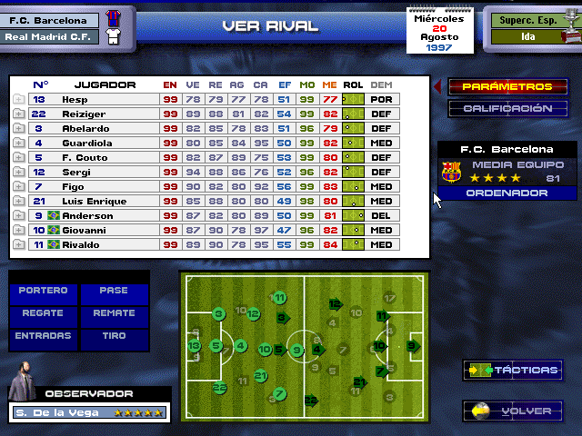

# PC Fútbol 6.0 — VER RIVAL: scouting del próximo contrincante

`[jugado]` 2026-08-21. Se llega desde el despacho pulsando **VER RIVAL**
(fila superior derecha, bajo TÁCTICAS — ver
[`07-despacho.md`](07-despacho.md)). Confirmado navegable, sin anomalía.

## Qué se ve

- **La plantilla completa del próximo rival** (en la sesión: F.C.
  Barcelona — Hesp, Reiziger, Abelardo, Guardiola, F. Couto, Sergi, Figo,
  Luis Enrique, Anderson, Giovanni, Rivaldo...), con la misma disposición
  de tabla que la propia alineación.
- **Nota de calidad de datos**: en esta partida todos los valores de
  atributo aparecían en 99 para prácticamente todos los jugadores rivales
  — muy probablemente un dato de build/test sin terminar de calibrar más
  que un diseño real (compárese con la variación sí presente en la
  plantilla propia del Real Madrid en `15-alineacion.md`), a tener en
  cuenta al usar esta partida como referencia de balance de valores.
- **`Observador` con nombre y rating** (S. De la Vega, estrellas) — la
  información de scouting está mediada por un ojeador con su propia
  fiabilidad, no un dato omnisciente del jugador.
- Botones: `PARÁMETROS`, `CALIFICACIÓN` (mismo alternador que en
  Alineación/Tácticas), `ORDENADOR`, `TÁCTICAS` (probablemente la táctica
  observada del rival), `VOLVER` (navegable, sin anomalía).

## Qué exige

El scouting mediado por un observador con nombre y fiabilidad (en vez de
mostrar los datos reales del rival sin más) es un patrón de diseño
transferible: la calidad de la información de scouting en PC Dynasty podría
depender de la calidad del ojeador asignado, no ser un espejo perfecto de
la ficha del rival.

## Pendiente

- `ORDENADOR` no probado — nombre ambiguo, podría ser "simular partido en
  el ordenador" (evitar si es una vía de "ver partido") o un ajuste de
  dificultad de la IA rival.
- `TÁCTICAS` (dentro de Ver Rival) no probado — confirmar si muestra una
  formación fija observada o un histórico de formaciones usadas por el
  rival.
- Repetir contra un rival con datos de atributo variados (no en 99 fijo)
  para confirmar que el 99 uniforme visto aquí es un artefacto de esta
  partida concreta y no el comportamiento normal de Ver Rival.
