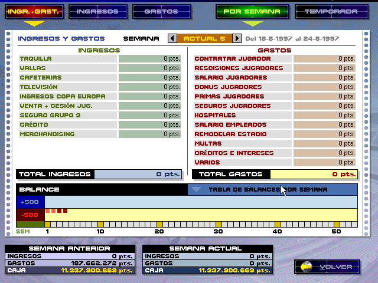

# PC Fútbol 6.0 — CAJA: finanzas del club por semana y temporada

`[jugado]` 2026-08-21. Se llega desde el despacho pulsando **CAJA** (fila
inferior derecha, bajo VER RIVAL — ver [`07-despacho.md`](07-despacho.md)).
Confirmado navegable, sin anomalía.

## Qué se ve

- **Cinco pestañas superiores**: `INGR.+GAST.` (vista combinada, activa por
  defecto), `INGRESOS`, `GASTOS`, `POR SEMANA`, `TEMPORADA` — no
  confirmadas todas navegables aún (ver Pendiente).
- **Selector de semana** (`◄ ACTUAL 5 ►`) con rango de fechas — la
  contabilidad del club está trazada semana a semana, no solo como un saldo
  agregado.
- **Columna INGRESOS**: `TAQUILLA`, `VALLAS`, `CAFETERÍAS`, `TELEVISIÓN`,
  `INGRESOS COPA EUROPA`, `VENTA + CESIÓN JUG.`, `SEGURO GRUPO 3`,
  `CRÉDITO`, `MERCHANDISING` — nueve fuentes de ingreso distintas.
- **Columna GASTOS**: `CONTRATAR JUGADOR`, `RESCISIONES JUGADORES`,
  `SALARIO JUGADORES`, `BONUS JUGADORES`, `PRIMAS JUGADORES`, `SEGUROS
  JUGADORES`, `HOSPITALES`, `SALARIO EMPLEADOS`, `REMODELAR ESTADIO`,
  `MULTAS`, `CRÉDITOS E INTERESES`, `VARIOS` — doce categorías, notablemente
  más granulares que los ingresos.
- **Gráfica "TABLA DE BALANCES POR SEMANA"**: barras +500/-500 por semana
  (1 a 50+), visualización de tendencia de caja a lo largo de toda la
  temporada, no solo el saldo puntual.
- **Resumen semana anterior/actual**: ingresos, gastos y caja total
  (`11.336.550.332 pts.` — un club grande arranca con una caja enorme,
  coherente con ser el Real Madrid).
- `VOLVER` (navegable, sin anomalía).

## La superposición ambiental se reproduce de forma consistente al pulsar las 4 pestañas alternativas

Sesión 2 (2026-08-21): se reintentó `INGRESOS` con coordenadas
recalibradas (varias variantes de `dy`, incluyendo puntos claramente
dentro del rectángulo visible de la pestaña) y **en todos los casos** el
resultado fue la misma barra ambiental `PCFUTBOL 6.0` (logo + iconos de
ayuda) cubriendo la fila de pestañas, nunca un cambio real a la vista
`INGRESOS`. Esto ya no parece un simple problema de calibración de esta
sesión concreta:

- **`Escape` no la cierra** (probado, sin efecto).
- **Un clic sobre el cuerpo de la pantalla (fuera de la fila de pestañas)
  sí la descarta**, devolviendo a `INGR.+GAST.` (la pestaña por defecto),
  nunca a la pestaña que se intentó pulsar.
- Ocurrió también al apuntar deliberadamente unos px más abajo del borde
  superior, dentro del área visualmente ocupada por el texto `INGRESOS` —
  lo que sugiere que **la franja superior de esta pantalla concreta puede
  tener un hotspot de ayuda/marca que se superpone al área clicable real
  de las 4 pestañas alternativas**, en vez de ser un desliz de coordenadas.
- No se ha logrado, en dos sesiones, hacer aparecer la vista `INGRESOS`,
  `GASTOS`, `POR SEMANA` o `TEMPORADA` — solo `INGR.+GAST.` (la que carga
  por defecto) se ha visto renderizada alguna vez.

Sigue sin confirmarse si esto es (a) un bug real reproducible del propio
juego en esta build, (b) una particularidad de esta resolución/escala de
captura que desplaza el hotspot real de las pestañas, o (c) que las 4
pestañas alternativas simplemente no están implementadas en esta versión y
cualquier clic ahí cae al mismo manejador "mostrar ayuda". Cualquier
agente que retome esto debería probar **el atajo de teclado** (si existe
uno, como ocurre con SEGUIR/`S`) en vez de seguir intentando con el ratón.

### Sesión 3 (2026-08-21): confirmado con Tab y con un tercer punto de calibración — se descarta definitivamente que sea un problema de coordenadas

Se probaron dos vías más:

1. **Tab (scancode `0f`/`8f`)** para intentar mover el foco de teclado
   entre pestañas antes de pulsar Enter/Espacio — sin ningún cambio visual
   detectable. No hay indicio de que esta pantalla soporte navegación por
   teclado entre sus pestañas.
2. **Un tercer punto de clic sobre `INGRESOS`**, esta vez más abajo dentro
   del rectángulo del botón (evitando deliberadamente el borde superior),
   distinto de los dos puntos ya probados en la sesión 2 — **mismo
   resultado exacto**: la superposición `PCFUTBOL 6.0`.

Con tres coordenadas distintas dentro del área visible del botón fallando
de la misma forma exacta en dos sesiones separadas, **se descarta la
hipótesis de calibración**. La conclusión más plausible ahora es que las 4
pestañas alternativas (`INGRESOS`, `GASTOS`, `POR SEMANA`, `TEMPORADA`) no
tienen un manejador de clic propio en esta build — cualquier clic en su
fila cae al manejador por defecto de la franja superior de la ventana
(que sí muestra el logo/ayuda en otras pantallas del juego, ver
`01-submenu-y-ayuda.md`), y **solo `INGR.+GAST.` (la pestaña activa por
defecto) es real; las otras cuatro serían decorativas/no implementadas**
en esta versión concreta del juego. No hay más vías obvias que probar sin
acceso a otro método de entrada (p. ej. un editor de memoria o los
ficheros de recursos del ejecutable, fuera del alcance de esta propuesta).

## Qué exige

El desglose de ingresos/gastos en fuentes y categorías nombradas —no un
solo número de "beneficio neto"— junto con el histórico semanal graficado,
es el nivel de detalle financiero de referencia para la escena de finanzas
de PC Dynasty: el jugador debería poder ver de dónde viene y a dónde va
cada peseta, semana a semana, no solo un balance final.

## Pendiente

- **Las cuatro pestañas alternativas (`INGRESOS`, `GASTOS`, `POR SEMANA`,
  `TEMPORADA`) siguen sin confirmarse navegables tras dos sesiones de
  intentos** — ver la sección de arriba. Probar con el teclado (Tab/flechas
  o una letra subrayada) en vez de solo ratón antes de concluir que están
  rotas.
- Confirmar si `TEMPORADA` muestra el balance acumulado del año frente al
  desglose semanal por defecto (sigue sin poder confirmarse).
