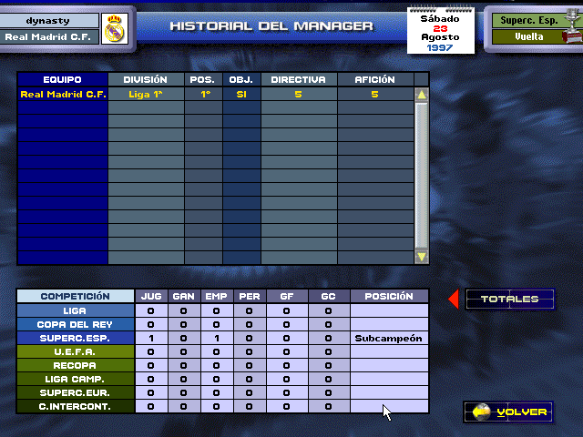
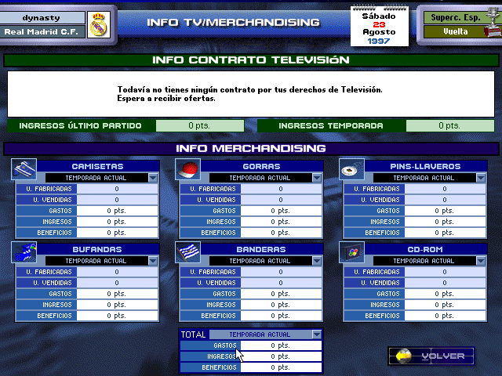
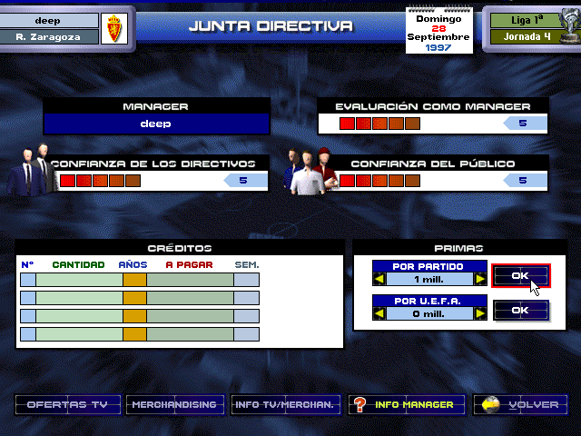
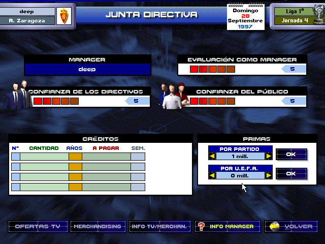

# PC Fútbol 6.0 — DECISIONES: junta directiva, historial y TV/merchandising

`[jugado]` 2026-08-21. Se llega desde el despacho pulsando **DECISIONES**
(fila inferior derecha, bajo CAJA — ver [`07-despacho.md`](07-despacho.md)).
Título real de la pantalla: **"JUNTA DIRECTIVA"**. Confirmado navegable,
sin anomalía — y con dos sub-pantallas propias exploradas a fondo.

## La pantalla principal: cómo te perciben, y tus primas pactadas

- **`EVALUACIÓN COMO MANAGER`**, **`CONFIANZA DE LOS DIRECTIVOS`**,
  **`CONFIANZA DEL PÚBLICO`** — tres barras independientes (0-5 con
  segmentos rojo/marrón), no un único "prestigio": la junta, la afición y
  tu propia evaluación de gestión son ejes separados.
- **`CRÉDITOS`**: tabla de préstamos activos (cantidad, años, a pagar,
  semana) — vacía al inicio de esta partida.
- **`PRIMAS`**: `POR PARTIDO` y `POR TÍTULO`, cada una con selector
  numérico (flechas ◄►, en millones) y su propio botón `OK` — primas
  configurables por el propio manager, pactadas con la plantilla como
  incentivo, no fijas.
- **Botonera inferior**: `OFERTAS TV`, `MERCHANDISING` (ambas
  **deshabilitadas/atenuadas** en esta partida — ver por qué en
  `INFO TV/MERCHAN.` abajo), `INFO TV/MERCHAN.`, **`INFO MANAGER`**,
  `VOLVER` (navegable, sin anomalía).

## INFO MANAGER → "HISTORIAL DEL MANAGER"

- **Tabla de trayectoria por temporada/equipo**: división, posición
  objetivo (`SÍ`/`NO`), confianza de directiva y de afición de cada
  etapa — el historial completo de carrera del manager, con una fila por
  temporada/club.
- **Tabla de récord por competición** (`LIGA`, `COPA DEL REY`,
  `SUPERC.ESP.`, `U.E.F.A.`, `RECOPA`, `LIGA CAMP.`, `SUPERC.EUR.`,
  `C.INTERCONT.`): jugados/ganados/empatados/perdidos/goles a favor/goles
  en contra/posición final — en la sesión, Supercopa mostraba
  `1 0 1 0 0 0 Subcampeón` tras el 0-0 de ida (empate cuenta como "1 empate",
  posición aún no resuelta hasta la vuelta).
- `VOLVER` (navegable, sin anomalía).

## INFO TV/MERCHANDISING

- **`INFO CONTRATO TELEVISIÓN`**: mensaje *"Todavía no tienes ningún
  contrato por tus derechos de Televisión. Espera a recibir ofertas."* —
  explica por qué `OFERTAS TV` aparecía deshabilitado en la pantalla
  principal: no es un botón roto, es un estado "sin oferta todavía" que se
  resuelve solo con el tiempo (SEGUIR), no hay una acción directa para
  solicitar el contrato.
- **`INFO MERCHANDISING`**: seis líneas de producto con ficha propia —
  `CAMISETAS`, `GORRAS`, `PINS-LLAVEROS`, `BUFANDAS`, `BANDERAS`, `CD-ROM`
  — cada una con `U. FABRICADAS`, `U. VENDIDAS`, `GASTOS`, `INGRESOS`,
  `BENEFICIOS` por temporada actual, más una fila `TOTAL` agregada. Todo en
  cero al inicio de temporada.
- `VOLVER` (navegable, sin anomalía).

## Qué exige

El patrón de tres barras de confianza independientes (junta/afición/
autoevaluación), primas configurables con OK explícito, y un historial de
manager separado del historial de club, es la referencia de qué debería
rastrear la carrera de manager en PC Dynasty más allá de resultados
deportivos: reputación con múltiples stakeholders, no un único número. El
desglose de merchandising por línea de producto (con fabricación vs. venta
vs. beneficio) es igualmente aplicable a cualquier sistema de ingresos
comerciales que se quiera modelar.

## PRIMAS: el `OK` de "POR PARTIDO" probado a fondo — confirma valor sin diálogo (sesión 7, 2026-08-22)

`[jugado]` 2026-08-22. Nota: en esta partida (Jornada 4) la segunda
prima de la pantalla se llama **`POR U.E.F.A.`**, no `POR TÍTULO` como
documentaba la sesión 2 — sugiere que la etiqueta de la segunda prima
depende de a qué competición europea esté clasificado el club en ese
momento de la temporada, no un texto fijo.

Se subió `POR PARTIDO` de `0 mill.` a `1 mill.` con el selector `►` y
se pulsó su `OK`:

- **`OK` no abre ningún diálogo de confirmación** — solo queda con un
  marco rojo de foco/pulsado, sin mensaje ni cambio visible inmediato
  en pantalla más allá de eso.
- **El valor sí se confirma de verdad**: saliendo con `VOLVER` al
  despacho y volviendo a entrar en `DECISIONES`, `POR PARTIDO` seguía
  mostrando `1 mill.` (no se resetea a `0` al salir de la pantalla):

  

- No se ha probado revertir a `0` ni pulsar el `OK` de `POR U.E.F.A.`
  (para no comprometer más presupuesto del necesario en esta sesión) —
  pero el patrón de "seleccionar valor, pulsar OK, confirma sin
  diálogo" queda establecido para ambos selectores de `PRIMAS`.

## Qué exige

Que `OK` confirme el valor sin pedir una segunda confirmación, pero que
el valor sobreviva a salir/reentrar en la pantalla, es el patrón de
"guardado inmediato, sin doble confirmación" que PC Dynasty debería
replicar para ajustes económicos de bajo riesgo (primas, no fichajes o
remodelaciones que sí implican un aviso tipo "las obras comenzarán...").

## Pendiente

- `OFERTAS TV` y `MERCHANDISING` seguían deshabilitados toda la sesión —
  no se ha llegado al punto en que el club recibe su primera oferta;
  repetir tras avanzar varias semanas con SEGUIR para ver el flujo
  completo de aceptar una oferta.
- El `OK` de `POR U.E.F.A.` (la segunda prima) no se ha pulsado — solo
  el de `POR PARTIDO`. No se ha probado revertir un valor de prima ya
  confirmado de vuelta a `0`.
