# PC Fútbol 6.0 — ESTADIO: render 3D, aforo y estado de las obras

`[jugado]` 2026-08-21. Se llega desde el despacho pulsando **ESTADIO**
(fila inferior derecha, bajo DECISIONES — ver
[`07-despacho.md`](07-despacho.md)). Confirmado navegable, sin anomalía.

## Qué se ve

- **Render 3D del propio estadio** (Santiago Bernabéu, coherente con el
  club elegido en esta partida) — no un icono genérico, un modelo
  específico por club real.
- **Datos del recinto**: capacidad, parking, estado del césped.
- **`ESTADO DE LAS OBRAS`**: tabla de categorías de infraestructura
  (`GRADAS`, `PARKING`, `EQUIPAMIENTO`, `SERVICIOS`) con columnas `POR
  PAGAR` y `SEM` (semanas restantes) — el estadio es un activo mejorable
  por partes, con obras que se pagan a plazos, no una compra única de "más
  capacidad".
- **Botonera**: `DÍA DE PARTIDO`, `REMODELAR`, `OBRAS`, `GRÁFICA`, `VOLVER`
  (navegable, sin anomalía).

## Qué exige

El estadio como activo con render propio por club real y un plan de obras
desglosado por categoría (gradas/parking/equipamiento/servicios) a plazos
es el nivel de detalle a igualar si PC Dynasty modela infraestructura de
club — no un simple "aforo: X, sube a Y por Z pesetas", sino una obra por
categoría con su propio calendario de pago.

## Los cuatro botones: todos explorados (2026-08-21, sesión 2)

### `DÍA DE PARTIDO` (pestaña por defecto al entrar)

- Anclado al **próximo partido concreto** (Supercopa vuelta vs. F.C.
  Barcelona), no una vista genérica: `PRECIO DE LAS ENTRADAS` con selector
  `◄►` (visto en 1.500 pts.) y `PRECIO POR VALLA` publicitaria (150.000
  pts.), más una oferta puntual para vender los derechos de publicidad en
  vallas del resto de temporada por 215 millones, con su propio botón
  `ACEPTAR` (no pulsado, por no alterar economía sin necesidad).

### `REMODELAR` → ampliación por categoría con coste y plazo

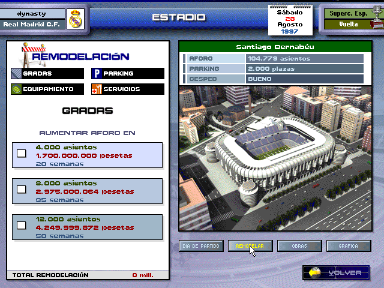

- 4 categorías en pestañas (`GRADAS`, `PARKING`, `EQUIPAMIENTO`,
  `SERVICIOS`); `GRADAS` (la que carga por defecto) ofrece 3 tramos fijos
  de ampliación de aforo, cada uno con checkbox propio, coste exacto y
  semanas de obra: `+4.000 asientos / 1.700.000.000 pts. / 20 semanas`,
  `+8.000 / 2.975.000.064 / 35 semanas`, `+12.000 / 4.249.999.872 / 50
  semanas` — **no es un slider continuo**, son escalones discretos con
  coste no lineal (el tramo mayor cuesta más del doble que el pequeño para
  el triple de aforo). Un contador `TOTAL REMODELACIÓN` al pie agrega la
  selección actual (0 mill. si no hay ningún tramo marcado). El clic sobre
  la pestaña `PARKING` no se ha logrado calibrar todavía (se quedó en
  `GRADAS`), así que no se ha confirmado si las otras 3 categorías siguen
  el mismo patrón de tramos.

### `OBRAS` → misma tabla "ESTADO DE LAS OBRAS" que en el despacho, con detalle

- Confirma y amplía lo ya visto desde el despacho: `GRADAS` y `PARKING`
  son categorías de una sola línea, pero **`EQUIPAMIENTO` y `SERVICIOS` se
  desglosan en sub-líneas propias** — `EQUIPAMIENTO`: `FOCOS`, `CALEF.
  CÉSPED`, `VESTUARIOS`, `MARCADORES`, `ACCESOS`; `SERVICIOS`:
  `ENFERMERÍA`, `TIENDA`, `CAFETERÍA`, `LAVABOS-W.C.` — cada una con sus
  propias columnas `POR PAGAR`/`SEM`. Todo vacío en esta partida (sin
  obras en curso).

### `GRÁFICA` → histórico de aforo por semana (modal)

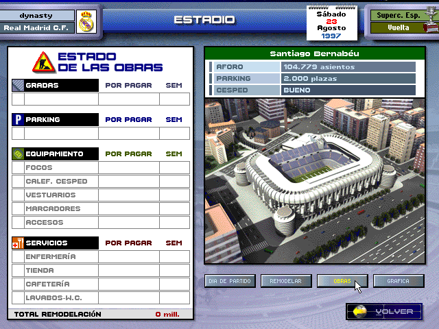

- Abre un modal **`GRÁFICA INFORMACIÓN AFOROS`**: eje Y `AFORO` (marcado
  hasta 104.779, el aforo actual), eje X `SEMANAS` (1 a 50), con barras muy
  pequeñas en las primeras semanas — es un histórico de evolución de aforo
  a lo largo de la temporada, no una vista alternativa del estadio 3D.
  Botón `OK` confirmado sin anomalía (cierra el modal con normalidad).

## Las otras 3 categorías de REMODELAR: cada una con su propio patrón de tramos (sesión 3)

Sesión 3 (2026-08-21) completó las 3 categorías que faltaban dentro de
`REMODELAR`:

### PARKING → por esquina del estadio, no un tramo único

- Cuatro bloques independientes — `SUR-ESTE`, `SUR-OESTE`, `NOR-ESTE`,
  `NOR-OESTE` — cada uno con su propio selector de plantas `1 2 3 4` y su
  propio diagrama del estadio resaltando esa esquina concreta.
- Un resumen `POR PLANTA` (`PLAZAS 500` / `PRECIO 595 millones` / `SEMANAS
  7`) se actualiza según la esquina/número de plantas elegido — el parking
  se amplía **por esquina física del estadio**, no como un número agregado
  de plazas.

### EQUIPAMIENTO → 5 sub-categorías con tramos nombrados

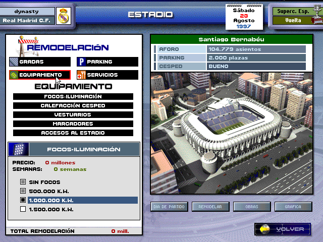

- Mismo patrón de lista `EXTRAS` que en Servicios (ver abajo): `FOCOS-
  ILUMINACIÓN`, `CALEFACCIÓN CÉSPED`, `VESTUARIOS`, `MARCADORES`, `ACCESOS
  AL ESTADIO` — exactamente las mismas 5 sub-líneas que ya se habían visto
  sin desglosar en la tabla `ESTADO DE LAS OBRAS` (ver `OBRAS` abajo).
- `FOCOS-ILUMINACIÓN` (la que carga por defecto) tiene 4 tramos con
  nombre propio en vez de un número de asientos: `SIN FOCOS`, `500.000
  K.W.`, `1.000.000 K.W.`, `1.500.000 K.W.` — de nuevo escalones
  discretos, no un slider continuo.

### SERVICIOS → "EXTRAS": 4 sub-categorías con tramos de calidad

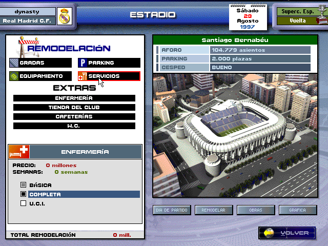

- Cabecera `EXTRAS` con 4 sub-líneas: `ENFERMERÍA`, `TIENDA DEL CLUB`,
  `CAFETERÍAS`, `W.C.` — coinciden con las 4 sub-líneas ya vistas en la
  tabla `SERVICIOS` de `ESTADO DE LAS OBRAS` (ahí llamadas `ENFERMERÍA`/
  `TIENDA`/`CAFETERÍA`/`LAVABOS-W.C.`).
- `ENFERMERÍA` (la que carga por defecto) tiene 3 tramos de calidad:
  `BÁSICA`, `COMPLETA`, `U.C.I.` — un tramo de servicio médico, no un
  aforo ni una potencia.
- **No se ha logrado hacer que el clic sobre las otras 3 sub-líneas
  (`TIENDA DEL CLUB`/`CAFETERÍAS`/`W.C.`) cambie el panel de detalle** —
  varios intentos recalibrados dejaron el contenido siempre en
  `ENFERMERÍA` (a veces con el borde de hover sobre la sub-línea correcta,
  pero sin cambiar el panel). No confirmado si es otro caso de calibración
  fina pendiente o un límite real de esta sub-navegación.

Patrón consolidado: las 4 categorías principales de `REMODELAR`
(`GRADAS`/`PARKING`/`EQUIPAMIENTO`/`SERVICIOS`) comparten la misma
filosofía — **tramos discretos con nombre, coste y semanas propios**, casi
nunca un único número editable — pero cada una aplica esa filosofía a un
eje distinto (aforo, plantas de parking por esquina, potencia/calidad de
instalación, nivel de servicio).

## SERVICIOS: la sub-navegación sí funciona — era calibración, no un límite real (sesión 6, 2026-08-22)

`[jugado]` 2026-08-22. Nota: esta sesión se jugó sobre una partida nueva
(R. Zaragoza / La Romareda), no la del Real Madrid de sesiones previas —
los números de aforo y personal difieren, pero el comportamiento de la
UI es comparable.

La sesión 3 había dejado sin resolver si el clic sobre `TIENDA DEL
CLUB`/`CAFETERÍAS`/`W.C.` (dentro de `REMODELAR` → `SERVICIOS`) cambiaba
de verdad el panel de detalle, o si había un límite real de la
sub-navegación. **Esta sesión confirma que sí cambia, con las
coordenadas bien calibradas**: las tres sub-líneas restantes abren cada
una su propio panel de detalle, con su propio patrón de tramos —
recalibrando el clic sobre la sub-línea concreta (no sobre la etiqueta
completa) fue suficiente, sin necesidad de ningún otro ajuste.

- **`TIENDA DEL CLUB`**: tramos `NINGUNA` / `1 TIENDA` / `5 TIENDAS` /
  `10 TIENDAS`.

  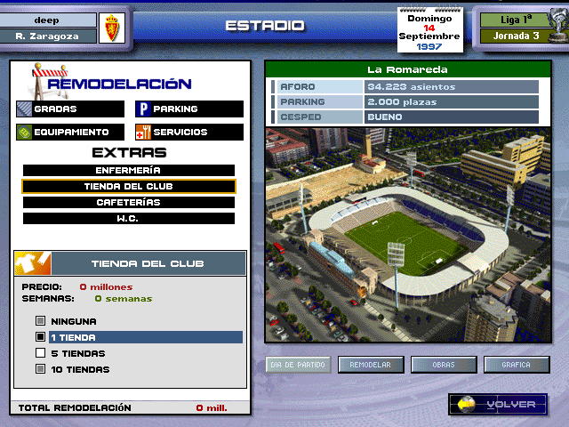

- **`CAFETERÍAS`**: tramos `1` / `5` / `10` / `20 CAFETERÍAS`.
- **`W.C.`**: tramos `1 W.C.` / `10 W.C.` / `40 W.C.` / `80 W.C.`.

  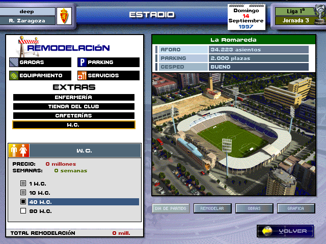

Con esto, las 4 sub-categorías de `SERVICIOS` (`ENFERMERÍA` incluida)
quedan confirmadas con panel de detalle propio y tramos discretos
propios — **la sospecha de un bug de sub-navegación queda descartada**,
era un problema de precisión de clic en sesiones anteriores.

## REMODELAR: marcar un tramo, confirmar, y comprobar que es reversible (sesión 6, 2026-08-22)

`[jugado]` 2026-08-22. Primera vez que se marca un checkbox de
remodelación real (tramo `GRADAS` → `+4.000 asientos / 1.500.000.000
pesetas / 20 semanas`) y se sigue el flujo hasta el final, en vez de solo
describirlo.

- **Marcar el checkbox** lo resalta con una X roja, pero **el contador
  `TOTAL REMODELACIÓN` al pie se queda en `0 mill.` y no sube** —
  discrepancia visual entre "seleccionado" y "contabilizado" que no se
  ha explicado.
- **Pulsar `VOLVER` con el checkbox marcado dispara un aviso**, no una
  pregunta de sí/no: *"Las obras comenzarán cuando termine la semana
  actual."*, con un único botón `Aceptar` — es un anuncio, no una
  confirmación cancelable en ese punto.

  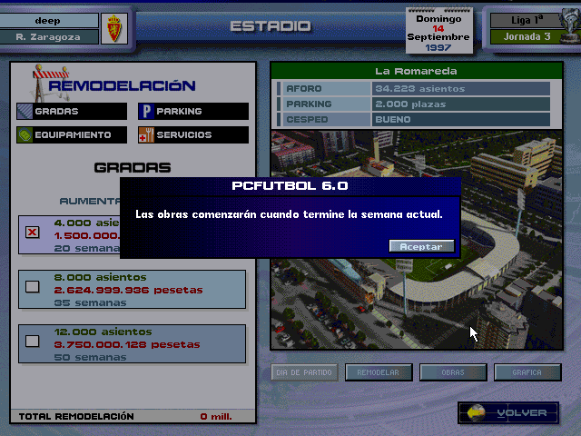

- Tras aceptar el aviso, la navegación **salió de `ESTADIO` hasta el
  despacho** (no se quedó en `ESTADIO`) — `VOLVER` sobre `GRADAS` con
  cambios pendientes propaga la salida hasta el hub, no solo hasta la
  pantalla anterior.
- **Al volver a entrar en `ESTADIO` → `REMODELAR` → `GRADAS`, el
  checkbox de `+4.000 asientos` seguía marcado** — sugiere que el
  aviso sí registró algo, no fue un mensaje vacío.
- **Se probó si ese checkbox se podía desmarcar de nuevo** (para ver si
  la remodelación era reversible en esta fase): un clic más sobre el
  mismo checkbox lo dejó vacío otra vez, y `VOLVER` mostró **el mismo
  aviso de "las obras comenzarán..."** incluso con el checkbox ya
  desmarcado — el aviso parece dispararse por haber tocado la pantalla
  de `GRADAS` con algún cambio en la sesión, no por el estado final del
  checkbox.
- **La comprobación definitiva fue la tabla `ESTADO DE LAS OBRAS`**: al
  final de toda la secuencia (marcar → volver → aceptar → reentrar →
  desmarcar → volver → aceptar), la fila `GRADAS` aparece **vacía**
  (sin `POR PAGAR` ni `SEM`) y `TOTAL REMODELACIÓN` sigue en `0 mill.` —
  es decir, **la remodelación no quedó comprometida de forma
  permanente**: el intento de marcarla se pudo revertir por completo
  antes de que se contabilizara ninguna obra real.

  

- No se llegó a comprobar `ESTADO DE LAS OBRAS` justo después del primer
  `Aceptar` (con el checkbox aún marcado) — solo se comprobó al final,
  con el checkbox ya desmarcado. No se puede confirmar con certeza si
  hubo una ventana intermedia en la que la obra sí figuraba como
  comprometida y luego se revirtió, o si nunca llegó a comprometerse
  mientras la sesión siguiera abierta.

## DÍA DE PARTIDO → intento sin completar, la sesión se cortó aquí (sesión 6)

`[jugado]` 2026-08-22. Se intentó volver a `DÍA DE PARTIDO` para
completar por fin el `ACEPTAR` de la oferta de vallas publicitarias
pendiente desde la sesión 2. **Dos clics sucesivos sobre el botón `DÍA
DE PARTIDO`** (con recalibración entre uno y otro) **no consiguieron
cambiar el panel**, que se quedó mostrando `ESTADO DE LAS OBRAS` en
ambas capturas:

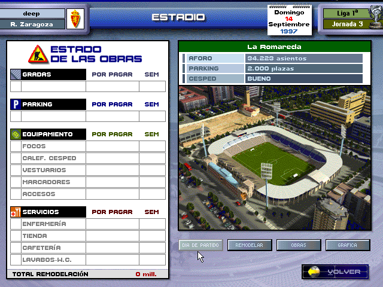

La sesión se interrumpió inmediatamente después (límite de sesión de la
API) sin más intentos. **No hay evidencia de que se llegara a ver el
panel de `DÍA DE PARTIDO` en esta sesión**, y mucho menos de que se
pulsara su `ACEPTAR` — a diferencia de lo planeado, esta parte de S6
queda sin ejecutar, no solo sin confirmar.

## DÍA DE PARTIDO: no es un problema de calibración — el botón está deshabilitado cuando el próximo partido es fuera de casa (sesión 7, 2026-08-22)

`[jugado]` 2026-08-22. Antes de reintentar el clic, protocolo de
diagnóstico de pérdida de foco (`bun tools/scripts/reference/vm.script.ts
key --game=pcf6 38 0f 8f b8` + captura): **confirmó pérdida de foco
real** — detrás del panel de `ESTADIO` apareció el escritorio de
Windows 98 con `PCFUTBOL 6.0` como única entrada en la barra de tareas:

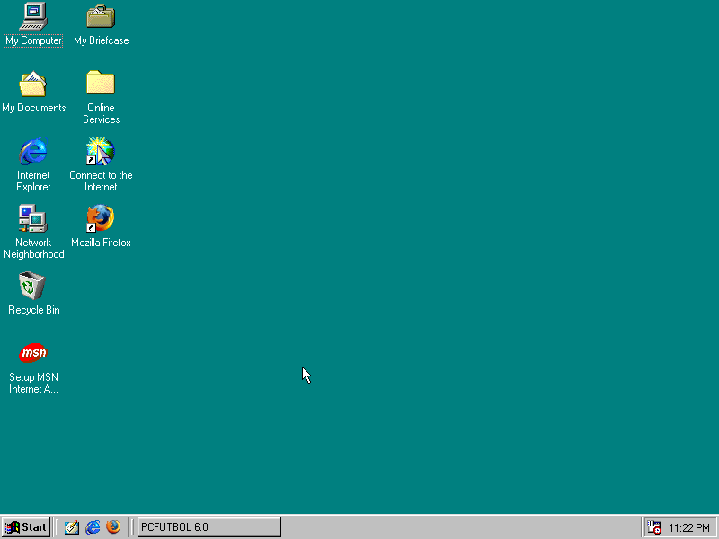

Clic con `--reset` sobre esa entrada de la barra de tareas devolvió el
foco al juego con normalidad (mismo patrón ya documentado en
`como-esta-montado.md`). Pero **tras recuperar el foco, un nuevo clic
con `--reset` sobre `DÍA DE PARTIDO` (coordenadas recalibradas con el
método de zoom/crop) siguió sin cambiar el panel** — descartando así la
pérdida de foco como explicación de los dos intentos fallidos de la
sesión 6.

Para aislar si el problema era la calibración en sí (no el foco), se
probó un clic de control sobre `REMODELAR` con las mismas coordenadas
recalculadas por el mismo método: **`REMODELAR` navegó con normalidad**
a `REMODELACIÓN` → `GRADAS` a la primera, confirmando que el mecanismo
de clic y el método de calibración funcionan bien en esta misma fila de
botones. Con `REMODELAR` ya activo (resaltado en amarillo), un zoom
sobre la fila de botones reveló la explicación real:

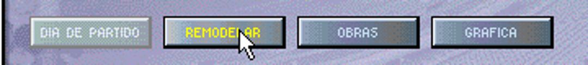

**`DÍA DE PARTIDO` se renderiza en un gris pálido claramente distinto**
del azul oscuro normal de `OBRAS`/`GRÁFICA` (botones inactivos pero
pulsables) y del amarillo de `REMODELAR` (pestaña activa) — es el
patrón visual de un botón **deshabilitado**, no de un botón normal sin
foco de hover. Un intento adicional con el atajo de teclado (tecla `D`,
sin `Alt`) tampoco produjo cambio alguno, coherente con un control
deshabilitado (un atajo de teclado no activa un botón que la propia UI
ha marcado como no pulsable).

**Hipótesis con evidencia de apoyo**: `VOLVER` desde `ESTADIO` al
despacho reveló que el próximo partido de esta partida es
**Mérida C.P. (CPU) vs. R. Zaragoza (deep) — Jornada 3, domingo 14 de
septiembre de 1997**, con Mérida C.P. listado primero (posición
convencional de local) y R. Zaragoza como visitante:

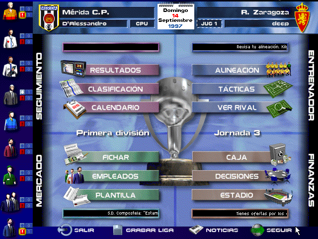

Es decir: el próximo partido de R. Zaragoza es **fuera de casa**. Si
`DÍA DE PARTIDO` configura precio de entradas y vallas publicitarias
*del propio estadio* para el próximo partido concreto (como ya
documentaba la sesión 2, anclado a un partido específico, no una vista
genérica), **no tiene sentido que el panel esté disponible cuando ese
partido no se juega en casa** — no hay entradas ni vallas propias que
gestionar para un partido de visitante. Esto encaja con el patrón ya
visto en sesión 2, donde `DÍA DE PARTIDO` sí estaba activo y anclado a
la vuelta de la Supercopa (que sí era en el propio estadio).

**No confirmado de forma definitiva** (no se pudo alcanzar el
calendario para verificar explícitamente la etiqueta local/visitante
del motor, solo la posición convencional en la cabecera del despacho),
pero es la explicación que mejor encaja con toda la evidencia
disponible: no es un fallo de calibración ni de foco, es un estado
deshabilitado condicionado a que el próximo partido sea en casa.

## Qué exige

Que `DÍA DE PARTIDO` se deshabilite por completo (no solo se oculte)
cuando el próximo partido es a domicilio, en vez de mostrar un panel
vacío o redirigir, es una señal de diseño clara: la gestión de
taquilla/vallas de PC Dynasty debería estar condicionada de forma
explícita a "¿el próximo partido es en mi estadio?", con el control
inhabilitado (visualmente distinto, no solo bloqueado) en caso
contrario — no basta con ocultar el botón o dejarlo activo sin efecto.

## Pendiente

- La oferta de vallas publicitarias (215 millones, sesión 2) sigue sin
  pulsarse — no por elección deliberada, sino porque `DÍA DE PARTIDO`
  aparece deshabilitado en el estado actual de la partida (próximo
  partido a domicilio, ver sección anterior). Pendiente reintentar en
  una sesión futura cuando el calendario tenga un partido en casa
  próximo, para confirmar la hipótesis y, si procede, documentar el
  panel sin pulsar su `ACEPTAR`.
- No se ha confirmado con el propio motor (etiqueta explícita
  local/visitante en `CALENDARIO`) que el próximo partido sea
  efectivamente a domicilio — la conclusión se apoya en la posición
  convencional de los equipos en la cabecera del despacho, no en un
  texto literal "visitante".
- La discrepancia entre "checkbox marcado" y "`TOTAL REMODELACIÓN` en 0
  mill." en `REMODELAR` → `GRADAS` no se ha explicado.
- No se comprobó `ESTADO DE LAS OBRAS` inmediatamente después del primer
  `Aceptar` del aviso de obras (con el checkbox aún marcado) — solo al
  final, ya desmarcado. Queda abierto si hubo una ventana real en la que
  la obra estuvo comprometida.
