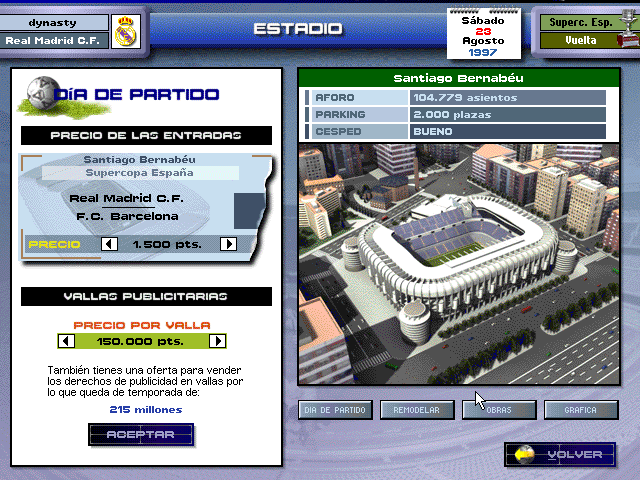
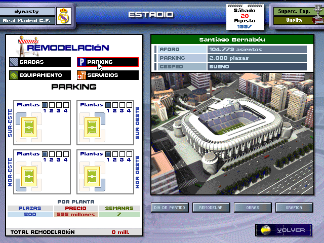

# PC Fútbol 6.0 — ESTADIO: render 3D, aforo y estado de las obras

`[jugado]` 2026-08-21. Se llega desde el despacho pulsando **ESTADIO**
(fila inferior derecha, bajo DECISIONES — ver
[`07-despacho.md`](07-despacho.md)). Confirmado navegable, sin anomalía.

## Qué se ve

- **Render 3D del propio estadio** (Santiago Bernabéu, coherente con el
  club elegido en esta partida) — no un icono genérico, un modelo
  específico por club real.
- **Datos del recinto**: capacidad, parking, estado del césped.
- **`ESTADO DE LAS OBRAS`**: tabla de categorías de infraestructura
  (`GRADAS`, `PARKING`, `EQUIPAMIENTO`, `SERVICIOS`) con columnas `POR
  PAGAR` y `SEM` (semanas restantes) — el estadio es un activo mejorable
  por partes, con obras que se pagan a plazos, no una compra única de "más
  capacidad".
- **Botonera**: `DÍA DE PARTIDO`, `REMODELAR`, `OBRAS`, `GRÁFICA`, `VOLVER`
  (navegable, sin anomalía).

## Qué exige

El estadio como activo con render propio por club real y un plan de obras
desglosado por categoría (gradas/parking/equipamiento/servicios) a plazos
es el nivel de detalle a igualar si PC Dynasty modela infraestructura de
club — no un simple "aforo: X, sube a Y por Z pesetas", sino una obra por
categoría con su propio calendario de pago.

## Los cuatro botones: todos explorados (2026-08-21, sesión 2)

### `DÍA DE PARTIDO` (pestaña por defecto al entrar)

- Anclado al **próximo partido concreto** (Supercopa vuelta vs. F.C.
  Barcelona), no una vista genérica: `PRECIO DE LAS ENTRADAS` con selector
  `◄►` (visto en 1.500 pts.) y `PRECIO POR VALLA` publicitaria (150.000
  pts.), más una oferta puntual para vender los derechos de publicidad en
  vallas del resto de temporada por 215 millones, con su propio botón
  `ACEPTAR` (no pulsado, por no alterar economía sin necesidad).

### `REMODELAR` → ampliación por categoría con coste y plazo

- 4 categorías en pestañas (`GRADAS`, `PARKING`, `EQUIPAMIENTO`,
  `SERVICIOS`); `GRADAS` (la que carga por defecto) ofrece 3 tramos fijos
  de ampliación de aforo, cada uno con checkbox propio, coste exacto y
  semanas de obra: `+4.000 asientos / 1.700.000.000 pts. / 20 semanas`,
  `+8.000 / 2.975.000.064 / 35 semanas`, `+12.000 / 4.249.999.872 / 50
  semanas` — **no es un slider continuo**, son escalones discretos con
  coste no lineal (el tramo mayor cuesta más del doble que el pequeño para
  el triple de aforo). Un contador `TOTAL REMODELACIÓN` al pie agrega la
  selección actual (0 mill. si no hay ningún tramo marcado). El clic sobre
  la pestaña `PARKING` no se ha logrado calibrar todavía (se quedó en
  `GRADAS`), así que no se ha confirmado si las otras 3 categorías siguen
  el mismo patrón de tramos.

### `OBRAS` → misma tabla "ESTADO DE LAS OBRAS" que en el despacho, con detalle

- Confirma y amplía lo ya visto desde el despacho: `GRADAS` y `PARKING`
  son categorías de una sola línea, pero **`EQUIPAMIENTO` y `SERVICIOS` se
  desglosan en sub-líneas propias** — `EQUIPAMIENTO`: `FOCOS`, `CALEF.
  CÉSPED`, `VESTUARIOS`, `MARCADORES`, `ACCESOS`; `SERVICIOS`:
  `ENFERMERÍA`, `TIENDA`, `CAFETERÍA`, `LAVABOS-W.C.` — cada una con sus
  propias columnas `POR PAGAR`/`SEM`. Todo vacío en esta partida (sin
  obras en curso).

### `GRÁFICA` → histórico de aforo por semana (modal)

- Abre un modal **`GRÁFICA INFORMACIÓN AFOROS`**: eje Y `AFORO` (marcado
  hasta 104.779, el aforo actual), eje X `SEMANAS` (1 a 50), con barras muy
  pequeñas en las primeras semanas — es un histórico de evolución de aforo
  a lo largo de la temporada, no una vista alternativa del estadio 3D.
  Botón `OK` confirmado sin anomalía (cierra el modal con normalidad).

## Las otras 3 categorías de REMODELAR: cada una con su propio patrón de tramos (sesión 3)

Sesión 3 (2026-08-21) completó las 3 categorías que faltaban dentro de
`REMODELAR`:

### PARKING → por esquina del estadio, no un tramo único

- Cuatro bloques independientes — `SUR-ESTE`, `SUR-OESTE`, `NOR-ESTE`,
  `NOR-OESTE` — cada uno con su propio selector de plantas `1 2 3 4` y su
  propio diagrama del estadio resaltando esa esquina concreta.
- Un resumen `POR PLANTA` (`PLAZAS 500` / `PRECIO 595 millones` / `SEMANAS
  7`) se actualiza según la esquina/número de plantas elegido — el parking
  se amplía **por esquina física del estadio**, no como un número agregado
  de plazas.

### EQUIPAMIENTO → 5 sub-categorías con tramos nombrados

- Mismo patrón de lista `EXTRAS` que en Servicios (ver abajo): `FOCOS-
  ILUMINACIÓN`, `CALEFACCIÓN CÉSPED`, `VESTUARIOS`, `MARCADORES`, `ACCESOS
  AL ESTADIO` — exactamente las mismas 5 sub-líneas que ya se habían visto
  sin desglosar en la tabla `ESTADO DE LAS OBRAS` (ver `OBRAS` abajo).
- `FOCOS-ILUMINACIÓN` (la que carga por defecto) tiene 4 tramos con
  nombre propio en vez de un número de asientos: `SIN FOCOS`, `500.000
  K.W.`, `1.000.000 K.W.`, `1.500.000 K.W.` — de nuevo escalones
  discretos, no un slider continuo.

### SERVICIOS → "EXTRAS": 4 sub-categorías con tramos de calidad

- Cabecera `EXTRAS` con 4 sub-líneas: `ENFERMERÍA`, `TIENDA DEL CLUB`,
  `CAFETERÍAS`, `W.C.` — coinciden con las 4 sub-líneas ya vistas en la
  tabla `SERVICIOS` de `ESTADO DE LAS OBRAS` (ahí llamadas `ENFERMERÍA`/
  `TIENDA`/`CAFETERÍA`/`LAVABOS-W.C.`).
- `ENFERMERÍA` (la que carga por defecto) tiene 3 tramos de calidad:
  `BÁSICA`, `COMPLETA`, `U.C.I.` — un tramo de servicio médico, no un
  aforo ni una potencia.
- **No se ha logrado hacer que el clic sobre las otras 3 sub-líneas
  (`TIENDA DEL CLUB`/`CAFETERÍAS`/`W.C.`) cambie el panel de detalle** —
  varios intentos recalibrados dejaron el contenido siempre en
  `ENFERMERÍA` (a veces con el borde de hover sobre la sub-línea correcta,
  pero sin cambiar el panel). No confirmado si es otro caso de calibración
  fina pendiente o un límite real de esta sub-navegación.

Patrón consolidado: las 4 categorías principales de `REMODELAR`
(`GRADAS`/`PARKING`/`EQUIPAMIENTO`/`SERVICIOS`) comparten la misma
filosofía — **tramos discretos con nombre, coste y semanas propios**, casi
nunca un único número editable — pero cada una aplica esa filosofía a un
eje distinto (aforo, plantas de parking por esquina, potencia/calidad de
instalación, nivel de servicio).

## Pendiente

- No se ha logrado cambiar el panel de detalle dentro de `SERVICIOS` más
  allá de `ENFERMERÍA` (ver arriba).
- No se ha marcado ningún checkbox de remodelación real ni pulsado
  `ACEPTAR` en la oferta de vallas publicitarias de `DÍA DE PARTIDO`, para
  no alterar el estado económico de la partida sin necesidad.
