# PC Fútbol 6.0 — FICHAR y PLANTILLA: mercado y gestión de plantilla

`[jugado]` 2026-08-21. Se llega desde el despacho pulsando **FICHAR** o
**PLANTILLA** (fila inferior izquierda — ver
[`07-despacho.md`](07-despacho.md)).

## La anomalía anterior era un error de calibración, no un bloqueo real

Sesiones previas registraban *"PLANTILLA y FICHAR no navegaron pese a hover
confirmado"* (ver la sección "Pendiente / con comportamiento raro" de
`07-despacho.md`, ahora resuelta). **Esta sesión confirma que ambos botones
navegan con normalidad** una vez recalibradas las coordenadas: la fila
inferior de la rejilla 2×4 (FICHAR/EMPLEADOS/PLANTILLA a la izquierda,
CAJA/DECISIONES/ESTADIO a la derecha) está más abajo de lo que sugería el
cálculo geométrico ingenuo a partir del wireframe — verificado con el
método del rectángulo/crop de zoom sobre una captura ya tomada, no con el
método de arrastre. La hipótesis de un prerrequisito bloqueante queda
descartada.

## FICHAR → "JUGADORES A LA VENTA"

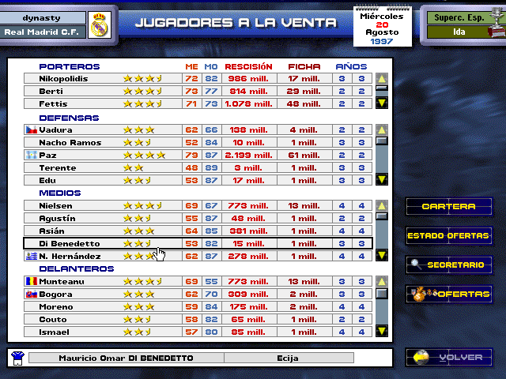

- Lista de jugadores disponibles en el mercado, agrupada por demarcación
  (`PORTEROS`/`DEFENSAS`/`MEDIOS`/`DELANTEROS`), con columnas `ME`
  (media), `MO` (moral u otro indicador), `RESCISIÓN` (cláusula), `FICHA`
  (ficha/salario) y `AÑOS` (duración de contrato).
- **Clicar una fila selecciona al jugador**: confirmado con "Dani" — la
  fila se resalta con un marco y el pie de pantalla muestra su nombre
  completo y club de origen (`Daniel López González, DANI` /
  `E. As Pontes`), sin abrir todavía un diálogo de oferta.

  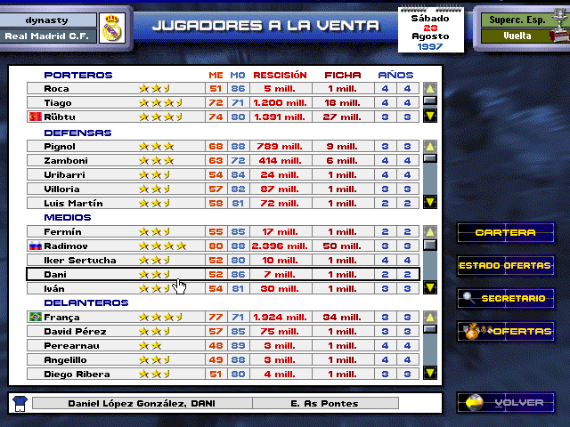

- Botonera lateral: **`CARTERA`**, **`ESTADO OFERTAS`**, **`SECRETARIO`**,
  **`OFERTAS`**, `VOLVER` (navegable, sin anomalía).

### CARTERA → "CARTERA DE FICHAJES"

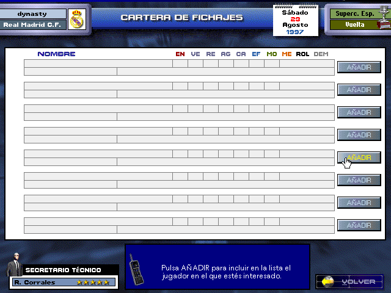

- Lista de seguimiento personal (`NOMBRE` + atributos `EN VE RE AG CA EF
  MO ME ROL DEM`), vacía al empezar, con un botón `AÑADIR` por fila.
- Pie: *"Pulsa AÑADIR para incluir en la lista el jugador en el que estés
  interesado"* + `SECRETARIO TÉCNICO` con nombre y rating (R. Corrales, 5
  estrellas) — el secretario técnico es quien "sabe" de estos jugadores, no
  un dato de sistema anónimo.
- **`AÑADIR` abre un selector completo de equipo/jugador** —
  "SELECCIONA UN JUGADOR PARA AÑADIR A TU CARTERA", con el mismo
  mapa Europa/Sudamérica + rejilla de división de España que se usa para
  elegir equipo en la creación de partida
  (ver [`05-liga-manager-nueva-partida.md`](05-liga-manager-nueva-partida.md)):

  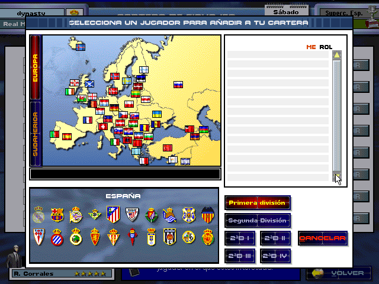

  Es decir: la cartera de fichajes no se limita a los jugadores ya listados
  en "Jugadores a la Venta" — se puede añadir a la lista de seguimiento
  **cualquier jugador de cualquier club**, esté o no en el mercado
  actualmente.

### ESTADO OFERTAS → "ESTADO DE LAS OFERTAS"

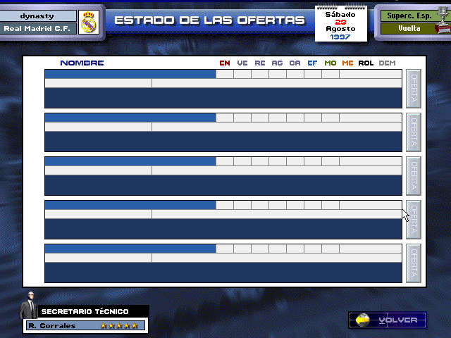

- Lista de negociaciones activas (vacía en esta partida), cada fila con
  una barra de progreso azul/blanca (probablemente el avance de la
  negociación) y un botón `OFERTA` propio por fila para actuar sobre ella.
  `VOLVER` (navegable, sin anomalía) devuelve a "Jugadores a la Venta".

### SECRETARIO → "SECRETARIO TÉCNICO": búsqueda de jugadores por criterios

- Formulario de **`CRITERIOS DE BÚSQUEDA`**: seis selectores numéricos con
  flechas `◄►` (`DEMARCACIÓN`, `EDAD`, `CALIDAD`, `ROL`, `PRECIO`) más ocho
  checkboxes booleanos (`JUGADORES EN ÚLTIMO AÑO DE CONTRATO`, `LIGA 1ª`,
  `LIGA 2ª`, `2ªB`, `COMUNITARIOS`, `EXTRACOMUNITARIOS`, `JUGADORES SIN
  EQUIPO`) y un botón `BUSCAR`.
- **`BUSCAR` sin ningún criterio marcado** muestra un diálogo de aviso:
  *"Debes indicar criterios para que se realice la búsqueda."* con
  `Aceptar` — confirmado que responde con normalidad (no es la anomalía de
  diálogo atascado).
- **Marcar el checkbox `JUGADORES SIN EQUIPO` confirmado funcional** (pasa
  a un cuadrado resaltado en rojo y permanece así) — pero **pulsar
  `BUSCAR` con solo ese checkbox marcado sigue mostrando el mismo aviso de
  "faltan criterios"**. Hipótesis: el motor de búsqueda exige además fijar
  al menos uno de los selectores numéricos (`DEMARCACIÓN`/`EDAD`/
  `CALIDAD`/`ROL`/`PRECIO`) — un checkbox booleano en solitario no basta
  como "criterio". No confirmado con una búsqueda que sí produzca
  resultados.
- `CARTERA`, `ESTADO OFERTAS` y `VOLVER` también accesibles desde aquí
  (misma botonera lateral que en "Jugadores a la Venta").

## PLANTILLA → "GESTIÓN DE LA PLANTILLA"

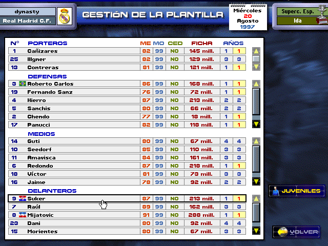

- Tabla de la plantilla propia con columnas `ME`, `MO`, `CED.` (cedido),
  `FICHA`, `AÑOS` — vista de gestión contractual de los jugadores ya en
  el club, complementaria a la vista de rendimiento de
  [`15-alineacion.md`](15-alineacion.md).
- Botón `VOLVER` (navegable, sin anomalía).

### JUVENILES → "JÓVENES PROMESAS": cantera con su propio ojeador

- Título real: **"JÓVENES PROMESAS"**. Muy distinto de FICHAR/SECRETARIO
  aunque comparte la idea de "buscar jugadores": aquí hay un **`OJEADOR`**
  propio (S. Delgado, ★★★★★) con su propia `CAPACIDAD DE BÚSQUEDA` por
  atributo (`PORTERO`/`REGATE`/`ENTRADAS`/`PASE`/`REMATE`/`TIRO`, todos
  `SÍ` en esta partida) y checkboxes de criterio de búsqueda específicos
  para juveniles, más un botón `BUSCAR` propio.
- Un **`ENTRENADOR`** de juveniles independiente (R. De la Fuente, ★★★★★),
  con un contador `4 JUGADORES` — la cantera tiene su propio cuerpo
  técnico, no comparte el del primer equipo.
- **`PLANTILLA DE JÓVENES PROMESAS`**: tabla con las mismas columnas que
  Alineación (`VE RE AG CA ME ROL FICHA AÑOS`) más alternador
  `PARÁMETROS`/`CALIFICACIÓN` y los mismos 6 iconos de atributo
  (`PORTERO`/`REGATE`/`ENTRADAS`/`PASE`/`REMATE`/`TIRO`) que en
  Alineación/Táctica — vacía en esta partida (0 canteranos promovibles
  aún). `VOLVER` (navegable, sin anomalía).

### CARTERA: el flujo de "añadir jugador" completado de principio a fin (sesión 4, 2026-08-21)

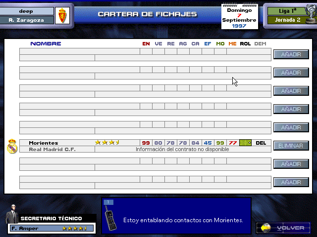

Sesión 2 solo había confirmado que `AÑADIR` abre el selector de
equipo/jugador (mapa Europa/Sudamérica + rejilla de clubes de España).
Esta sesión se completó el flujo entero:

- Clicar un club en la rejilla (probado con **Real Madrid C.F.**) rellena
  el panel derecho con **la plantilla real completa de ese club** (dorsal,
  nombre, `ME`, `ROL`) — Suker, Raúl, Mijatovic, Morientes, Guti, Seedorf,
  Redondo, Roberto Carlos, Hierro, etc., datos de la temporada 97-98 real.
  Confirma que el buscador de fichajes puede consultar la plantilla de
  **cualquier** club de **cualquier** país del mapa, no solo equipos ya
  con jugadores "a la venta".
- **Un solo clic sobre una fila de jugador solo la selecciona** (resaltado
  naranja, sin cerrar el selector) — hace falta **doble clic** para
  confirmar y añadirlo de verdad a la cartera (probado con Morientes).
- Al añadirse, la fila de `CARTERA DE FICHAJES` deja de estar vacía y
  muestra su **ficha de atributos completa** (`EN 99 VE 80 RE 78 AG 78
  CA 84 EF 45 MO 99 ME 77`, `ROL`/`DEM` = `DEL`), el escudo de su club
  actual (Real Madrid C.F.), y el texto **"Información del contrato no
  disponible"** (a diferencia de un jugador ya fichable en "Jugadores a
  la Venta", del que sí se conocen ficha/años/rescisión) — el motor
  distingue entre datos públicos de mercado y datos de un jugador que
  solo se está *vigilando*.
- El botón de la fila cambia de `AÑADIR` a **`ELIMINAR`** una vez el
  jugador está en la cartera — quitarlo no se probó, pero confirma que es
  reversible.
- El secretario técnico reacciona con una frase de estado propia:
  **"Estoy entablando contactos con Morientes."** — sugiere que añadir a
  la cartera dispara una gestión de fondo (el secretario "investiga" al
  jugador), no es solo una lista estática de favoritos.

## Qué exige

Que la cartera de fichajes permita añadir *cualquier* jugador de *cualquier*
club (no solo los ya puestos a la venta) es el hallazgo de diseño más
relevante aquí: modela una lista de "objetivos de scouting" independiente
del mercado activo, coherente con cómo funciona el scouting real (se sigue
a un jugador mucho antes de que esté disponible). PC Dynasty debería
separar del mismo modo "quién está en venta ahora" de "a quién quiero
seguir", con esta última sin restricción de disponibilidad actual.

## OFERTAS: el cuarto botón, probado a fondo pero sin fichaje cerrado (sesión 5, 2026-08-22)

`[jugado]` 2026-08-22. `OFERTAS` (distinto de `ESTADO OFERTAS`) abre el
**mismo selector de equipo/jugador que `CARTERA` → `AÑADIR`** (mapa
Europa/Sudamérica + rejilla de clubes de España): confirma que es otra
puerta de entrada al mismo buscador universal de jugadores, no un mercado
propio y separado.

- Con **S.D. Compostela** seleccionado, un clic en una fila de su
  plantilla solo selecciona (sin abrir nada); hace falta **doble clic**
  para abrir la ficha completa del jugador — mismo patrón que en
  `CARTERA`. Doble clic sobre **Dimitri Popov** (medio ruso, 28 años,
  MEDIA 76) abrió su ficha de atributos junto a un panel inferior
  **`HACER OFERTA`** nunca visto hasta ahora:

  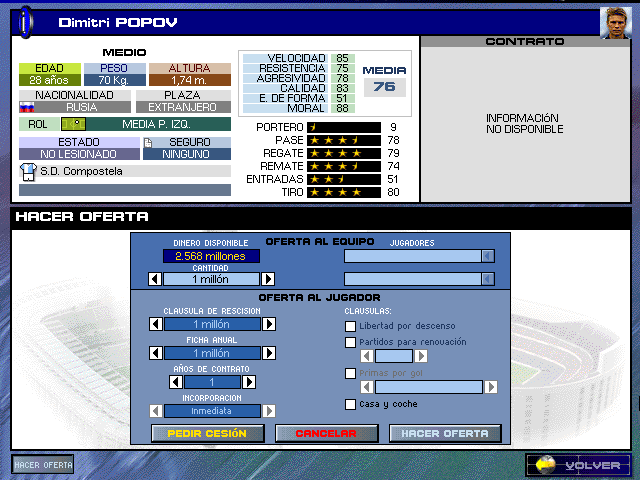

  - `DINERO DISPONIBLE` (2.568 millones en esta partida) y **`CANTIDAD`**
    (oferta en millones *al club*, independiente de la oferta al
    jugador) con selector `◄►`.
  - `OFERTA AL JUGADOR`: `CLÁUSULA DE RESCISIÓN`, `FICHA ANUAL`, `AÑOS DE
    CONTRATO`, `INCORPORACIÓN` (Inmediata/otra), todos con `◄►`.
  - `CLÁUSULAS` opcionales: `Libertad por descenso`, `Partidos para
    renovación`, `Primas por gol`, `Casa y coche`.
  - Tres botones: `PEDIR CESIÓN`, `CANCELAR`, `HACER OFERTA` — el "pedir
    cesión" como alternativa a comprar en firme, no probado.
- **Pulsar `HACER OFERTA` registra la negociación en `ESTADO OFERTAS`**
  con un mensaje fechado del motor: *"(07-09-1997) Has ofrecido al
  jugador un contrato por 1 año con una ficha anual de 1 millón y una
  clausula de rescisión de 1 millón."* — confirma que la oferta queda
  como un proceso vivo, no un resultado inmediato de sí/no.

  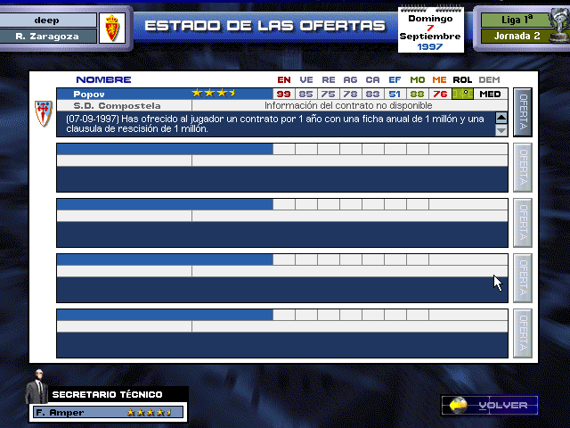

- **Avanzar de jornada (SEGUIR) hace que el club rival responda por su
  cuenta**: en la Jornada 3 (una semana después), `ESTADO OFERTAS`
  mostraba una respuesta nueva de S.D. Compostela: *"Estamos dispuestos a
  negociar el traspaso de Popov, pero la cantidad ofrecida es muy
  baja."* — la negociación por la ficha/cláusula del jugador y la
  `CANTIDAD` ofrecida al club son evaluadas por separado, y el club
  contesta con lenguaje natural fechado en vez de aceptar/rechazar sin
  más.
- Subir `CANTIDAD` (probado con clics repetidos, con `--hold-ms` y en
  bucle) hasta **1.550 millones** y reenviar registra un nuevo mensaje:
  *"(14-09-1997) Has ofrecido a su equipo 1.550 millones."* — pero **no
  se llegó a comprobar la respuesta del club a esta oferta más alta**: el
  intento de avanzar de jornada (`SEGUIR`) chocó con un aviso no
  relacionado, *"La alineación no es correcta"* (con un jugador,
  Kily González, sancionado y aparentemente aún alineado), que bloqueó
  el avance de semana. Se descartó el aviso (`Aceptar`) pero la sesión
  terminó sin volver a `ESTADO OFERTAS` ni sin comprobar si Popov llegó a
  aparecer en `GESTIÓN DE LA PLANTILLA` — al revisar la plantilla más
  tarde en la misma sesión, **Popov no aparecía** en el grupo de MEDIOS.
  **El fichaje de Popov queda documentado como negociación en curso, no
  como transferencia completada.**

## SECRETARIO: la combinación de criterios que sí dispara la búsqueda (sesión 5, 2026-08-22)

`[jugado]` 2026-08-22. La sesión anterior había dejado sin resolver qué
combinación de criterios hace que `BUSCAR` deje de mostrar el aviso de
"faltan criterios". Esta sesión prueba varias combinaciones sobre el
mismo formulario y encuentra el patrón:

- **Un solo selector numérico marcado (`EDAD` = 17-22) no basta** — sigue
  el aviso *"Debes indicar criterios para que se realice la búsqueda."*
- **Dos selectores numéricos (`EDAD` + `DEMARCACIÓN` = PORTERO) tampoco
  bastan** — mismo aviso, contradiciendo la hipótesis anterior de que
  "un numérico además del checkbox" sería suficiente.
- **Solo al añadir además el checkbox booleano `JUGADORES SIN EQUIPO`
  (con los dos numéricos ya fijados) `BUSCAR` arranca de verdad**: el
  panel `JUGADORES ENCONTRADOS` cambia a *"Estoy buscando jugadores con
  las características requeridas."*

  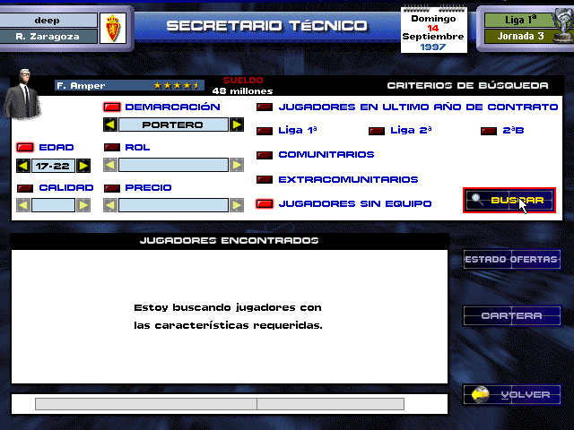

- La búsqueda no llegó a producir una lista de resultados dentro de la
  sesión (el mensaje "Estoy buscando..." seguía igual en la última
  comprobación) — no se confirma si hace falta esperar a un `SEGUIR`
  (como con las ofertas) o si simplemente no hubo candidatos que
  encajaran.
- **Conclusión más precisa que la de la sesión anterior**: el motor de
  `BUSCAR` en SECRETARIO exige **al menos un criterio numérico Y al
  menos un criterio booleano a la vez** — ni un numérico solo, ni dos
  numéricos juntos, activan la búsqueda por sí solos.

## JUVENILES: su propio BUSCAR, con un solo checkbox le basta (sesión 5, 2026-08-22)

`[jugado]` 2026-08-22. El `BUSCAR` de `JUVENILES` (dentro del panel del
`OJEADOR` de la cantera) usa un formulario más simple: **solo seis
checkboxes por atributo** (`PORTERO`/`REGATE`/`ENTRADAS`/`PASE`/
`REMATE`/`TIRO`), sin selectores numéricos.

- Con ningún checkbox marcado, `BUSCAR` muestra el mismo aviso genérico
  de "faltan criterios" que en SECRETARIO.
- **Marcar un único checkbox (`PORTERO`) y pulsar `BUSCAR` ya activa la
  búsqueda real** (*"Estoy buscando jugadores con las características
  requeridas."*) — a diferencia de SECRETARIO, aquí **un solo criterio
  booleano sí basta**, coherente con que este formulario no tiene
  selectores numéricos con los que combinarlo.

  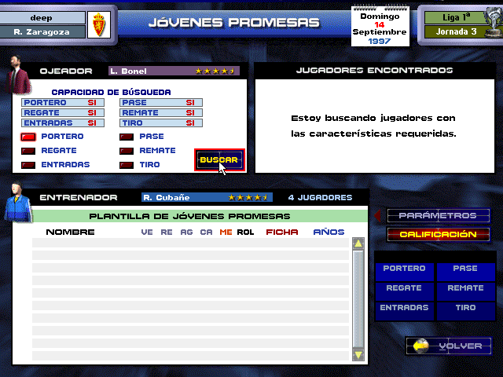

- Tampoco aquí se llegó a ver una lista de resultados antes de que
  terminara la sesión.

## Qué exige

Dos hallazgos de diseño nuevos esta sesión: primero, que **una oferta de
fichaje separa explícitamente la negociación con el jugador (ficha,
cláusula, años) de la negociación con el club vendedor (cantidad)**, y
que el club responde con mensajes de texto fechados y con estado
propio en vez de un resultado inmediato — el mercado de fichajes vive en
el tiempo de partida, no se resuelve en el momento del clic. Segundo,
que el motor de búsqueda de personal (`BUSCAR`) no es uniforme: la
variante con selectores numéricos exige combinar tipos de criterio
(numérico + booleano), mientras que la variante solo-booleana de
juveniles se conforma con un único criterio. Un mapa de equivalencias
para PC Dynasty debería reproducir esa asimetría de validación en vez de
asumir una única regla de "mínimo de criterios" para todas las búsquedas
de la saga.

## Pendiente

- El fichaje de Popov vía `OFERTAS` sigue **sin resolverse**: la última
  oferta conocida (1.550 millones al club) no llegó a recibir respuesta
  observada, y Popov no aparecía en la plantilla al cierre de la sesión.
  Falta reabrir `ESTADO OFERTAS` tras avanzar más jornadas para ver si
  se acepta, se rechaza definitivamente, o expira.
- No se ha resuelto el aviso "La alineación no es correcta" que bloqueó
  `SEGUIR` (aparentemente por un jugador sancionado, Kily González,
  todavía en la alineación) — pendiente de corregir la alineación desde
  fuera de FICHAR para poder seguir avanzando jornadas.
- Ni SECRETARIO ni JUVENILES llegaron a mostrar una lista de resultados
  con nombres — solo el mensaje intermedio "Estoy buscando...". No se
  sabe si hace falta esperar (como con las ofertas) o si esta partida
  concreta no tenía candidatos que encajasen con los criterios probados.
- No se ha probado `PEDIR CESIÓN` (alternativa a `HACER OFERTA` en el
  formulario de oferta a jugador).
