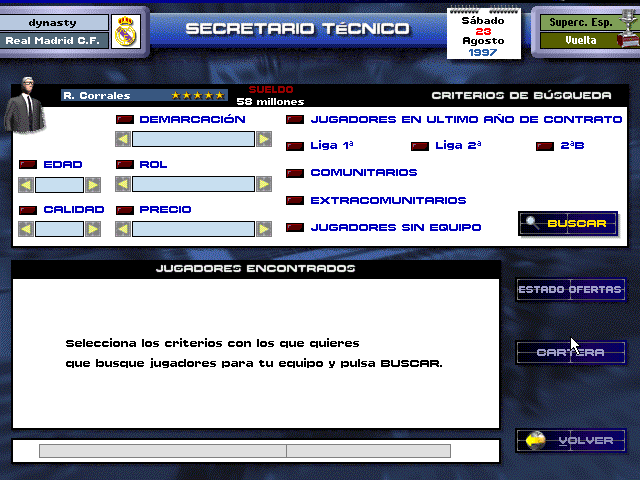
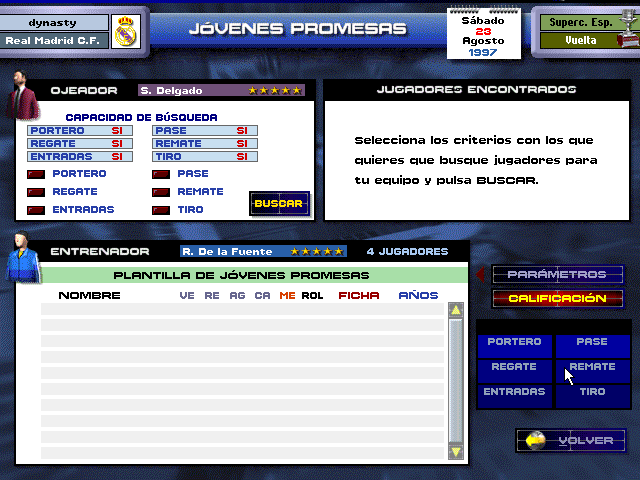

# PC Fútbol 6.0 — FICHAR y PLANTILLA: mercado y gestión de plantilla

`[jugado]` 2026-08-21. Se llega desde el despacho pulsando **FICHAR** o
**PLANTILLA** (fila inferior izquierda — ver
[`07-despacho.md`](07-despacho.md)).

## La anomalía anterior era un error de calibración, no un bloqueo real

Sesiones previas registraban *"PLANTILLA y FICHAR no navegaron pese a hover
confirmado"* (ver la sección "Pendiente / con comportamiento raro" de
`07-despacho.md`, ahora resuelta). **Esta sesión confirma que ambos botones
navegan con normalidad** una vez recalibradas las coordenadas: la fila
inferior de la rejilla 2×4 (FICHAR/EMPLEADOS/PLANTILLA a la izquierda,
CAJA/DECISIONES/ESTADIO a la derecha) está más abajo de lo que sugería el
cálculo geométrico ingenuo a partir del wireframe — verificado con el
método del rectángulo/crop de zoom sobre una captura ya tomada, no con el
método de arrastre. La hipótesis de un prerrequisito bloqueante queda
descartada.

## FICHAR → "JUGADORES A LA VENTA"

- Lista de jugadores disponibles en el mercado, agrupada por demarcación
  (`PORTEROS`/`DEFENSAS`/`MEDIOS`/`DELANTEROS`), con columnas `ME`
  (media), `MO` (moral u otro indicador), `RESCISIÓN` (cláusula), `FICHA`
  (ficha/salario) y `AÑOS` (duración de contrato).
- **Clicar una fila selecciona al jugador**: confirmado con "Dani" — la
  fila se resalta con un marco y el pie de pantalla muestra su nombre
  completo y club de origen (`Daniel López González, DANI` /
  `E. As Pontes`), sin abrir todavía un diálogo de oferta.

  

- Botonera lateral: **`CARTERA`**, **`ESTADO OFERTAS`**, **`SECRETARIO`**,
  **`OFERTAS`**, `VOLVER` (navegable, sin anomalía).

### CARTERA → "CARTERA DE FICHAJES"

- Lista de seguimiento personal (`NOMBRE` + atributos `EN VE RE AG CA EF
  MO ME ROL DEM`), vacía al empezar, con un botón `AÑADIR` por fila.
- Pie: *"Pulsa AÑADIR para incluir en la lista el jugador en el que estés
  interesado"* + `SECRETARIO TÉCNICO` con nombre y rating (R. Corrales, 5
  estrellas) — el secretario técnico es quien "sabe" de estos jugadores, no
  un dato de sistema anónimo.
- **`AÑADIR` abre un selector completo de equipo/jugador** —
  "SELECCIONA UN JUGADOR PARA AÑADIR A TU CARTERA", con el mismo
  mapa Europa/Sudamérica + rejilla de división de España que se usa para
  elegir equipo en la creación de partida
  (ver [`05-liga-manager-nueva-partida.md`](05-liga-manager-nueva-partida.md)):

  

  Es decir: la cartera de fichajes no se limita a los jugadores ya listados
  en "Jugadores a la Venta" — se puede añadir a la lista de seguimiento
  **cualquier jugador de cualquier club**, esté o no en el mercado
  actualmente.

### ESTADO OFERTAS → "ESTADO DE LAS OFERTAS"

- Lista de negociaciones activas (vacía en esta partida), cada fila con
  una barra de progreso azul/blanca (probablemente el avance de la
  negociación) y un botón `OFERTA` propio por fila para actuar sobre ella.
  `VOLVER` (navegable, sin anomalía) devuelve a "Jugadores a la Venta".

### SECRETARIO → "SECRETARIO TÉCNICO": búsqueda de jugadores por criterios

- Formulario de **`CRITERIOS DE BÚSQUEDA`**: seis selectores numéricos con
  flechas `◄►` (`DEMARCACIÓN`, `EDAD`, `CALIDAD`, `ROL`, `PRECIO`) más ocho
  checkboxes booleanos (`JUGADORES EN ÚLTIMO AÑO DE CONTRATO`, `LIGA 1ª`,
  `LIGA 2ª`, `2ªB`, `COMUNITARIOS`, `EXTRACOMUNITARIOS`, `JUGADORES SIN
  EQUIPO`) y un botón `BUSCAR`.
- **`BUSCAR` sin ningún criterio marcado** muestra un diálogo de aviso:
  *"Debes indicar criterios para que se realice la búsqueda."* con
  `Aceptar` — confirmado que responde con normalidad (no es la anomalía de
  diálogo atascado).
- **Marcar el checkbox `JUGADORES SIN EQUIPO` confirmado funcional** (pasa
  a un cuadrado resaltado en rojo y permanece así) — pero **pulsar
  `BUSCAR` con solo ese checkbox marcado sigue mostrando el mismo aviso de
  "faltan criterios"**. Hipótesis: el motor de búsqueda exige además fijar
  al menos uno de los selectores numéricos (`DEMARCACIÓN`/`EDAD`/
  `CALIDAD`/`ROL`/`PRECIO`) — un checkbox booleano en solitario no basta
  como "criterio". No confirmado con una búsqueda que sí produzca
  resultados.
- `CARTERA`, `ESTADO OFERTAS` y `VOLVER` también accesibles desde aquí
  (misma botonera lateral que en "Jugadores a la Venta").

## PLANTILLA → "GESTIÓN DE LA PLANTILLA"

- Tabla de la plantilla propia con columnas `ME`, `MO`, `CED.` (cedido),
  `FICHA`, `AÑOS` — vista de gestión contractual de los jugadores ya en
  el club, complementaria a la vista de rendimiento de
  [`15-alineacion.md`](15-alineacion.md).
- Botón `VOLVER` (navegable, sin anomalía).

### JUVENILES → "JÓVENES PROMESAS": cantera con su propio ojeador

- Título real: **"JÓVENES PROMESAS"**. Muy distinto de FICHAR/SECRETARIO
  aunque comparte la idea de "buscar jugadores": aquí hay un **`OJEADOR`**
  propio (S. Delgado, ★★★★★) con su propia `CAPACIDAD DE BÚSQUEDA` por
  atributo (`PORTERO`/`REGATE`/`ENTRADAS`/`PASE`/`REMATE`/`TIRO`, todos
  `SÍ` en esta partida) y checkboxes de criterio de búsqueda específicos
  para juveniles, más un botón `BUSCAR` propio.
- Un **`ENTRENADOR`** de juveniles independiente (R. De la Fuente, ★★★★★),
  con un contador `4 JUGADORES` — la cantera tiene su propio cuerpo
  técnico, no comparte el del primer equipo.
- **`PLANTILLA DE JÓVENES PROMESAS`**: tabla con las mismas columnas que
  Alineación (`VE RE AG CA ME ROL FICHA AÑOS`) más alternador
  `PARÁMETROS`/`CALIFICACIÓN` y los mismos 6 iconos de atributo
  (`PORTERO`/`REGATE`/`ENTRADAS`/`PASE`/`REMATE`/`TIRO`) que en
  Alineación/Táctica — vacía en esta partida (0 canteranos promovibles
  aún). `VOLVER` (navegable, sin anomalía).

## Qué exige

Que la cartera de fichajes permita añadir *cualquier* jugador de *cualquier*
club (no solo los ya puestos a la venta) es el hallazgo de diseño más
relevante aquí: modela una lista de "objetivos de scouting" independiente
del mercado activo, coherente con cómo funciona el scouting real (se sigue
a un jugador mucho antes de que esté disponible). PC Dynasty debería
separar del mismo modo "quién está en venta ahora" de "a quién quiero
seguir", con esta última sin restricción de disponibilidad actual.

## Pendiente

- `OFERTAS` (el cuarto botón de FICHAR, distinto de `ESTADO OFERTAS`) no
  se ha pulsado todavía.
- No se ha completado un fichaje real (seleccionar jugador → hacer
  oferta → confirmar) — solo se ha probado selección de fila y el flujo de
  CARTERA.
- No se ha confirmado qué combinación exacta de criterios hace que
  `BUSCAR` (en SECRETARIO) produzca resultados en vez del aviso de "faltan
  criterios" — probar fijando un selector numérico además del checkbox.
- El `BUSCAR` propio de JUVENILES (ojeador) tampoco se ha pulsado.
