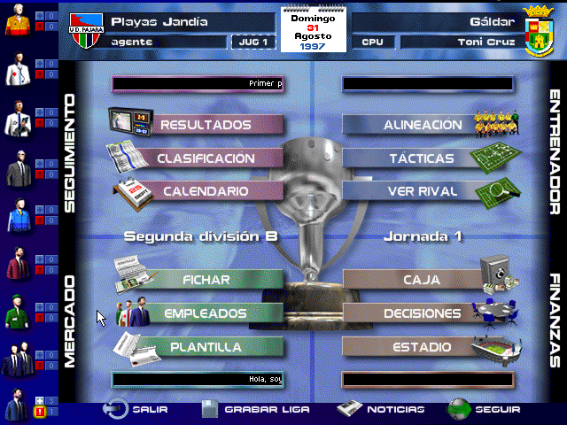

# PC Fútbol 6.0 — el despacho de Liga Promanager: mismo hub, contexto de "contratado"

`[jugado]` 2026-08-21 (sesión 3). Se llega aquí tras aceptar una oferta en
"SELECCIÓN DE OFERTAS" y recorrer pretemporada → "Equipos en
Competiciones" → recap de temporada anterior — ver el flujo completo en
[`10-liga-promanager-ofertas.md`](10-liga-promanager-ofertas.md). Esta
ficha compara el resultado, botón a botón, contra el despacho de Liga
Manager ([`07-despacho.md`](07-despacho.md)).

## Es el mismo hub, no una pantalla distinta

La rejilla 2×4 con las mismas doce etiquetas (`RESULTADOS`/`CLASIFICACIÓN`/
`CALENDARIO` a la izquierda arriba, `FICHAR`/`EMPLEADOS`/`PLANTILLA` a la
izquierda abajo, `ALINEACIÓN`/`TÁCTICAS`/`VER RIVAL` a la derecha arriba,
`CAJA`/`DECISIONES`/`ESTADIO` a la derecha abajo), las mismas cuatro
etiquetas verticales de cuadrante (`SEGUIMIENTO`/`MERCADO` a la izquierda,
`ENTRENADOR`/`FINANZAS` a la derecha) y la misma barra inferior (`SALIR`/
`GRABAR LIGA`/`NOTICIAS`/`SEGUIR`) aparecen **al pixel, sin ningún botón
añadido ni quitado**. No hay una escena de despacho "Promanager" separada
en el motor — es el mismo componente de Liga Manager, solo con datos de
partida distintos.

## Lo único que cambia es el contexto de cabecera

- **Escudo propio**: `UD Pájara` (el club matriz al que pertenece el equipo
  filial `Playas Jandía` aceptado en la oferta), no el nombre de club
  elegido libremente como en Liga Manager.
- **Nombre de mánager**: `agente` (el nombre tecleado en "SELECCIÓN DE
  OFERTAS"), en la misma posición que `dynasty`/`Real Madrid C.F.` ocupaba
  en el despacho de Liga Manager.
- **Rival y fecha**: `Gáldar` / `Toni Cruz` (CPU) como próximo rival,
  `Domingo 31 Agosto 1997`, `JUG 1` — el primer partido de la Segunda
  División B, jornada 1 (`Segunda división B` / `Jornada 1` como subtítulo
  central sobre el trofeo, sustituyendo el "Pretemporada"/"Preparación" que
  se ve en el despacho de Liga Manager antes del primer partido de Liga).
- **Columna de retratos** a la izquierda: misma composición visual (fila
  vertical de miniaturas con camiseta + contadores), no comparada en
  detalle en esta sesión.

## Qué exige

Confirma que **el despacho es una escena reutilizable independiente del
modo de carrera** (Liga Manager vs. Promanager) — solo cambia el estado de
datos (equipo, mánager, rival, fecha), no el layout ni los botones. PC
Dynasty debería modelar esto como una sola escena de "hub del club" que
recibe el contexto de partida como datos, no como dos implementaciones de
UI paralelas para "dueño" (Liga Manager) y "contratado" (Promanager).

## Pendiente

- No se ha comparado sub-pantalla a sub-pantalla (Resultados, Calendario,
  Alineación...) dentro de este despacho de Promanager — solo se confirmó
  que la rejilla de nivel superior es idéntica. Es razonable esperar que
  cada sub-pantalla también sea el mismo componente reutilizado, pero no
  está confirmado explícitamente todavía.
- No se ha completado un ciclo `SEGUIR` (avance de jornada/partido) desde
  este despacho de Promanager — solo se llegó hasta aquí y se documentó la
  cabecera. El ciclo debería ser idéntico al ya documentado en
  `07-despacho.md` ("El ciclo SEGUIR"), siempre en modo `RESULTADO`, pero
  falta confirmarlo explícitamente en el contexto de Promanager.
- El segundo slot de mánager creado automáticamente en "SELECCIÓN DE
  OFERTAS" (ver `10-liga-promanager-ofertas.md`) no se ha explorado —
  desconocido si permite gestionar una segunda carrera en paralelo desde
  este mismo despacho o si es simplemente un slot libre sin usar.
