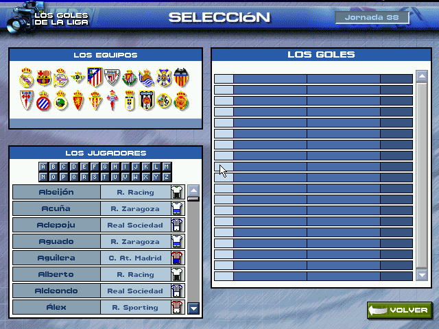
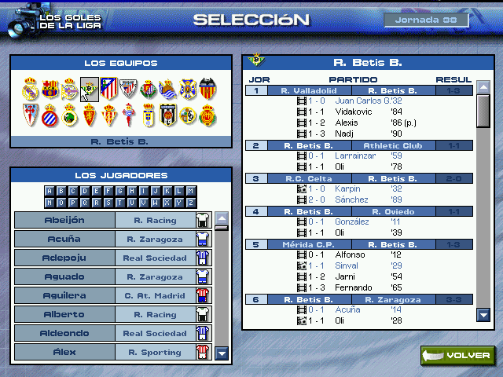
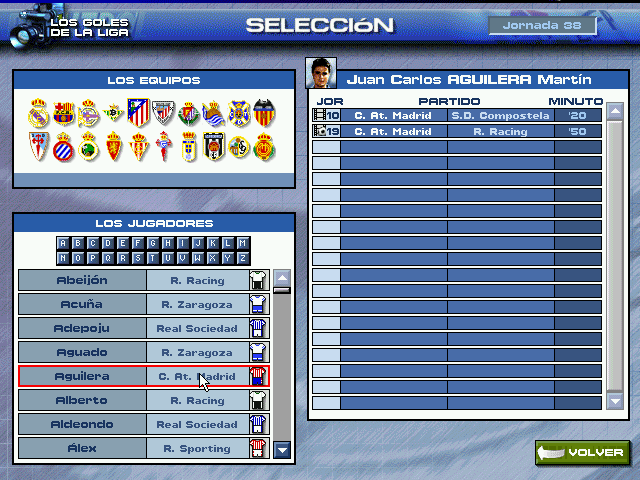
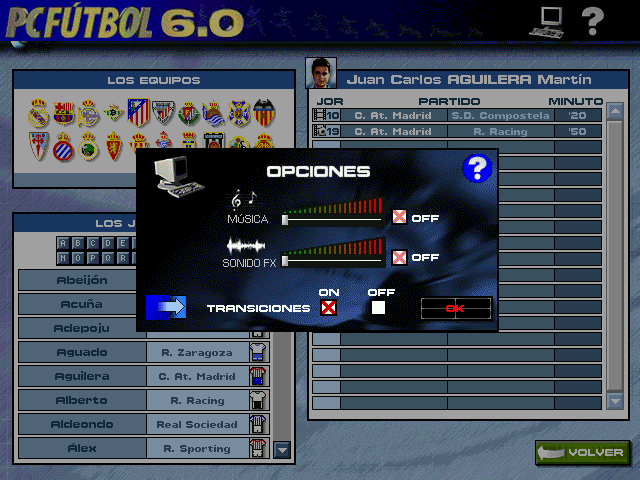

# PC Fútbol 6.0 — Los Goles de la Liga: hemeroteca de goleadores por equipo o jugador

`[jugado]` 2026-08-21 (sesión 3). Se llega aquí pulsando la loseta **LOS
GOLES DE LA LIGA** del menú principal (icono de cámara, esquina superior
derecha — ver [`00-menu-principal.md`](00-menu-principal.md)). Es un modo
de exhibición/consulta, no de gestión: no hay SEGUIR ni avance de
temporada, solo un visor de estadística histórica.

## Qué se ve

- **Cabecera "SELECCIÓN"** con un indicador `Jornada 38` (la última
  jornada de la temporada 97-98 cargada en esta partida) — de solo
  lectura, no es un selector de jornada.
- **`LOS EQUIPOS`**: rejilla de 20 escudos de Primera División.
- **`LOS JUGADORES`**: índice alfabético A-Z + lista completa de
  jugadores (nombre, equipo, icono de camiseta), scrollable.
- **`LOS GOLES`**: panel derecho, vacío hasta que se elige un equipo o un
  jugador — no es una tabla que se auto-rellena al entrar.
- **`VOLVER`** (abajo a la derecha).

## Dos filtros independientes sobre el mismo panel `LOS GOLES`

### Filtro por equipo: log completo jornada a jornada

Clicar un escudo (probado con **R. Betis B.**, tercera fila) rellena el
panel derecho con el **historial completo de partidos jugados por ese
equipo en la temporada**, jornada a jornada: `JOR` (número), `PARTIDO`
(local vs. visitante), `RESUL` (resultado del partido), y bajo cada fila
de partido, una **sub-fila por cada gol marcado en ese encuentro** con el
nombre del goleador y el minuto (incluye marcador `(p.)` para goles de
penalti). No es solo "cuántos goles metió el equipo": es el relato
completo de cada partido con autoría de cada gol.

### Filtro por jugador: ficha individual con foto

Clicar una fila de `LOS JUGADORES` (probado con **Aguilera**) sustituye el
panel derecho por una **ficha de goleador individual**: foto de carné del
jugador, nombre completo (`Juan Carlos AGUILERA Martín` — el juego guarda
nombre y apellidos completos, no solo el apodo corto usado en el resto de
listas), y una tabla `JOR` / `PARTIDO` / `MINUTO` con cada gol que ese
jugador ha marcado en la temporada. Los dos filtros (equipo/jugador) son
mutuamente excluyentes sobre el mismo panel — elegir uno sustituye la vista
del otro, no la combina.

## La franja superior de marca abre un overlay global de OPCIONES (confirma el patrón ya visto en CAJA)

Al intentar clicar el indicador `Jornada 38` de la cabecera, el clic cayó
sobre la franja superior de marca "PCFUTBOL 6.0" en vez del indicador, y
abrió un diálogo modal **`OPCIONES`** (no visto documentado hasta ahora
con este nivel de detalle): sliders `MÚSICA` y `SONIDO FX` (ambos en
`OFF` en esta partida) y un radio `TRANSICIONES` `ON`/`OFF`, con botón
`OK`. **Este `OK` respondió con normalidad al primer clic tras
recalibrar** (el primer intento cayó ligeramente fuera del rectángulo).
Esto confirma, en una pantalla nueva y sin relación con el despacho, la
misma hipótesis ya documentada en [`18-caja.md`](18-caja.md): la franja
superior de marca de la ventana tiene su propio hotspot de "menú de
opciones/ayuda" que se superpone a controles vecinos si el clic cae
demasiado arriba — no es un fallo de `CAJA` en particular, es un
comportamiento global de la ventana del juego.

## Qué exige

Un histórico de goleadores navegable por dos ejes (equipo/jugador), con
autoría y minuto de cada gol y una ficha propia con foto por jugador, es
el nivel de detalle a igualar para cualquier vista de "estadísticas
históricas" en PC Dynasty — no basta un contador agregado de goles por
jugador, hace falta el log completo partido a partido con quién marcó y
cuándo, reutilizable tanto por equipo como por jugador individual sobre la
misma estructura de datos.

## Pendiente

- No se ha probado si el índice alfabético A-Z de `LOS JUGADORES` salta
  correctamente a cada letra (solo se hizo scroll manual).
- No se ha confirmado si `LOS GOLES` tiene scroll propio para partidos más
  allá de los visibles en pantalla (la barra de scroll a la derecha del
  panel sugiere que sí, pero no se ha probado con un equipo/jugador con
  muchos más goles).
- No se ha probado qué pasa si no hay ninguna jornada jugada todavía en la
  partida (esta sesión ya tenía una temporada completa cargada,
  `Jornada 38`).
