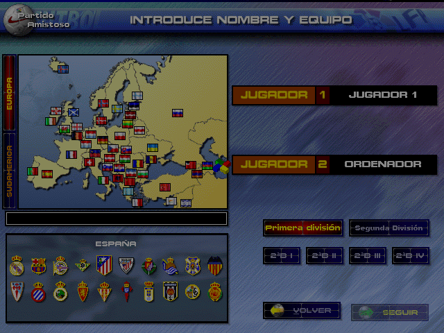
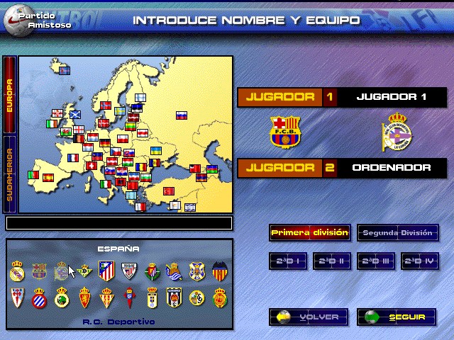
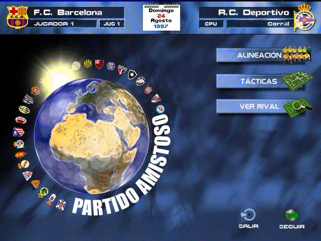
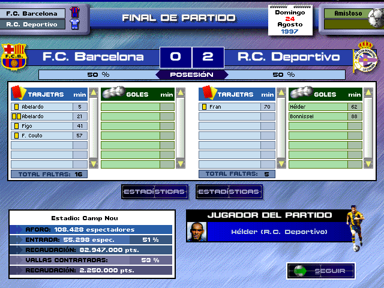

# PC Fútbol 6.0 — Partido Amistoso: exhibición de un solo partido, sin liga

`[jugado]` 2026-08-21 (sesión 3). Se llega aquí pulsando la loseta
**PARTIDO AMISTOSO** del menú principal (balón de fútbol, fila central —
ver [`00-menu-principal.md`](00-menu-principal.md)). Confirmado
navegable de principio a fin en esta sesión, incluyendo el partido
completo en modo `RESULTADO` (nunca visionado, per instrucción permanente
de esta exploración).

## `INTRODUCE NOMBRE Y EQUIPO`: dos slots, JUGADOR 1 y JUGADOR 2

- **`JUGADOR 1`** (por defecto nombrado "JUGADOR 1") y **`JUGADOR 2`** (por
  defecto **"ORDENADOR"** — el segundo slot empieza como CPU, no como un
  segundo humano) — mismo componente de fila naranja "JUGADOR N" que en
  otras pantallas del juego.
- Mismo mapa **Europa/Sudamérica** + rejilla de escudos de España (con
  filtros `Primera división`/`Segunda División`/`2ªB I`-`IV`) que en la
  pretemporada de Liga Manager/Promanager — reutiliza el mismo componente
  de selección de equipo por escudo.
- `VOLVER`/`SEGUIR` al pie — `SEGUIR` empieza apagado.

### Mecánica de asignación de equipo: confirmada funcionando para ambos jugadores

- Clicar la fila `JUGADOR 1` la activa (resaltado visual, sin cambio de
  contenido visible); clicar después un escudo de la rejilla de España
  **asigna ese equipo a JUGADOR 1 al instante** — el escudo aparece junto a
  la fila y el nombre del club se resalta en la rejilla (`F.C. Barcelona`
  confirmado).
- Repetir el mismo gesto con `JUGADOR 2` (clicar su fila, luego un escudo
  distinto) **asigna el equipo a JUGADOR 2** igual de bien (`R.C.
  Deportivo` confirmado) — el mecanismo es simétrico entre ambos slots, no
  hay un "jugador 1 es siempre el humano" forzado a nivel de UI (aunque
  JUGADOR 2 sigue etiquetado "CPU" en la fila, por defecto).
- **`SEGUIR` solo se activa (pasa de apagado a su color normal) cuando
  ambos slots tienen equipo asignado** — confirmado: seguía apagado con
  solo JUGADOR 1 asignado, se encendió en cuanto JUGADOR 2 tuvo equipo
  también.

## El hub `PARTIDO AMISTOSO`: un mini-despacho de solo tres botones

Tras `SEGUIR`, aparece una pantalla propia con cabecera de partido
(escudos, nombres, `JUGADOR 1`/`CPU`, fecha `Domingo 24 Agosto 1997`) y un
globo terráqueo giratorio rodeado de escudos de clubes como decoración
(motivo visual reutilizado también en otras transiciones del juego). Solo
tres acciones de gestión, mucho más reducido que el despacho de Liga
Manager/Promanager (12 botones): **`ALINEACIÓN`**, **`TÁCTICAS`**, **`VER
RIVAL`** (mismos tres nombres/iconos que en el despacho completo — no
probados en profundidad esta sesión, se asume que son los mismos
componentes reutilizados) — más `SALIR`/`SEGUIR` al pie. No hay
`RESULTADOS`/`CLASIFICACIÓN`/`CALENDARIO`/`FICHAR`/`EMPLEADOS`/`PLANTILLA`/
`CAJA`/`DECISIONES`/`ESTADIO`: tiene sentido, un amistoso suelto no
gestiona liga, mercado, finanzas ni infraestructura.

## El ciclo del partido: idéntico al de Liga Manager, siempre en modo RESULTADO

`SEGUIR` desde el mini-hub abre la misma pantalla `OPCIONES DE
CONFIGURACIÓN` ya documentada en [`07-despacho.md`](07-despacho.md) ("El
ciclo SEGUIR"), con `RESULTADO` **ya marcado por defecto** (confirmado sin
tocar nada). Se pulsó `SEGUIR` directamente sin cambiar el checkbox, por
instrucción permanente de esta exploración. El resto del ciclo es
idéntico: previa estática de estadio (Espacio para avanzar) →
`FINAL PRIMERA PARTE` → `SEGUIR` → `FINAL DE PARTIDO` (con `JUGADOR DEL
PARTIDO`) → `SEGUIR`.

## Tras el partido: vuelve directo al menú principal, no a un hub

**Diferencia clave frente a Liga Manager/Promanager**: `SEGUIR` desde
`FINAL DE PARTIDO` **no devuelve al mini-hub `PARTIDO AMISTOSO`** — lleva
directo de vuelta a la pantalla de **menú principal**. Confirma que
`PARTIDO AMISTOSO` es un modo de **exhibición de un solo uso**: se juega un
partido y se acaba, sin ciclo de temporada ni estado persistente entre
partidos (a diferencia de Liga Manager/Promanager, donde `SEGUIR` tras el
partido devuelve siempre al despacho con la fecha avanzada).

## Qué exige

Un modo de "partido suelto" con solo tres acciones de preparación
(alineación/táctica/scouting del rival) y sin ciclo de temporada es el
patrón de referencia para cualquier "partido rápido"/exhibición que PC
Dynasty quiera ofrecer fuera del modo carrera: reutiliza los mismos
componentes de selección de equipo, configuración de partido y resultado
que el modo carrera, pero sin engancharlos a ningún estado persistente
(calendario, caja, plantilla) — un modo verdaderamente aislado.

## Pendiente

- No se probaron `ALINEACIÓN`/`TÁCTICAS`/`VER RIVAL` dentro del mini-hub de
  Partido Amistoso — se asume que son los mismos componentes del despacho
  completo, pero no está confirmado explícitamente.
- No se probó asignar un JUGADOR 2 humano (dos jugadores humanos en la
  misma sesión) — el campo `JUGADOR 2` quedó en su valor "ORDENADOR" por
  defecto, sin explorar si es editable a un segundo nombre de jugador.
- No se probaron los filtros `Segunda División`/`2ªB I`-`IV` de la rejilla
  de equipos, solo `Primera división` (activa por defecto).
- No se probó `SALIR` desde el mini-hub (solo se llegó hasta `SEGUIR`).
