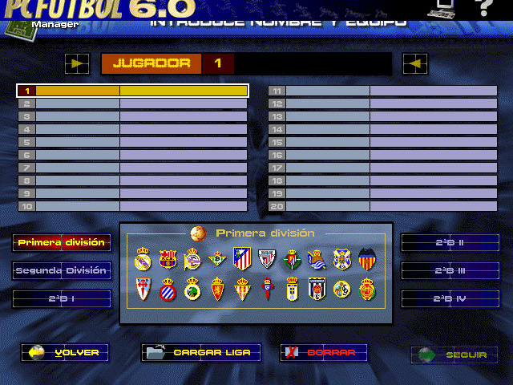
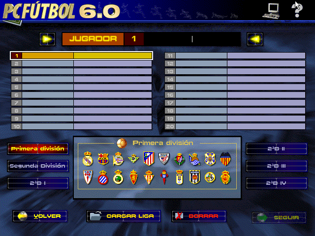

# PC Fútbol 6.0 — chrome general (aparece en varias pantallas)

`[jugado]` 2026-08-20. No todo lo observado pertenece a una pantalla
concreta. Esto va apareciendo **en cualquier sitio** del juego (menú
principal, dentro de una partida, en Liga Manager y en Liga Promanager) —
se documenta aquí una sola vez, en vez de repetirse en cada capítulo.
Capturas en `screenshots/general/`.

## La barra superior oculta

Pasar el ratón por el borde superior de la pantalla — **en cualquier
pantalla del juego**, comprobado tanto en el menú principal como dentro de
Liga Manager — despliega una barra que normalmente está oculta:



```
┌──────────────────────────────────────────────────────────────────┐
│ PCFUTBOL 6.0                                    [🖥]      [?]     │
└──────────────────────────────────────────────────────────────────┘
```

- **Se oculta por defecto** y sólo aparece con el cursor pegado al borde
  superior — un patrón de chrome "auto-hide", igual que una barra de tareas
  en modo ocultar automáticamente. No hay ninguna pista visual de que esté
  ahí hasta que el ratón la toca.
- **Dos iconos a la derecha**: un monitor/ordenador (sin confirmar qué hace
  — no se pudo interactuar con certeza en esta sesión) y una interrogación.

### El cursor de ayuda contextual

Pulsar la interrogación cambia el cursor a un icono de ayuda (flecha + `?`):



- Patrón clásico "¿Qué es esto?": se pulsa la ayuda y luego el elemento
  sobre el que se quiere información, en vez de abrir un panel de ayuda
  directamente.
- No se confirmó en esta sesión que mostrara contenido al pulsar sobre un
  campo concreto — puede necesitar un elemento con ayuda registrada
  específicamente, o no se acertó el hotspot exacto. Pendiente de repetir
  con más tiempo.

## Qué exige

Es chrome del **sistema**, no de una pantalla — candidato a componente
propio (`AutoHideTopBar` en `../pc-dynasty/mapa-de-equivalencias.md`) que
cualquier escena de PC Dynasty podría montar igual, sin que cada pantalla
tenga que reimplementarlo.

## Pendiente de añadir aquí

Cualquier otro elemento que se confirme como repetido entre pantallas
distintas (Manager y Promanager incluidos) se añade a este fichero, no a
uno de sección.
