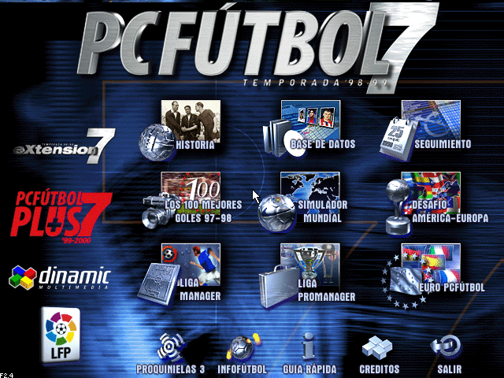

# PC Fútbol 7 — menú principal (arrancado de verdad)

`[jugado]` 2026-08-20. A diferencia del disco de 6.0, éste arranca a un
escritorio de Windows 98 desnudo — el juego está instalado pero no se lanza
solo. Se llega a él por **Inicio → Programas → PC Fútbol 7 → "PCFútbol 7 sin
intro"** (también existe "con intro", y un desinstalador e Infofútbol en el
mismo submenú). Anotado por si hace falta repetir la captura: el atajo
existe, el disco simplemente no lo arranca por sí solo.



## Lo que se ve

```
┌──────────────────────────────────────────────────────────────────┐
│  PCFÚTBOL 7 (cromado, metal)      ┌────────┐ ┌────────┐ ┌────────┐│
│  TEMPORADA 98-99                  │HISTORIA│ │  BASE  │ │SEGUIMI-││
│                                    │        │ │ DATOS  │ │ ENTO   ││
│  eXtension 7                      └────────┘ └────────┘ └────────┘│
│                                    ┌────────┐ ┌────────┐ ┌────────┐│
│  PCFÚTBOL PLUS 7  99-2000         │100 MEJO│ │SIMULADO│ │DESAFÍO ││
│  (rojo, destacado)                │RES GOLES│ │R MUNDIAL│ │AMÉRICA-││
│                                    │ 97-98  │ │        │ │EUROPA  ││
│  dinamic multimedia                └────────┘ └────────┘ └────────┘│
│                                    ┌────────┐ ┌────────┐ ┌────────┐│
│  [LFP]                            │ LIGA   │ │ LIGA   │ │  EURO  ││
│                                    │MANAGER │ │PROMANAG│ │PCFÚTBOL││
│                                    └────────┘ └────────┘ └────────┘│
│         PROQUINIELAS 3  INFOFÚTBOL  GUÍA RÁPIDA  CRÉDITOS  SALIR   │
│ F2.4                                                               │
└──────────────────────────────────────────────────────────────────┘
```

Misma rejilla 3×3, mismo riel izquierdo, misma barra inferior que 6.0 — la
**estructura no cambió entre versiones**, sólo el contenido y la piel:

| | 6.0 | 7 |
|---|---|---|
| Estilo del logo | Oro, 3D, sobre azul de rejilla | Cromo/metal, sobre azul con vetas de luz |
| Fila 2, columna 2 | Partido Amistoso | Simulador Mundial |
| Fila 3, columna 3 | Proquinielas 2.0 | Euro PCFútbol |
| Barra inferior | 4 acciones (Instrucciones, Infofútbol, Créditos, Salir) | 5 acciones (Proquinielas 3 pasó aquí, + Guía Rápida es nueva) |
| Riel: título cruzado | `eX2` apagado, títulos hermanos | `eXtension 7` + `PCFÚTBOL PLUS 7` en rojo, sin lista de hermanos |
| Marcador de build | `F2.17` | `F2.4` |

- **Proquinielas** migró de ser una loseta de la rejilla (6.0) a ser una
  meta-acción de la barra inferior (7) — señal de que la frontera entre "modo
  de juego" y "meta-acción" no es fija: cambió de categoría entre versiones
  sin cambiar de nombre.
- **Guía Rápida** es una meta-acción nueva en 7 que no existía en 6.0 — un
  candidato directo para lo que ya identificamos como hueco en
  `mapa-de-equivalencias.md` (`HoverReadout`/ayuda contextual).

## Qué exige

Ninguna corrección a `DestinationBoard`: confirma que la rejilla 3×3 + riel +
barra inferior es la forma estable de la saga entre 6.0 y 7.0 — el objetivo
declarado del proyecto. La tabla de arriba es útil para
[`../../pcfutbol/13-version-objetivo-6-0-y-7-0.md`](../../pcfutbol/13-version-objetivo-6-0-y-7-0.md):
documenta exactamente qué cambia y qué no entre las dos versiones que
mezclamos.
